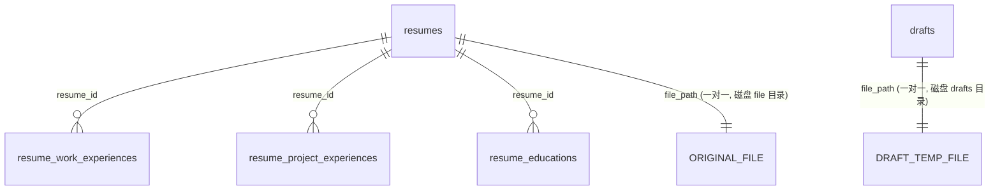

# Schema / 数据结构设计 — 简历信息收集（Backend）

## 文档版本

| 版本 | 日期 | 修改说明 | 作者 |
|------|------|----------|------|
| v0.1 | 2026-11-10 | 初始草稿（architecture-advisor Step 2.1），待「Schema + 接口设计评审」关卡确认 | Yin Yang（backend） |

---

> **输入**：`01_requirements/requirements.md`（REQ-BE-01..06）、`00_impact_analysis.md` v3、HLD、ADR-001..003、裁决 C-01..C-15 / D-01..D-06、仓库 `AGENTS.md`、`rules/backend/database.md`。
> **范围**：SQLite 两个**物理分离**的数据库文件 + 两个文件目录。不含代码。
> **约定**：表名、字段名 `snake_case`；时间为 ISO 8601 UTC 文本（`YYYY-MM-DDTHH:MM:SSZ`）；列类型显式声明并写明可空性；SQL 一律参数绑定；连接建立时 `PRAGMA foreign_keys = ON`、`PRAGMA busy_timeout = 5000`；schema 版本用 `PRAGMA user_version`（本版 = 1）。

---

## 一、数据结构清单

| 结构名 | 类型 | 所在库/目录 | 关联需求 | 说明 | 预估数据量 |
|--------|------|-----------|---------|------|-----------|
| `drafts` | 表 | 草稿库 `drafts.db` | REQ-BE-01/02/03/05 | 未确认草稿：原始文件元数据、简历模型候选值与字段状态、令牌哈希 | 同时 ≤ 数十行（约 5 人并发，7 天清理） |
| `resumes` | 表 | 正式库 `resume.db` | REQ-BE-04 | 已确认简历主记录；含原始文件关联；(姓名,手机号,邮箱) 规范化键唯一 | POC：百至千级 |
| `resume_work_experiences` | 表 | 正式库 | REQ-BE-04 | 工作经历（多条，保持顺序） | 每份简历 0..N 条 |
| `resume_project_experiences` | 表 | 正式库 | REQ-BE-04 | 项目经历（多条） | 同上 |
| `resume_educations` | 表 | 正式库 | REQ-BE-04 | 教育背景（多条） | 同上 |
| 草稿临时文件目录 | 目录 | `{DATA_DIR}/drafts/` | REQ-BE-01/05 | 未确认草稿的原始文件；7 天无活动清理 | ≤ 数十个，每个 ≤ 10 MB |
| 正式归档目录 `file/` | 目录 | `{FILE_DIR}`（项目 `file` 目录） | REQ-BE-04 | 已确认简历的原始文件；无自动过期 | 与 `resumes` 一对一 |

> 草稿库与正式库为两个独立 SQLite 文件（C-12、B-04、ADR-003）；不同库之间不建外键，`resumes` 与 `drafts` 无引用关系。具体目录部署路径为【待 DL 确认】（见第六节），本文用 `{DATA_DIR}`、`{FILE_DIR}` 占位，二者经环境变量配置，不写死。

---

## 二、详细设计

### 2.1 `drafts` — 未确认草稿（草稿库 `drafts.db`）

**关联需求：** REQ-BE-01.5/01.6、REQ-BE-02、REQ-BE-03.2/03.5、REQ-BE-05

```sql
-- drafts.db
CREATE TABLE IF NOT EXISTS drafts (
    id                TEXT    NOT NULL PRIMARY KEY,            -- 草稿 id，UUID v4 字符串
    token_hash        TEXT    NOT NULL,                        -- 草稿访问令牌的 SHA-256 十六进制；库内不存令牌明文
    file_path         TEXT    NOT NULL,                        -- 临时原始文件，相对 {DATA_DIR}/drafts/ 的路径（服务端生成名，如 <id>.pdf）
    original_filename TEXT    NOT NULL,                        -- 用户原文件名，仅用于展示，不参与落盘路径
    content_type      TEXT    NOT NULL
                      CHECK (content_type IN ('application/pdf', 'image/jpeg', 'image/png')),
    file_size         INTEGER NOT NULL
                      CHECK (file_size > 0 AND file_size <= 10485760),   -- 10 MB
    fields_json       TEXT    NOT NULL,                        -- 简历模型候选值 + 字段状态（结构见 2.1.1）
    created_at        TEXT    NOT NULL,                        -- ISO 8601 UTC
    updated_at        TEXT    NOT NULL,                        -- ISO 8601 UTC，字段被修改时刷新
    last_active_at    TEXT    NOT NULL                         -- ISO 8601 UTC，读取/更新时刷新；清理依据
);

CREATE UNIQUE INDEX IF NOT EXISTS uq_drafts_token_hash ON drafts (token_hash);   -- 凭令牌定位草稿
CREATE INDEX        IF NOT EXISTS idx_drafts_last_active ON drafts (last_active_at); -- 7 天无活动清理扫描
PRAGMA user_version = 1;
```

| 字段 | 类型 | 可空 | 说明 |
|---|---|:-:|---|
| `id` | TEXT | 否 | 主键，UUID v4 |
| `token_hash` | TEXT | 否 | `sha256(令牌)`；令牌 = `secrets.token_urlsafe(32)`，只经 HttpOnly Cookie 传输 |
| `file_path` | TEXT | 否 | 相对路径；磁盘文件名 `<id><扩展名>`（扩展名由魔数推断，不取用户文件名） |
| `original_filename` | TEXT | 否 | 展示用；日志不得输出（B-03） |
| `content_type` | TEXT | 否 | 由魔数确认，限三种 |
| `file_size` | INTEGER | 否 | 字节，1..10485760 |
| `fields_json` | TEXT | 否 | 22 个字段节点，见 2.1.1 |
| `created_at` / `updated_at` / `last_active_at` | TEXT | 否 | ISO 8601 UTC |

> **没有 `status`（草稿→已确认）列**：确认成功后草稿即删除（C-11），幂等依赖正式库唯一约束（C-10/D-02），不再需要草稿状态机（取代影响分析 v1 的“草稿 id 唯一关联”设计）。

#### 2.1.1 `fields_json` 结构

固定 22 个键，每个键为 `{ "value": ..., "status": ... }`。键集合来自 `global-info/简历模板.md`（C-14，语言能力独立分类）：

| 键 | value 类型 | 来源（模板区块） | 核心必填 |
|---|---|---|:-:|
| `name` | string \| null | 姓名 | ✅ |
| `job_title` / `expected_city` / `expected_salary` / `available_time` | string \| null | 求职意向 | |
| `phone` | string \| null | 联系方式 | ✅ |
| `email` | string \| null | 联系方式 | ✅ |
| `homepage` | string \| null | 联系方式（个人主页/GitHub/LinkedIn） | |
| `gender` / `birth_month` / `political_status` / `current_city` / `work_years` / `highest_education` | string \| null | 个人信息 | |
| `strengths` | string[] | 个人优势 | |
| `work_experiences` | WorkExperience[] | 工作经历 | |
| `project_experiences` | ProjectExperience[] | 项目经历 | |
| `educations` | Education[] | 教育背景 | |
| `skills` | string[] | 专业技能 | |
| `certificates_honors` | string[] | 证书与荣誉 | |
| `languages` | string[] | 语言能力 | |
| `self_evaluation` | string \| null | 自我评价（模板标注可选） | |

`status` 取值（C-04）：`recognized`（已识别，待确认）/ `uncertain`（不确定）/ `missing`（缺失）/ `confirmed`（已确认）。

不变式（由 services 层保证，非 DB 约束）：

1. `missing` ⇒ value 为 `null`（标量）或 `[]`（列表）。
2. `recognized` / `uncertain` ⇒ value 非空。
3. 用户经更新接口提交的字段一律置为 `confirmed`；提交 `null` / `[]` 表示“确认留空”，仍为 `confirmed`（非核心字段允许；核心三项不允许为空）。
4. 模型返回无依据或结构不合法的字段，降级为 `uncertain` 或 `missing`，不得猜测补全（B-04、REQ-BE-02.3）。
5. 状态只能单向变为 `confirmed`，不回退。

嵌套对象（列表项内部字段不单独带状态，整个区块一个状态）：

| 类型 | 属性（均为 string \| null，除标注外） |
|---|---|
| WorkExperience | `company`、`position`、`start_date`、`end_date`（可为“至今”）、`department`、`reports_to`、`team_size`、`responsibilities`（string[]）、`achievements`（string[]） |
| ProjectExperience | `name`、`start_date`、`end_date`、`background`、`role`、`tech`、`outcome` |
| Education | `start_date`、`end_date`、`school`、`major`、`degree`、`honors` |

---

### 2.2 `resumes` — 已确认简历主记录（正式库 `resume.db`）

**关联需求：** REQ-BE-04（AC3/AC5/AC6/AC9）；B-04、B-05

```sql
-- resume.db
CREATE TABLE IF NOT EXISTS resumes (
    id                  TEXT    NOT NULL PRIMARY KEY,          -- UUID v4；同时用作归档文件名
    -- 核心信息（保存前必须具备且格式合法）
    name                TEXT    NOT NULL CHECK (length(trim(name)) > 0),      -- 用户确认的姓名（展示值，仅去首尾空格）
    phone               TEXT    NOT NULL CHECK (length(trim(phone)) > 0),     -- 用户确认的手机号（展示值）
    email               TEXT    NOT NULL CHECK (length(trim(email)) > 0),     -- 用户确认的邮箱（展示值）
    -- 幂等键（规范化值，见 2.2.1）
    name_key            TEXT    NOT NULL,
    phone_key           TEXT    NOT NULL,
    email_key           TEXT    NOT NULL,
    -- 求职意向
    job_title           TEXT,
    expected_city       TEXT,
    expected_salary     TEXT,
    available_time      TEXT,
    -- 联系方式（其余）
    homepage            TEXT,
    -- 个人信息
    gender              TEXT,
    birth_month         TEXT,                                  -- 形如 YYYY-MM，不强校验
    political_status    TEXT,
    current_city        TEXT,
    work_years          TEXT,
    highest_education   TEXT,
    -- 文本列表区块：JSON 数组（元素为字符串），无内容为 '[]'
    strengths_json            TEXT NOT NULL DEFAULT '[]' CHECK (json_valid(strengths_json)),
    skills_json               TEXT NOT NULL DEFAULT '[]' CHECK (json_valid(skills_json)),
    certificates_honors_json  TEXT NOT NULL DEFAULT '[]' CHECK (json_valid(certificates_honors_json)),
    languages_json            TEXT NOT NULL DEFAULT '[]' CHECK (json_valid(languages_json)),
    self_evaluation     TEXT,
    -- 原始文件关联（一对一，B-05）
    file_path           TEXT    NOT NULL,                      -- 相对 {FILE_DIR} 的路径，如 <id>.pdf
    original_filename   TEXT    NOT NULL,                      -- 用户原文件名（仅展示/追溯）
    content_type        TEXT    NOT NULL
                        CHECK (content_type IN ('application/pdf', 'image/jpeg', 'image/png')),
    file_size           INTEGER NOT NULL CHECK (file_size > 0 AND file_size <= 10485760),
    -- 审计字段
    created_at          TEXT    NOT NULL,
    updated_at          TEXT    NOT NULL
);

-- 幂等键唯一约束：兜底并发确认（C-10 / D-02）
CREATE UNIQUE INDEX IF NOT EXISTS uq_resumes_identity ON resumes (name_key, phone_key, email_key);
-- 一份原始文件只关联一条记录（一对一）
CREATE UNIQUE INDEX IF NOT EXISTS uq_resumes_file_path ON resumes (file_path);
PRAGMA user_version = 1;
```

#### 2.2.1 幂等键规范化规则（D-02，写入 `*_key` 列与查重时共用，服务层单点实现）

| 键 | 规则（按序） |
|---|---|
| `name_key` | 去首尾空格 → 将内部连续空白合并为单个空格 |
| `phone_key` | 去所有空格、连字符 → 若以 `+86` 或 `86` 开头且其后恰为 11 位大陆号（`1` 开头共 11 位）则去掉该前缀；其余国际号保留 `+` 前缀原样 |
| `email_key` | 去首尾空格 → 转小写 |

> 说明：规范化发生在格式校验**之后**。C-09 校验口径为“11 位大陆号或 `+` 开头国际号”，因此不带 `+` 的 `86…` 输入会先被校验拒绝；D-02 所述 `86` 前缀去除在此只作防御性处理（与 D-02 字面一致），见第六节待 DL 确认点 3。
> `name` / `phone` / `email` 列保存用户确认的展示值（仅去首尾空格），`*_key` 仅用于判重，不对外返回。

#### 2.2.2 其余字段说明

| 字段 | 类型 | 可空 | 说明 |
|---|---|:-:|---|
| `id` | TEXT | 否 | UUID v4；归档文件名 = `<id><扩展名>` |
| `name`/`phone`/`email` | TEXT | 否 | 核心三项；`CHECK` 兜底非空 |
| `*_key` | TEXT | 否 | 规范化幂等键；与 `uq_resumes_identity` 配套 |
| 其余标量 | TEXT | 是 | 用户确认“留空”→ NULL |
| `*_json` | TEXT | 否 | JSON 字符串数组；`json_valid` 兜底 |
| `file_path` | TEXT | 否 | 相对路径；唯一 |
| `original_filename` | TEXT | 否 | 日志不得输出 |
| `content_type`、`file_size` | TEXT、INTEGER | 否 | 与文件一致 |
| `created_at`、`updated_at` | TEXT | 否 | 已确认记录不可修改（C-11），`updated_at` 初始 = `created_at` |

---

### 2.3 `resume_work_experiences` — 工作经历

```sql
CREATE TABLE IF NOT EXISTS resume_work_experiences (
    id                  INTEGER PRIMARY KEY AUTOINCREMENT,
    resume_id           TEXT    NOT NULL REFERENCES resumes (id) ON DELETE CASCADE,
    seq                 INTEGER NOT NULL CHECK (seq >= 0),     -- 在简历中的顺序，从 0 起
    company             TEXT,
    position            TEXT,
    start_date          TEXT,                                  -- 如 2021.03
    end_date            TEXT,                                  -- 如 2024.06 或 至今
    department          TEXT,
    reports_to          TEXT,
    team_size           TEXT,
    responsibilities_json TEXT NOT NULL DEFAULT '[]' CHECK (json_valid(responsibilities_json)),
    achievements_json     TEXT NOT NULL DEFAULT '[]' CHECK (json_valid(achievements_json)),
    created_at          TEXT    NOT NULL,
    updated_at          TEXT    NOT NULL
);
CREATE UNIQUE INDEX IF NOT EXISTS uq_work_resume_seq ON resume_work_experiences (resume_id, seq);
```

### 2.4 `resume_project_experiences` — 项目经历

```sql
CREATE TABLE IF NOT EXISTS resume_project_experiences (
    id          INTEGER PRIMARY KEY AUTOINCREMENT,
    resume_id   TEXT    NOT NULL REFERENCES resumes (id) ON DELETE CASCADE,
    seq         INTEGER NOT NULL CHECK (seq >= 0),
    name        TEXT,
    start_date  TEXT,
    end_date    TEXT,
    background  TEXT,
    role        TEXT,
    tech        TEXT,
    outcome     TEXT,
    created_at  TEXT    NOT NULL,
    updated_at  TEXT    NOT NULL
);
CREATE UNIQUE INDEX IF NOT EXISTS uq_project_resume_seq ON resume_project_experiences (resume_id, seq);
```

### 2.5 `resume_educations` — 教育背景

```sql
CREATE TABLE IF NOT EXISTS resume_educations (
    id          INTEGER PRIMARY KEY AUTOINCREMENT,
    resume_id   TEXT    NOT NULL REFERENCES resumes (id) ON DELETE CASCADE,
    seq         INTEGER NOT NULL CHECK (seq >= 0),
    start_date  TEXT,
    end_date    TEXT,
    school      TEXT,
    major       TEXT,
    degree      TEXT,
    honors      TEXT,
    created_at  TEXT    NOT NULL,
    updated_at  TEXT    NOT NULL
);
CREATE UNIQUE INDEX IF NOT EXISTS uq_education_resume_seq ON resume_educations (resume_id, seq);
```

> 子表字段全部可空（“其余字段可为空”）；`ON DELETE CASCADE` 仅为引用完整性保障，本期**不提供**删除/修改已确认记录的能力（REQ-BE-04.9）。子表以 `(resume_id, seq)` 唯一索引兼作 `resume_id` 查询索引。

---

## 三、关系图



`drafts` 与 `resumes` 位于不同 SQLite 文件，无外键、无引用。

---

## 四、存储一致性与生命周期

### 4.1 原始文件与记录一致（B-05，REQ-BE-04.3/04.4）

确认保存（有效、非重复）的顺序：

| 步 | 动作 | 失败处理 |
|---|---|---|
| 0 | 校验确认动作与核心三项；计算 `*_key`；**先查重**（`SELECT … WHERE name_key=? AND phone_key=? AND email_key=?`），命中直接走“已保存过”分支（见 4.3） | — |
| 1 | 将草稿文件**复制**到 `{FILE_DIR}/.<resume_id><ext>.tmp`（临时名，不是最终名） | 删除 tmp，返回 `save_failed`；草稿保留，可重试 |
| 2 | 单个事务写入 `resumes` + 三张子表（含 `file_path = <resume_id><ext>`） | 回滚；删除 tmp；若 `IntegrityError` 为 `uq_resumes_identity` 冲突（并发）→ 回查已有记录，按“已保存过”处理 |
| 3 | 事务提交后，将 tmp **原子重命名**为 `{FILE_DIR}/<resume_id><ext>` | 重命名失败：记录已存在而最终文件缺失 → 立即重试一次；仍失败则保留 tmp 并返回 `save_failed`，由启动对账 roll-forward（见 4.2） |
| 4 | 删除草稿行与草稿临时文件，作废令牌（响应 `Set-Cookie` 过期） | 失败仅记日志，不影响已保存结果；残留草稿由 7 天清理兜底 |

### 4.2 启动对账（REQ-BE-04.4）

进程启动时、对 `{FILE_DIR}` 与 `resumes.file_path` 比对：

| 情形 | 处理 |
|---|---|
| `.<id><ext>.tmp` 存在，且 `resumes.id = <id>` 存在 | roll-forward：重命名为最终名 |
| `.<id><ext>.tmp` 存在，无对应记录 | 删除（保存未提交） |
| 最终名文件存在，无对应记录 | 删除（有文件无记录） |
| 记录存在，最终文件与 tmp 均不存在 | **不可自动修复**：记录告警日志（仅 id，不含内容）；人工处理 |

### 4.3 幂等与重复确认（C-10、D-02、D-04）

- 查重命中（含并发冲突后回查）：不新增、不覆盖记录；丢弃本次草稿内容与临时文件；删除草稿并作废令牌；响应带 `already_saved = true` 与已有 `resume_id`，不回显已有记录内容。
- 唯一约束 `uq_resumes_identity` 是并发的最终兜底；步骤 0 的先查重只为避免无谓的文件复制。

### 4.4 保留期与清理策略

| 对象 | 保留期 | 触发 | 范围限制 |
|---|---|---|---|
| `drafts` 行 + 草稿临时文件 | `last_active_at` 起 **7 天**无活动即清理（ADR-003） | 进程启动时 + 每 1 小时一次的定时扫描（单进程，C-06） | 只作用于草稿库与 `{DATA_DIR}/drafts/`，**不得触及 `{FILE_DIR}`** |
| 草稿目录孤儿文件（无对应 `drafts` 行，如解析失败/崩溃遗留） | 超过 1 天即清理 | 同上 | 同上 |
| 被新上传“替换”的旧草稿 | 7 天清理兜底；若本次请求带有效旧令牌，新草稿创建成功后尽力立即删除旧草稿（见第六节确认点 4） | 上传成功后 | 同上 |
| `resumes`、子表、`{FILE_DIR}` 文件 | **无自动过期**；本期无用户删除功能，清理由后续运维流程定义（Q7） | — | — |

### 4.5 数据保护

- 两个库与两个目录均含个人敏感信息：依赖受控主机/磁盘加密（HLD §8 假设 3，待部署负责人核实）。
- 令牌仅存哈希；`original_filename`、`fields_json`、各简历字段不得进入日志或错误响应（B-03）。
- 所有 SQL 参数绑定；`*_json` 列写入前用 JSON 序列化，不拼接 SQL。
- 测试仅用合成/脱敏简历（B-06）。

---

## 五、设计决策

| 决策项 | 决策 | 理由 | ADR |
|--------|------|------|-----|
| 草稿库与正式库分离 | 两个独立 SQLite 文件，不同库不建外键 | C-12、B-04：草稿不进入正式库；清理查询简单，7 天清理不会误触正式数据 | ADR-003 已覆盖 |
| 草稿存储形态 | 独立 SQLite 文件，`fields_json` 整体存 JSON | 草稿短生命周期、整读整写，不做关系查询；避免为 22 字段 + 3 个嵌套区块建一套临时表 | — |
| 令牌存储 | 库内只存 `sha256(token)`，令牌 `secrets.token_urlsafe(32)` | 库泄露不等于令牌泄露；随机令牌无需签名密钥，减少一类环境密钥（B-01） | — |
| 无草稿状态列 | 不设 `status`，确认后即删除草稿 | C-11：确认后删草稿并作废令牌；幂等由正式库唯一约束承担（C-10），取代 v1 “草稿 id 唯一关联” | — |
| 幂等键 | 规范化 (姓名, 手机号, 邮箱) 存 `*_key` 三列 + 联合唯一索引；展示值另存 | C-10/D-02：规范化规则单点在服务层实现；展示值保留用户确认的原貌 | 达 ADR 门槛候选（难回退的数据约束 + 影响跨 Workbench 行为），Step 3 统一判定 |
| 正式库结构化程度 | 标量字段平铺列；工作/项目/教育拆子表；文本列表区块用 JSON 数组列 | 三个多条区块内部有结构，拆表便于后续查询；纯字符串列表无查询需求，JSON 数组最简 | — |
| 原始文件关联 | 作为 `resumes` 的列（`file_path` 等），不单独建表 | C-02 一对一；同一事务写入，天然原子 | — |
| 字段状态粒度 | 每个“区块”一个状态：标量字段各一个；列表区块（含经历）整体一个 | 与 C-03 “按字段逐项校对”一致；避免嵌套逐项状态使契约膨胀（POC） | — |
| 状态不落正式库 | `resumes` 不存字段状态 | 入库即全部由用户确认；状态只在草稿期有意义 | — |
| 文件名 | 一律服务端生成（`<uuid><ext>`），扩展名由魔数决定 | REQ-BE-01.3，防路径穿越 | — |
| 子表主键 | `INTEGER AUTOINCREMENT` + `(resume_id, seq)` 唯一 | 保持顺序；符合“实体含 id/created_at/updated_at”惯例 | — |
| 并发写 | 默认 journal，`busy_timeout=5000`，不调 WAL | POC、单进程、约 5 人并发；`database.md` 与 POC 口径 | — |
| 迁移 | `PRAGMA user_version` + `IF NOT EXISTS` 启动建表 | POC 无迁移工具；版本号为将来留口 | — |

---

## 六、需 Dev Lead 确认的点

1. **目录布局**：`{DATA_DIR}`（含 `drafts.db`、`resume.db`、`drafts/`）与 `{FILE_DIR}`（项目 `file` 目录）的具体路径与是否同一文件系统（步骤 3 的原子重命名要求 tmp 与最终文件同目录同卷，本设计已把 tmp 放在 `{FILE_DIR}` 内以满足）。`AGENTS.md` 中该项仍为【待确认】。
2. **Cookie 滑动续期**：为与“7 天**无活动**”一致，本设计在草稿读取/更新成功时刷新 `last_active_at`，并建议同时续期 Cookie（Max-Age 7 天）；REQ-BE-05.2 只写“有效期 7 天”。是否采纳滑动续期？（影响接口响应是否带 `Set-Cookie`。）
3. **手机号 `86` 前缀**：D-02 要求去除 `+86` / `86` 前缀，但 C-09 校验使不带 `+` 的 `86…` 先被拒绝。本设计只在去前缀后恰为 11 位大陆号时才去除（避免误伤国际号）；请确认。
4. **替换旧草稿的立即删除**：REQ-BE-01.6 写“旧草稿由 7 天清理兜底”。本设计增加“带有效旧令牌时，新草稿成功后尽力删除旧草稿”以减少个人信息残留；若要严格按 REQ-BE-01.6 只依赖清理，去掉即可。
5. **清理间隔**：定时扫描间隔取 1 小时（需求只写“固定间隔”）。
6. **核心字段 NOT NULL**：`resumes` 将 `name/phone/email` 设为 `NOT NULL` + 非空 `CHECK`；格式校验（手机号/邮箱）只在服务层，不入 `CHECK`（避免规则变更需改库）。
