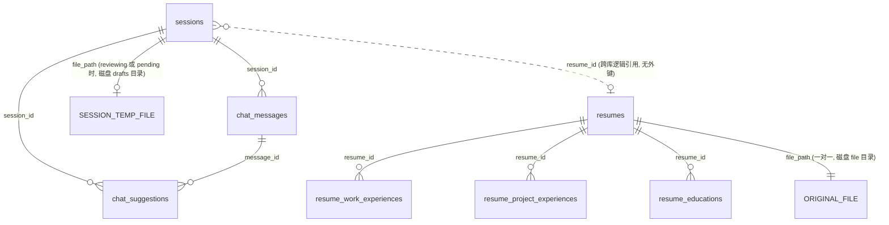

# Schema / 数据结构设计 — 简历信息收集（Backend）

## 文档版本

| 版本 | 日期 | 修改说明 | 作者 |
|------|------|----------|------|
| v0.1 | 2026-11-10 | 初始草稿（architecture-advisor Step 2.1） | Yin Yang（backend） |
| v0.1.0 | 2026-11-10 | 按契约审视 O-01..O-13 修订：O-03 立即删旧草稿；O-04 前缀去除规则；O-06 目录布局（`data/`、`file/`，正式库文件名 `resumes.db`）；O-07 清理间隔 1 小时；第六节确认点转为裁决记录 | Yin Yang（backend） |
| v0.2.0 | 2026-11-11 | v2/v2.1 增量（HR_PR-1-CRv2/CRv2.1，对应 OpenAPI 0.2.0 草稿）：① 草稿表 `drafts`（令牌唯一、7 天清理）→ 会话表 `sessions`（浏览器标识哈希非唯一、状态 `reviewing/saved`、关联 `resume_id`、更新候选状态 `update_state`）；② 新增 `chat_messages`、`chat_suggestions`；③ 取消 TTL 清理，改手动删除与启动时一次孤儿清扫；④ `resumes.file_path` 命名规则增加更新后的唯一版本名（TQ-v2-08），`resumes.db` 结构不变；⑤ 草稿库 `user_version` 1 → 2，v1 旧草稿不迁移（直接丢弃 `drafts` 表）；⑥ 保存/更新/对账/清理策略（§4）按 ADR-004/005/008 的 v2/v2.1 修订更新 | Yin Yang（backend） |

---

> **输入**：`01_requirements/requirements.md`（v2：REQ-BE-01..09）、`00_impact_analysis.md`（v2 第三、十一节）、HLD v2.1、ADR-001..009、裁决 C-01..C-15 / D-01..D-06 / X-01..X-10a / Y-01、Y-02、TQ-v2-01..10、仓库 `AGENTS.md`、`rules/backend/database.md`。
> **范围**：SQLite 两个**物理分离**的数据库文件 + 两个文件目录。不含代码。
> **约定**：表名、字段名 `snake_case`；时间为 ISO 8601 UTC 文本（`YYYY-MM-DDTHH:MM:SSZ`）；列类型显式声明并写明可空性；SQL 一律参数绑定；连接建立时 `PRAGMA foreign_keys = ON`、`PRAGMA busy_timeout = 5000`；schema 版本用 `PRAGMA user_version`，**按库分别维护**：`drafts.db` = 2（v2），`resumes.db` = 1（不变）。

---

## 一、数据结构清单

| 结构名 | 类型 | 所在库/目录 | 关联需求 | 说明 | 预估数据量 |
|--------|------|-----------|---------|------|-----------|
| `sessions` | 表 | 草稿库 `drafts.db` | REQ-BE-01/02/03/04/05/09 | 会话：归属浏览器标识哈希、状态（校对中/已保存）、未确认草稿字段与原始文件元数据、关联的简历记录 id、更新候选状态（v2，替代 v1 `drafts`） | 随使用持续增长（不自动清理，ADR-008）；POC：数十至数百行 |
| `chat_messages` | 表 | 草稿库 | REQ-BE-07 | 会话内的用户/助手消息，按 `seq` 排序 | 每会话数十条量级，不设上限（TQ-v2-06） |
| `chat_suggestions` | 表 | 草稿库 | REQ-BE-07 | 助手消息附带的修改建议（字段、新值、可否应用、状态） | 每条助手消息 0..N 项 |
| `resumes` | 表 | 正式库 `resumes.db` | REQ-BE-04/08/09 | 已确认简历主记录；含原始文件关联；(姓名,手机号,邮箱) 规范化键唯一。**结构不变**；v2.1 起可被会话内的再次确认覆盖（REQ-BE-09），`updated_at` 记最近更新时间 | POC：百至千级 |
| `resume_work_experiences` | 表 | 正式库 | REQ-BE-04 | 工作经历（多条，保持顺序） | 每份简历 0..N 条 |
| `resume_project_experiences` | 表 | 正式库 | REQ-BE-04 | 项目经历（多条） | 同上 |
| `resume_educations` | 表 | 正式库 | REQ-BE-04 | 教育背景（多条） | 同上 |
| 草稿临时文件目录 | 目录 | `{DATA_DIR}/drafts/` | REQ-BE-01/05/09 | 会话的临时原始文件（`reviewing` 会话；`update_state=pending` 的更新候选）；不自动清理，随会话删除或归档/更新成功后删除 | 与 `reviewing` 与 `pending` 会话数一致，每个 ≤ 10 MB |
| 正式归档目录 `file/` | 目录 | `{FILE_DIR}`（项目 `file` 目录） | REQ-BE-04/08/09 | 已确认简历的原始文件；无自动过期；首次保存名 `<resume_id><ext>`，更新后为唯一版本名（§2.2.3） | 与 `resumes` 一对一 |

> 草稿库与正式库为两个独立 SQLite 文件（C-12、B-04、ADR-003）；不同库之间不建外键；`sessions.resume_id` 只是对正式库记录 id 的逻辑引用（无外键、跨库）。目录布局已裁决（O-06）：`{DATA_DIR}` 默认 = 仓库内 `data/`（存 `drafts.db`、`resumes.db`、`drafts/` 临时文件），`{FILE_DIR}` 默认 = 仓库内 `file/`；二者均可用环境变量覆盖，并须加入 `.gitignore`（实现阶段落实，本期设计不建仓库文件）。

---

## 二、详细设计

### 2.1 `sessions` — 会话（草稿库 `drafts.db`，v2 新增，替代 v1 `drafts`）

**关联需求：** REQ-BE-01.5/01.6、REQ-BE-02、REQ-BE-03、REQ-BE-04.6–04.8、REQ-BE-05、REQ-BE-09

```sql
-- drafts.db（user_version = 2）
CREATE TABLE IF NOT EXISTS sessions (
    id                TEXT    NOT NULL PRIMARY KEY,            -- 会话 id，UUID v4；契约中的 session_id
    browser_hash      TEXT    NOT NULL,                        -- 浏览器标识的 SHA-256 十六进制；非唯一：一个浏览器多个会话
    status            TEXT    NOT NULL DEFAULT 'reviewing'
                      CHECK (status IN ('reviewing', 'saved')),
    file_path         TEXT,                                    -- 临时原始文件，相对 {DATA_DIR}/drafts/（<id>.<ext>）；文件已删除时为 NULL
    original_filename TEXT    NOT NULL,                        -- 用户原文件名，仅展示；日志不得输出
    content_type      TEXT    NOT NULL
                      CHECK (content_type IN ('application/pdf', 'image/jpeg', 'image/png')),
    file_size         INTEGER NOT NULL
                      CHECK (file_size > 0 AND file_size <= 10485760),
    fields_json       TEXT    NOT NULL CHECK (json_valid(fields_json)),
                                                               -- reviewing：当前草稿（22 字段值 + 状态，见 2.1.3）
                                                               -- saved 且 update_state='pending'：冻结的更新候选（保存命中幂等键那一刻的内容）
                                                               -- 其余 saved：'{}'（内容读正式库，不在草稿库留副本）
    resume_id         TEXT,                                    -- 关联的 resumes.id（跨库逻辑引用，无外键）；reviewing 时为 NULL
    update_state      TEXT    NOT NULL DEFAULT 'none'
                      CHECK (update_state IN ('none', 'pending', 'applied')),
    created_at        TEXT    NOT NULL,                        -- ISO 8601 UTC
    updated_at        TEXT    NOT NULL,                        -- 字段/状态被修改时刷新
    last_active_at    TEXT    NOT NULL,                        -- 最近活动时间；列表排序依据（TQ-v2-05：读取不刷新）
    CHECK (
        (status = 'reviewing' AND resume_id IS NULL AND update_state = 'none' AND file_path IS NOT NULL)
        OR
        (status = 'saved' AND resume_id IS NOT NULL
            AND (update_state <> 'pending' OR file_path IS NOT NULL))
    )
);

CREATE INDEX IF NOT EXISTS idx_sessions_browser_active ON sessions (browser_hash, last_active_at DESC); -- 会话列表：本浏览器、最近活动倒序
CREATE INDEX IF NOT EXISTS idx_sessions_resume ON sessions (resume_id);                                   -- 按记录反查关联会话（调试/对账用，POC 可省）
```

| 字段 | 类型 | 可空 | 说明 |
|---|---|:-:|---|
| `id` | TEXT | 否 | 主键，UUID v4；临时文件名 = `<id><ext>` |
| `browser_hash` | TEXT | 否 | `sha256(浏览器标识)`；标识 = `secrets.token_urlsafe(32)`，只经 HttpOnly Cookie 传输；所有按会话 id 的读写条件都带 `AND browser_hash = ?`（ADR-008 跟进 4） |
| `status` | TEXT | 否 | `reviewing`（校对中，可编辑/对话）/ `saved`（已保存，只读） |
| `file_path` | TEXT | 是 | 相对路径；`reviewing` 与 `update_state='pending'` 时必有；首次保存成功（无更新候选）与更新成功后置 NULL（文件已删） |
| `original_filename` / `content_type` / `file_size` | TEXT / TEXT / INTEGER | 否 | 本会话上传文件的元数据；`pending` 时用于展示更新候选的文件信息 |
| `fields_json` | TEXT | 否 | 见上方注释与 2.1.3 |
| `resume_id` | TEXT | 是 | 保存后关联的简历记录：首次保存 = 新记录 id；命中幂等键 = 已有记录 id（含并发命中） |
| `update_state` | TEXT | 否 | `none`：无候选；`pending`：命中幂等键，冻结的候选等待用户确认更新；`applied`：候选已覆盖到记录（REQ-BE-09.5，幂等返回依据） |
| `created_at`/`updated_at`/`last_active_at` | TEXT | 否 | ISO 8601 UTC |

**会话状态机（`status` × `update_state`）：**

| 情形 | `status` | `update_state` | `resume_id` | `file_path` | `fields_json` |
|---|---|---|---|---|---|
| 上传成功 | reviewing | none | NULL | 有 | 草稿 |
| 首次保存成功 | saved | none | 新记录 id | NULL（文件已删） | `'{}'` |
| 保存命中幂等键（已保存过，含并发） | saved | **pending** | 已有记录 id | **保留**（更新候选） | **冻结保留** |
| 确认更新成功 | saved | **applied** | 不变 | NULL（文件已删） | `'{}'` |

`saved` 会话的 `fields_json` 与文件在 `pending` 期间冻结：分区编辑、对话、再次保存均被拒绝（REQ-BE-03.6、REQ-BE-07.9），更新只经 REQ-BE-09 的独立入口。`reviewing → saved` 是单向的，没有 `saved → reviewing`。

> **会话名称不落库**（X-04）：列表/详情读取时计算——`reviewing` 取 `fields_json` 中 `name.value`（有值为"简历 · 姓名"，否则"未命名简历"），`saved` 取 `resumes.name`；因此没有 `display_name` 列，不会与姓名更新不同步。

#### 2.1.1 `chat_messages` — 对话消息（REQ-BE-07）

```sql
CREATE TABLE IF NOT EXISTS chat_messages (
    id          TEXT    NOT NULL PRIMARY KEY,                  -- 消息 id，UUID v4；契约中的 message_id
    session_id  TEXT    NOT NULL REFERENCES sessions (id) ON DELETE CASCADE,
    seq         INTEGER NOT NULL CHECK (seq >= 1),             -- 会话内顺序，从 1 起；同事务内取 max(seq)+1
    role        TEXT    NOT NULL CHECK (role IN ('user', 'assistant')),
    content     TEXT    NOT NULL CHECK (length(content) > 0),  -- 用户消息 ≤ 2000 字符（服务层校验，TQ-v2-06）；助手回复长度由解析结构限制
    created_at  TEXT    NOT NULL,
    updated_at  TEXT    NOT NULL                               -- 消息不修改，初始 = created_at
);
CREATE UNIQUE INDEX IF NOT EXISTS uq_chat_messages_session_seq ON chat_messages (session_id, seq);
```

- 用户消息与对应助手回复**在同一个事务内**写入（调用模型成功之后）；模型调用失败/结构非法时两者都不落库（X-01、REQ-BE-07.2）。同一事务内 `seq` 连续（用户 n、助手 n+1）。
- 发给模型的"最近 20 条"按 `seq` 倒序取（TQ-v2-06）。
- 内容属敏感信息：不进日志（B-03）；随会话删除（`ON DELETE CASCADE`，连接建立时 `PRAGMA foreign_keys = ON`）。

#### 2.1.2 `chat_suggestions` — 修改建议（REQ-BE-07）

```sql
CREATE TABLE IF NOT EXISTS chat_suggestions (
    id            TEXT    NOT NULL PRIMARY KEY,                -- 建议 id，UUID v4；契约中的 suggestion_id
    session_id    TEXT    NOT NULL REFERENCES sessions (id) ON DELETE CASCADE,
    message_id    TEXT    NOT NULL REFERENCES chat_messages (id) ON DELETE CASCADE,  -- 所属助手消息（"卡片"）
    seq           INTEGER NOT NULL CHECK (seq >= 1),           -- 卡片内顺序
    field         TEXT    NOT NULL
                  CHECK (field IN ('name','job_title','expected_city','expected_salary','available_time',
                                   'phone','email','homepage','gender','birth_month','political_status',
                                   'current_city','work_years','highest_education','self_evaluation',
                                   'strengths','skills','certificates_honors','languages')),
                                                               -- 白名单 = 标量字段 + 4 个文本列表字段；不含 work/project/education 经历（TQ-v2-01）
    new_value_json TEXT   NOT NULL CHECK (json_valid(new_value_json)),   -- 新值：标量为 JSON 字符串/null，列表为字符串数组
    applicable    INTEGER NOT NULL CHECK (applicable IN (0, 1)),         -- 1=通过字段规则，可应用
    reason        TEXT    CHECK (reason IN ('required','invalid_format','invalid_type','too_long')),
                                                               -- applicable=0 时的原因代码（只含代码，不含值）
    status        TEXT    NOT NULL DEFAULT 'pending'
                  CHECK (status IN ('pending', 'applied', 'cancelled')),
    created_at    TEXT    NOT NULL,
    updated_at    TEXT    NOT NULL,                            -- 应用/取消时刷新
    CHECK ((applicable = 1 AND reason IS NULL) OR (applicable = 0 AND reason IS NOT NULL))
);
CREATE UNIQUE INDEX IF NOT EXISTS uq_chat_suggestions_msg_seq ON chat_suggestions (message_id, seq);
CREATE INDEX        IF NOT EXISTS idx_chat_suggestions_session ON chat_suggestions (session_id);
```

- **只存新值，不存原值**：原值在读取时取会话当前字段值（`reviewing` 会话，且建议 `pending`），因此不存在"过期原值"（对应 Q-frontend-v2-05）；`applied`/`cancelled` 的建议与 `saved` 会话中的建议，响应里 `old_value` 为 null。
- 被丢弃的建议（未知字段、三项必填新值未出现在用户消息中、与当前值相同）**不入库**；`applicable=0` 的建议入库并带原因代码，展示但无"应用"。
- **卡片 = 一条助手消息下的全部建议**。应用/取消以卡片为单位：应用时在 `BEGIN IMMEDIATE` 内对该消息下 `applicable=1 AND status='pending'` 的建议重新校验，全部通过才写字段并全部置 `applied`；任一失败则全部不生效（REQ-BE-07.7）；`applicable=0` 的建议状态保持 `pending`，不参与动作。
- 新值属敏感信息，不进日志；随会话删除。

#### 2.1.3 `fields_json` 结构（v2 未变）

固定 22 个键，每个键为 `{ "value": ..., "status": ... }`。键集合来自 `global-info/简历模板.md`（C-14，语言能力独立分类）：

| 键 | value 类型 | 来源（模板区块） | 核心必填 |
|---|---|---|:-:|
| `name` | string \| null | 姓名 | ✅ |
| `job_title` / `expected_city` / `expected_salary` / `available_time` | string \| null | 求职意向 | |
| `phone` | string \| null | 联系方式 | ✅ |
| `email` | string \| null | 联系方式 | ✅ |
| `homepage` | string \| null | 联系方式（个人主页/GitHub/LinkedIn） | |
| `gender` / `birth_month` / `political_status` / `current_city` / `work_years` / `highest_education` | string \| null | 个人信息 | |
| `strengths` | string[] | 个人优势 | |
| `work_experiences` | WorkExperience[] | 工作经历 | |
| `project_experiences` | ProjectExperience[] | 项目经历 | |
| `educations` | Education[] | 教育背景 | |
| `skills` | string[] | 专业技能 | |
| `certificates_honors` | string[] | 证书与荣誉 | |
| `languages` | string[] | 语言能力 | |
| `self_evaluation` | string \| null | 自我评价（模板标注可选） | |

`status` 取值（C-04）：`recognized`（已识别，待确认）/ `uncertain`（不确定）/ `missing`（缺失）/ `confirmed`（已确认）。

不变式（由 services 层保证，非 DB 约束）：

1. `missing` ⇒ value 为 `null`（标量）或 `[]`（列表）。
2. `recognized` / `uncertain` ⇒ value 非空。
3. 用户经更新接口提交的字段一律置为 `confirmed`；提交 `null` / `[]` 表示“确认留空”，仍为 `confirmed`（非核心字段允许；核心三项不允许为空）。
4. 模型返回无依据或结构不合法的字段，降级为 `uncertain` 或 `missing`，不得猜测补全（B-04、REQ-BE-02.3）。
5. 状态只能单向变为 `confirmed`，不回退。

嵌套对象（列表项内部字段不单独带状态，整个区块一个状态）：

| 类型 | 属性（均为 string \| null，除标注外） |
|---|---|
| WorkExperience | `company`、`position`、`start_date`、`end_date`（可为“至今”）、`department`、`reports_to`、`team_size`、`responsibilities`（string[]）、`achievements`（string[]） |
| ProjectExperience | `name`、`start_date`、`end_date`、`background`、`role`、`tech`、`outcome` |
| Education | `start_date`、`end_date`、`school`、`major`、`degree`、`honors` |

---

### 2.2 `resumes` — 已确认简历主记录（正式库 `resumes.db`）

**关联需求：** REQ-BE-04（AC3/AC5/AC6/AC9）、REQ-BE-08、REQ-BE-09；B-04、B-05

> **v2/v2.1：表结构不变**（DDL 与索引均不变，`user_version` 仍为 1，无需迁移）。变化的只是语义，见 §2.2.3。

```sql
-- resumes.db
CREATE TABLE IF NOT EXISTS resumes (
    id                  TEXT    NOT NULL PRIMARY KEY,          -- UUID v4；同时用作归档文件名
    -- 核心信息（保存前必须具备且格式合法）
    name                TEXT    NOT NULL CHECK (length(trim(name)) > 0),      -- 用户确认的姓名（展示值，仅去首尾空格）
    phone               TEXT    NOT NULL CHECK (length(trim(phone)) > 0),     -- 用户确认的手机号（展示值）
    email               TEXT    NOT NULL CHECK (length(trim(email)) > 0),     -- 用户确认的邮箱（展示值）
    -- 幂等键（规范化值，见 2.2.1）
    name_key            TEXT    NOT NULL,
    phone_key           TEXT    NOT NULL,
    email_key           TEXT    NOT NULL,
    -- 求职意向
    job_title           TEXT,
    expected_city       TEXT,
    expected_salary     TEXT,
    available_time      TEXT,
    -- 联系方式（其余）
    homepage            TEXT,
    -- 个人信息
    gender              TEXT,
    birth_month         TEXT,                                  -- 形如 YYYY-MM，不强校验
    political_status    TEXT,
    current_city        TEXT,
    work_years          TEXT,
    highest_education   TEXT,
    -- 文本列表区块：JSON 数组（元素为字符串），无内容为 '[]'
    strengths_json            TEXT NOT NULL DEFAULT '[]' CHECK (json_valid(strengths_json)),
    skills_json               TEXT NOT NULL DEFAULT '[]' CHECK (json_valid(skills_json)),
    certificates_honors_json  TEXT NOT NULL DEFAULT '[]' CHECK (json_valid(certificates_honors_json)),
    languages_json            TEXT NOT NULL DEFAULT '[]' CHECK (json_valid(languages_json)),
    self_evaluation     TEXT,
    -- 原始文件关联（一对一，B-05）
    file_path           TEXT    NOT NULL,                      -- 相对 {FILE_DIR} 的路径：首次保存 <id>.pdf；更新后为 <id>-<suffix8>.<ext>（§2.2.3）
    original_filename   TEXT    NOT NULL,                      -- 用户原文件名（仅展示/追溯）
    content_type        TEXT    NOT NULL
                        CHECK (content_type IN ('application/pdf', 'image/jpeg', 'image/png')),
    file_size           INTEGER NOT NULL CHECK (file_size > 0 AND file_size <= 10485760),
    -- 审计字段
    created_at          TEXT    NOT NULL,
    updated_at          TEXT    NOT NULL
);

-- 幂等键唯一约束：兜底并发确认（C-10 / D-02）
CREATE UNIQUE INDEX IF NOT EXISTS uq_resumes_identity ON resumes (name_key, phone_key, email_key);
-- 一份原始文件只关联一条记录（一对一）
CREATE UNIQUE INDEX IF NOT EXISTS uq_resumes_file_path ON resumes (file_path);
PRAGMA user_version = 1;
```

#### 2.2.1 幂等键规范化规则（D-02，写入 `*_key` 列与查重时共用，服务层单点实现）

| 键 | 规则（按序） |
|---|---|
| `name_key` | 去首尾空格 → 将内部连续空白合并为单个空格 |
| `phone_key` | 去所有空格、连字符 → 若以 `+86` 或 `86` 开头且其后恰为 11 位大陆号（`1` 开头共 11 位）则去掉该前缀；其余国际号保留 `+` 前缀原样 |
| `email_key` | 去首尾空格 → 转小写 |

> 说明：规范化发生在格式校验**之后**。C-09 校验口径为“11 位大陆号或 `+` 开头国际号”，因此不带 `+` 的 `86…` 输入会先被校验拒绝；仅当 `+86`（或 `86`）后恰为 11 位大陆号时才去除前缀（O-04）；不带 `+` 的 `86…` 分支实际不会触发，无害。
> `name` / `phone` / `email` 列保存用户确认的展示值（仅去首尾空格），`*_key` 仅用于判重，不对外返回。

#### 2.2.2 其余字段说明

| 字段 | 类型 | 可空 | 说明 |
|---|---|:-:|---|
| `id` | TEXT | 否 | UUID v4；归档文件名 = `<id><扩展名>` |
| `name`/`phone`/`email` | TEXT | 否 | 核心三项；`CHECK` 兜底非空 |
| `*_key` | TEXT | 否 | 规范化幂等键；与 `uq_resumes_identity` 配套 |
| 其余标量 | TEXT | 是 | 用户确认“留空”→ NULL |
| `*_json` | TEXT | 否 | JSON 字符串数组；`json_valid` 兜底 |
| `file_path` | TEXT | 否 | 相对路径；唯一；首次保存 `<id><ext>`，确认更新后 `<id>-<8位后缀><ext>`（§2.2.3） |
| `original_filename` | TEXT | 否 | 日志不得输出 |
| `content_type`、`file_size` | TEXT、INTEGER | 否 | 与文件一致 |
| `created_at`、`updated_at` | TEXT | 否 | `created_at` = 首次保存时间，**永不改变**；`updated_at` 初始 = `created_at`，REQ-BE-09 覆盖更新时刷新。除此之外无修改路径（TQ-v2-09：列表与排序用 `created_at`，详情另显示 `updated_at`） |

---

#### 2.2.3 v2.1 覆盖更新与文件命名（REQ-BE-09，TQ-v2-08）

- **覆盖的内容**：单事务内 `UPDATE resumes SET` 全部 22 个字段值（含 `name/phone/email` 展示值）、`file_path`、`original_filename`、`content_type`、`file_size`、`updated_at`；`WHERE id = ? AND name_key = ? AND phone_key = ? AND email_key = ?`，`rowcount != 1` 视为冲突并回滚。**不改** `id`、三个 `*_key`、`created_at`。然后 `DELETE` 三张子表该 `resume_id` 的全部行，按候选内容重新 `INSERT`（子行 `created_at/updated_at` = 本次更新时间）。这是覆盖不是合并：候选里为空的字段会清空已有值。
- **文件命名**：首次保存沿用 `<resume_id><ext>`；确认更新使用**唯一版本名** `<resume_id>-<suffix8><ext>`（`suffix8` 为 8 位小写十六进制随机串，满足 `[A-Za-z0-9-]{1,64}` 的归档名规则，36+1+8 ≤ 64）。每次更新生成新的后缀，因此新旧文件永不同名，与扩展名是否相同无关；`uq_resumes_file_path` 不会冲突。
- **顺序**（详见 §4.1a）：新文件暂存并提升为终态 → 单事务覆盖记录 → 提交后删除旧终态文件。任一时刻记录指向的 `file_path` 文件都存在。
- 子表、索引、CHECK 约束均不变。

---

### 2.3 `resume_work_experiences` — 工作经历

```sql
CREATE TABLE IF NOT EXISTS resume_work_experiences (
    id                  INTEGER PRIMARY KEY AUTOINCREMENT,
    resume_id           TEXT    NOT NULL REFERENCES resumes (id) ON DELETE CASCADE,
    seq                 INTEGER NOT NULL CHECK (seq >= 0),     -- 在简历中的顺序，从 0 起
    company             TEXT,
    position            TEXT,
    start_date          TEXT,                                  -- 如 2021.03
    end_date            TEXT,                                  -- 如 2024.06 或 至今
    department          TEXT,
    reports_to          TEXT,
    team_size           TEXT,
    responsibilities_json TEXT NOT NULL DEFAULT '[]' CHECK (json_valid(responsibilities_json)),
    achievements_json     TEXT NOT NULL DEFAULT '[]' CHECK (json_valid(achievements_json)),
    created_at          TEXT    NOT NULL,
    updated_at          TEXT    NOT NULL
);
CREATE UNIQUE INDEX IF NOT EXISTS uq_work_resume_seq ON resume_work_experiences (resume_id, seq);
```

### 2.4 `resume_project_experiences` — 项目经历

```sql
CREATE TABLE IF NOT EXISTS resume_project_experiences (
    id          INTEGER PRIMARY KEY AUTOINCREMENT,
    resume_id   TEXT    NOT NULL REFERENCES resumes (id) ON DELETE CASCADE,
    seq         INTEGER NOT NULL CHECK (seq >= 0),
    name        TEXT,
    start_date  TEXT,
    end_date    TEXT,
    background  TEXT,
    role        TEXT,
    tech        TEXT,
    outcome     TEXT,
    created_at  TEXT    NOT NULL,
    updated_at  TEXT    NOT NULL
);
CREATE UNIQUE INDEX IF NOT EXISTS uq_project_resume_seq ON resume_project_experiences (resume_id, seq);
```

### 2.5 `resume_educations` — 教育背景

```sql
CREATE TABLE IF NOT EXISTS resume_educations (
    id          INTEGER PRIMARY KEY AUTOINCREMENT,
    resume_id   TEXT    NOT NULL REFERENCES resumes (id) ON DELETE CASCADE,
    seq         INTEGER NOT NULL CHECK (seq >= 0),
    start_date  TEXT,
    end_date    TEXT,
    school      TEXT,
    major       TEXT,
    degree      TEXT,
    honors      TEXT,
    created_at  TEXT    NOT NULL,
    updated_at  TEXT    NOT NULL
);
CREATE UNIQUE INDEX IF NOT EXISTS uq_education_resume_seq ON resume_educations (resume_id, seq);
```

> 子表字段全部可空（“其余字段可为空”）；`ON DELETE CASCADE` 仅为引用完整性保障，本期**不提供**删除已确认记录的能力；修改只经 REQ-BE-09 的覆盖更新（子表先删后重建，REQ-BE-04.9）。子表以 `(resume_id, seq)` 唯一索引兼作 `resume_id` 查询索引。

---

## 三、关系图



`sessions`、`chat_messages`、`chat_suggestions` 在草稿库，`resumes` 及子表在正式库；跨库只有 `sessions.resume_id` 这一处逻辑引用，不建外键。一个 `resumes` 记录可被多个 `saved` 会话引用（同一人多次保存命中幂等键）。

---

## 四、存储一致性与生命周期

### 4.1 首次保存：原始文件与记录一致（B-05，REQ-BE-04.3/04.4/04.6/04.7）

确认保存（有效、非重复）的顺序（v1 顺序不变，仅第 4 步随会话化修订）：

| 步 | 动作 | 失败处理 |
|---|---|---|
| 0 | 校验会话归属（`browser_hash`）、`status='reviewing'`、确认动作与核心三项；计算 `*_key`；**先查重**（`SELECT … WHERE name_key=? AND phone_key=? AND email_key=?`），命中直接走“已保存过”分支（见 4.3） | — |
| 1 | 将会话临时文件**复制**到 `{FILE_DIR}/.<resume_id><ext>.tmp`（临时名，不是最终名） | 删除 tmp，返回 `save_failed`；会话保持 `reviewing`，可重试 |
| 2 | 单个事务写入 `resumes` + 三张子表（含 `file_path = <resume_id><ext>`） | 回滚；删除 tmp；若 `IntegrityError` 为 `uq_resumes_identity` 冲突（并发）→ 回查已有记录，按“已保存过”处理 |
| 3 | 事务提交后，将 tmp **原子重命名**为 `{FILE_DIR}/<resume_id><ext>` | 重命名失败：记录已存在而最终文件缺失 → 立即重试一次；仍失败则保留 tmp 并返回 `save_failed`，由启动对账 roll-forward（见 4.2）。已知窗口同 v1 |
| 4 | 在草稿库用**一条条件更新**置会话为已保存：`UPDATE sessions SET status='saved', resume_id=?, update_state='none', file_path=NULL, fields_json='{}', updated_at=?, last_active_at=? WHERE id=? AND browser_hash=? AND status='reviewing'`；成功后再删除会话临时文件（先库后文件）。**不清除浏览器标识 Cookie**（ADR-008） | `rowcount != 1`（并发地被同会话另一请求先保存/被删除）→ 按只读/不存在处理；更新或删文件失败仅记日志，不影响已保存结果：会话仍 `reviewing` 时用户再次确认会命中幂等键，走 4.3 得到“已保存过”；残留临时文件由 4.4 启动清扫兜底 |

### 4.1a 已保存过后的确认更新（B-05，REQ-BE-09，ADR-004/005 v2.1 修订，TQ-v2-08）

适用：会话 `status='saved' AND update_state='pending'`，用户在差异卡片上显式“确认更新”。**新文件以唯一版本名先提升为终态，再提交事务**——与首次保存的顺序不同，原因见下方说明。

| 步 | 动作 | 失败处理 |
|---|---|---|
| 0 | 校验会话归属、`pending`（`applied` → 幂等返回，见下）、`confirm_update=true`、核心三项合法、重算 `*_key` 且与 `resumes.id = sessions.resume_id` 的记录一致 | 校验失败：什么都没动；会话仍 `pending`，可重试 |
| 1 | 生成 `file_id = <resume_id>-<suffix8>`；将会话临时文件**复制**到 `{FILE_DIR}/.<file_id><ext>.tmp` | 复制失败：`stage` 自清理，无残留；返回 `save_failed`，记录与会话不变 |
| 2 | 原子重命名为 `{FILE_DIR}/<file_id><ext>`（全新唯一名，不存在覆盖，`promote` 仍拒绝覆盖） | 失败：删除 tmp；返回 `save_failed`；记录不变 |
| 3 | 单个事务（`resumes.db`，`BEGIN IMMEDIATE`）：读出旧 `file_path` → `UPDATE resumes`（§2.2.3，带键守卫）→ 删除三张子表该记录的行 → 重新插入 | 回滚 → 记录**不变**；删除步骤 2 的新终态文件（补偿）。提交结果不明（连接异常）时先查记录 `file_path` 是否已是新名：已是 → 视为已提交，保留新文件；否 → 视为未提交，删新文件 |
| 4 | 提交后删除旧终态文件（步骤 3 读出的旧 `file_path`） | 失败/崩溃：仅留下旧版本文件（记录指向的新文件存在，B-05 成立）；由 4.2 的“陈旧旧版文件”规则在下次启动清理 |
| 5 | 草稿库：`UPDATE sessions SET update_state='applied', file_path=NULL, fields_json='{}', updated_at=?, last_active_at=? WHERE id=? AND update_state='pending'`；再删除会话临时文件 | 失败仅记日志：记录已是新内容；会话仍 `pending` 时用户再次点击会再次覆盖为同样内容（幂等）；临时文件由清扫兜底 |

**说明（与 ADR-005 字面顺序的差异，TQ-v2-08 已确认）：** 首次保存用“tmp → 事务 → 重命名”，更新改为“tmp → 重命名为唯一版本名 → 事务 → 删旧文件”。字面照搬会遇到两个问题：① 新旧扩展名相同则终态名相同，`promote` 拒绝覆盖，且对账遇到“记录 + 终态 + tmp”只计冲突、不处理，提交后崩溃会留下“新元数据 + 旧内容”；② 无法区分“提交后崩溃（应前滚）”与“提交前崩溃（应丢弃 tmp）”。唯一版本名使新文件在提交前即可安全提升：提交前失败/崩溃只留下无记录引用的新终态文件（对账情形 3 直接清理），提交后记录必然指向存在的文件，**不存在“记录先于文件”的窗口**。

**并发与幂等：**

- 两个会话同时更新同一记录：事务内读旧 `file_path` 并串行（`BEGIN IMMEDIATE`），后到者覆盖先到者，先到者的新文件在后到者的步骤 4 中作为“旧文件”删除，不遗留。
- 同一会话重复请求：`update_state='applied'` → 直接返回记录 id 与当前 `updated_at`，不再写入。
- 更新与手动删除会话并发：步骤 5 的条件更新 `rowcount != 1` 仅记日志；记录已更新的事实不受影响。

### 4.2 启动对账（REQ-BE-04.4，REQ-BE-09.4）

进程启动时、对 `{FILE_DIR}` 与 `resumes.file_path` 比对：

| 情形 | 处理 |
|---|---|
| `.<id><ext>.tmp` 存在，且 `resumes.id = <id>` 存在，且该记录的终态文件不存在 | roll-forward：重命名为最终名（仅首次保存的提交后窗口；更新路径不产生该状态） |
| `.<id><ext>.tmp` 存在，无对应记录（`id` 部分不是记录 id；含更新路径提升前的 tmp） | 删除（保存/更新未提交） |
| 最终名文件存在，无对应记录（`id` 部分不是记录 id；含 `<resume_id>-<suffix8>` 形式的新版本文件：更新在提交前崩溃留下的、或被第二次更新取代的旧版本） | 删除。**例外（保险丝）：数据库一条记录都没有而 `file/` 下有终态文件时，终态文件保留并告警（计入冲突），不删除**——记录从不被删除，该状态只可能来自库被替换/误删或目录配置错误 |
| **（v2.1 新增）终态文件的 `id` 部分恰好等于某条记录 id，但文件名不等于该记录的 `file_path`**（更新后遗留的首次保存文件 `<resume_id><ext>`） | 若**该记录自己的终态文件存在** → 判定为陈旧旧版并删除；否则保持“冲突，不猜”（计入冲突，人工处理）。避免误删唯一一份数据 |
| 记录存在，最终文件与 tmp 均不存在 | **不可自动修复**：记录告警日志（仅 id，不含内容）；人工处理 |

对账仍只在启动时同步运行一次，且早于接收请求；更新路径只发生在请求期，二者不会并发。

### 4.3 幂等与重复确认（C-10、D-02；v2.1 修订 D-04）

- 查重命中（含并发冲突后回查）：不新增、不覆盖记录；**会话保留本次内容作为更新候选**：`UPDATE sessions SET status='saved', resume_id=<已有记录 id>, update_state='pending', updated_at=?, last_active_at=? WHERE id=? AND browser_hash=? AND status='reviewing'`；`fields_json` 与临时文件冻结保留，不删除；响应带 `already_saved = true` 与已有 `resume_id`。条件 `status='reviewing'` 保证同一会话的并发重复提交只有一个生效，其余按只读处理。
- 展示已有记录内容（X-06 选 B）：会话读取时由 `resume_id` 读正式库（只含值，X-07）；此时 v1 的“不回显已有记录内容”（D-04）被替代。
- 唯一约束 `uq_resumes_identity` 是并发的最终兜底；步骤 0 的先查重只为避免无谓的文件复制。

### 4.4 保留期与清理策略（v2 修订：取消 7 天 TTL）

| 对象 | 保留期 | 触发 | 范围限制 |
|---|---|---|---|
| `sessions`、`chat_messages`、`chat_suggestions` | **不自动清理**，只能用户手动删除（ADR-008、DL 2026-11-11） | 手动删除会话（见下） | 只作用于草稿库与 `{DATA_DIR}/drafts/`，**不得触及 `resumes.db` 与 `{FILE_DIR}`** |
| 手动删除 `reviewing` 会话 | 立即 | 单事务 `DELETE FROM sessions`（级联删除消息与建议），事务后删除临时文件（先库后文件） | 同上 |
| 手动删除 `saved` 会话 | 立即 | 同上；如 `update_state='pending'`，一并删除保留的临时文件。**已保存的简历记录与原始文件保留** | 同上 |
| 草稿目录孤儿文件（无 `sessions.file_path` 引用，如解析/保存/删除中途崩溃遗留，及 v1 旧草稿文件） | 超过 1 天即清理（宽限不变） | **仅进程启动时清扫一次**；不再有定时线程（取消 `CLEANUP_INTERVAL_SECONDS`、`DRAFT_TTL_DAYS`） | 同上；引用集合 = `SELECT file_path FROM sessions WHERE file_path IS NOT NULL` |
| `resumes`、子表、`{FILE_DIR}` 文件 | **无自动过期**；无删除接口；仅 REQ-BE-09 覆盖更新（旧版本文件在更新后删除，不保留历史） | — | — |

> 孤儿清扫的启动顺序：创建目录 → 初始化两库（含 §4.6 的 `drafts` 库升级）→ 对账 → 孤儿清扫（一次）→ 开始接收请求。去掉了 v1 的“过期草稿删除”步骤和调度线程。

### 4.5 数据保护

- 两个库与两个目录均含个人敏感信息：依赖受控主机/磁盘加密（HLD §8 假设 3，待部署负责人核实）。v2 起草稿库长期保存对话与简历内容（ADR-008 已接受），重要性上升。
- 浏览器标识仅存哈希；`original_filename`、`fields_json`、对话消息、建议新值、各简历字段不得进入日志或错误响应（B-03）。
- 所有 SQL 参数绑定；`*_json` 列写入前用 JSON 序列化，不拼接 SQL。
- 测试仅用合成/脱敏简历（B-06）。

### 4.6 `drafts.db` 升级与 v1 旧草稿（DL 2026-11-11 确认不迁移）

- `drafts.db` 的 `PRAGMA user_version` 由 1 升到 2；`resumes.db` 保持 1。版本常量按库分别维护（v1 实现里两库共用同一常量）。
- 初始化 `drafts.db` 时：读 `user_version`——`< 2`（含全新库为 0）则在同一事务内 `DROP TABLE IF EXISTS drafts`（v1 表，及其索引 `uq_drafts_token_hash`、`idx_drafts_last_active` 随表删除），创建 `sessions`、`chat_messages`、`chat_suggestions` 及索引，最后 `PRAGMA user_version = 2`；`> 2` 拒绝启动（沿用现有“数据库版本更新于程序”检查）。
- 为什么不能直接 `CREATE TABLE IF NOT EXISTS drafts`（v1 方式）：v2 用新表名 `sessions`，旧 `drafts` 表（`token_hash` 唯一）与会话语义冲突；`IF NOT EXISTS` 对已存在的 v1 表是静默无效，不能就地改。
- v1 旧草稿丢弃：旧草稿对应的临时文件仍在 `{DATA_DIR}/drafts/`，没有 `sessions` 引用，由启动孤儿清扫在超过 1 天后删除；v1 的 `draft_token` Cookie 被忽略（新 Cookie 名为 `browser_id`）。

---

## 五、设计决策

| 决策项 | 决策 | 理由 | ADR |
|--------|------|------|-----|
| 草稿库与正式库分离 | 两个独立 SQLite 文件，不同库不建外键 | C-12、B-04：草稿不进入正式库；草稿侧的删除与清扫不会误触正式数据 | ADR-003 已覆盖 |
| 草稿存储形态 | 独立 SQLite 文件，`fields_json` 整体存 JSON | 草稿整读整写，不做关系查询；避免为 22 字段 + 3 个嵌套区块建一套临时表（v2 的会话仍沿用） | — |
| 令牌存储 | 库内只存 `sha256(token)`，令牌 `secrets.token_urlsafe(32)`（v2：该令牌即浏览器标识，列为 `sessions.browser_hash`，非唯一） | 库泄露不等于令牌泄露；随机令牌无需签名密钥，减少一类环境密钥（B-01） | ADR-008 |
| ~~无草稿状态列~~（v2 作废） | v1：不设 `status`，确认后删除草稿 | v2 会话保留：改用 `sessions.status/update_state`（见下表 v2 决策） | ADR-008 |
| 幂等键 | 规范化 (姓名, 手机号, 邮箱) 存 `*_key` 三列 + 联合唯一索引；展示值另存 | C-10/D-02：规范化规则单点在服务层实现；展示值保留用户确认的原貌 | ADR-004 |
| 正式库结构化程度 | 标量字段平铺列；工作/项目/教育拆子表；文本列表区块用 JSON 数组列 | 三个多条区块内部有结构，拆表便于后续查询；纯字符串列表无查询需求，JSON 数组最简 | — |
| 原始文件关联 | 作为 `resumes` 的列（`file_path` 等），不单独建表 | C-02 一对一；同一事务写入，天然原子 | — |
| 字段状态粒度 | 每个“区块”一个状态：标量字段各一个；列表区块（含经历）整体一个 | 与 C-03 “按字段逐项校对”一致；避免嵌套逐项状态使契约膨胀（POC） | — |
| 状态不落正式库 | `resumes` 不存字段状态 | 入库即全部由用户确认；状态只在草稿期有意义 | — |
| 文件名与保存顺序 | 文件名一律服务端生成（`<uuid><ext>`），扩展名由魔数决定；保存顺序“tmp → 事务 → 重命名”并启动对账（§4.1/§4.2） | REQ-BE-01.3 防路径穿越；B-05 一致性；磁盘布局难以回退 | ADR-005 |
| 子表主键 | `INTEGER AUTOINCREMENT` + `(resume_id, seq)` 唯一 | 保持顺序；符合“实体含 id/created_at/updated_at”惯例 | — |
| 并发写 | 默认 journal，`busy_timeout=5000`，不调 WAL | POC、单进程、约 5 人并发；`database.md` 与 POC 口径 | — |
| 迁移 | `PRAGMA user_version` + `IF NOT EXISTS` 启动建表 | POC 无迁移工具；版本号为将来留口 | — |

**v2/v2.1 新增决策（本版 v0.2.0）：**

| 决策项 | 决策 | 理由 | ADR |
|--------|------|------|-----|
| 会话表替代草稿表 | 新表 `sessions`（浏览器标识哈希**非唯一**，列表索引 `(browser_hash, last_active_at DESC)`），旧 `drafts` 表丢弃；会话 id 用 UUID | 一个浏览器多个会话；X-08 契约统一称“会话”；v1 旧草稿 DL 确认不迁移 | ADR-008 已覆盖 |
| 状态建模 | `status`（`reviewing/saved`）与 `update_state`（`none/pending/applied`）两列 + 联合 CHECK，不再另设草稿状态机 | 两组状态正交：`saved` 只读；`pending` 仅表示“有冻结候选可更新”；CHECK 在库层挡住不可能的组合（如 `reviewing` 带 `resume_id`） | ADR-004 v2.1 已覆盖 |
| 更新候选不另建表 | 候选 = 会话行自身的 `fields_json` + 临时文件 + 文件元数据，在 `pending` 期间冻结 | 候选与会话一对一、生命周期同会话；少一张表和一套同步逻辑 | ADR-004 v2.1 已覆盖 |
| 已保存会话不留内容副本 | 首次保存/更新成功后 `fields_json='{}'`、`file_path=NULL`；内容读正式库 | 避免草稿库长期持有第二份敏感简历；与 ADR-008 “已保存会话从正式库读取”一致 | ADR-008 已覆盖 |
| 会话名称不落库 | 读取时计算，无 `display_name` 列 | X-04：姓名更新后不会出现副本不同步 | — |
| 消息与建议分表 | `chat_messages` + `chat_suggestions`（FK 级联删除）；建议只存**新值**，原值读取时取当前值 | 建议有独立状态且按卡片应用；不存原值则无“过期原值”问题；级联删除让手动删除只需删 `sessions` 一行 | ADR-007 已覆盖 |
| 建议字段白名单入库约束 | `chat_suggestions.field` 用 CHECK 限定 19 个字段，经历类三个区块不在内 | TQ-v2-01：库层兜底服务层的白名单，防止误入整体替换风险高的字段 | ADR-007 已覆盖 |
| 取消 TTL 与调度 | 不自动清理任何会话；只在启动时清扫一次孤儿文件（宽限 1 天），无定时线程 | ADR-008、DL 2026-11-11：只手动删除；孤儿只来自崩溃遗留 | ADR-008 已覆盖 |
| 覆盖更新的文件命名 | 更新后 `file_path = <resume_id>-<suffix8><ext>`，先提升为终态再提交事务，提交后删旧文件；对账新增“陈旧旧版文件”规则 | TQ-v2-08：避免同扩展名无法覆盖、提交后崩溃难以判定前滚/丢弃；任一时刻记录指向的文件存在 | ADR-005 v2.1 修订（Step 3 补写） |
| 覆盖更新的记录写法 | `UPDATE resumes`（键守卫）+ 子表先删后重建；`created_at` 不变，`updated_at` 刷新 | 覆盖不是合并，沿用 id 与幂等键；`resumes` 表结构零改动，无需迁移 | ADR-004 v2.1 已覆盖 |
| 按库维护 schema 版本 | `drafts.db` = 2，`resumes.db` = 1；`drafts.db` 升级时在事务内丢弃 v1 `drafts` 表并建新表 | v1 共用一个版本常量会让 `resumes.db` 被无谓升版；`CREATE TABLE IF NOT EXISTS` 无法就地改旧表 | — |
| 归档读取不新增索引 | `resumes.db` 结构不变，列表 `ORDER BY created_at DESC` 全表排序 | POC 数据量百至千级；任务书要求 `resumes.db` 结构不变 | — |


---

## 六、契约审视裁决记录（2026-11-10）

| 编号 | 裁决 | 本文落点 |
|---|---|---|
| O-01 | 读取/更新成功时滑动续期 Cookie，与“7 天无活动”一致（v2 作废：Cookie 改为浏览器标识，≤ 400 天续期；最近活动时间不由读取刷新） | `last_active_at` 刷新（§2.1、§4.4） |
| O-03 | 带有效旧令牌重传成功时立即删除旧草稿 | §4.4 |
| O-04 | 仅 `+86` 后恰为 11 位大陆号时去前缀 | §2.2.1 |
| O-06 | `{DATA_DIR}` = 仓库内 `data/`（`drafts.db`、`resumes.db`）；`{FILE_DIR}` = 仓库内 `file/`；环境变量可覆盖；加入 `.gitignore`；tmp 文件放在 `{FILE_DIR}` 内以保证原子重命名 | §一 |
| O-07 | 清理间隔 1 小时 | §4.4 |
| 其他 | `name/phone/email` 在 `resumes` 中 `NOT NULL` + 非空 `CHECK`，格式校验只在服务层（设计内部决策，未提交裁决，保持原设计） | §2.2 |

---

## 七、v2/v2.1 裁决落点（2026-11-11）

| 编号 | 裁决 | 本文落点 |
|---|---|---|
| X-03 | 删除会话成功返回 204，不存在/不属于统一 404 | §4.4（删除行为）；契约见 `api_design_resume.md` |
| X-04 | 会话名称后端生成，读取时计算 | §2.1（名称不落库） |
| X-06 | 已保存过会话展示已有记录内容；D-04 被替代 | §4.3 |
| X-07 | 已保存内容共用“只有值”的结构；校对中仍“值 + 状态” | §2.1（`saved` 会话 `fields_json='{}'`，内容读正式库） |
| X-08 | 契约与存储统一称“会话”（`session_id`） | §2.1、§2.1.1、§2.1.2 |
| Y-01、Y-02 | 前端快捷回复触发更新，不经模型；后端返回两份完整值，不算差异 | §2.1（`pending` 冻结 `fields_json`）、§4.1a |
| TQ-v2-01 | 建议字段白名单：标量 + 4 个文本列表，不含三类经历 | §2.1.2（`field` CHECK） |
| TQ-v2-05 | 读取不刷新最近活动时间 | §2.1（`last_active_at` 注释） |
| TQ-v2-06 | 对话 ≤ 2000 字符、发模型最近 20 条、消息不设上限 | §2.1.1 |
| TQ-v2-08 | 唯一版本文件名 + 先提升后提交；对账加“陈旧旧版文件”规则 | §2.2.3、§4.1a、§4.2 |
| TQ-v2-09 | 列表/排序用首次保存时间，详情另显示最近更新时间 | §2.2.2（`created_at`/`updated_at`） |

