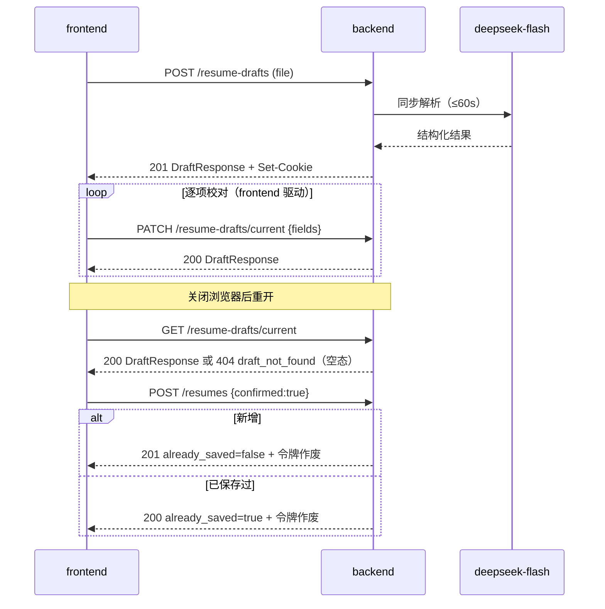

# 接口设计 — 简历信息收集（Backend）

## 文档版本

| 版本 | 日期 | 修改说明 | 作者 |
|------|------|----------|------|
| v0.1 | 2026-11-10 | 初始草稿（architecture-advisor Step 2.2） | Yin Yang（backend） |
| v0.1.0 | 2026-11-10 | 按契约审视 O-01..O-13 冻结 OpenAPI：O-01 滑动续期 Cookie；O-02 上传失败不动旧草稿；O-03 有效旧令牌重传成功即删旧草稿；O-04 仅 `+86` 后恰 11 位大陆号才去前缀；O-05 `phone` 加 `pattern`（前端即时校验唯一来源）；O-06 目录布局；O-07 清理间隔 1 小时；O-08 201/200 + `already_saved`；O-09 核心三项 `minLength: 1`；O-10 `draft_not_found` 前端按接口区分文案；O-11 区块整体状态；O-12 GET 404 为空态；O-13 无限流为已知风险。`info.version`: `0.1.0-draft` → `0.1.0` | Yin Yang（backend） |

---

> **输入**：`01_requirements/requirements.md`（REQ-BE-01..06）、HLD §4、裁决 C-01..C-15 / D-01..D-06、`rules/backend/api.md`、`02_schema/sql_ddl_resume.md`。
> **契约载体**：`openapi.yaml`（OpenAPI 3.1.0，已用 openapi-spec-validator 校验通过）。本文给出设计说明与决策；字段级细节以 `openapi.yaml` 为准，二者不重复双写。
> **状态**：**已冻结 v0.1.0**（2026-11-10，经 cross-workbench-review 契约审视 O-01..O-13；C-13、D-06 已满足）。后续变更须经 cross-workbench-reviewer。

---

## 一、接口清单

| # | 方法 + 路径 | 用途 | 关联 REQ | 成功状态 | 幂等 |
|---|---|---|---|---|---|
| 1 | `POST /api/v1/resume-drafts` | 上传简历（multipart），同步解析，创建未确认草稿并下发 Cookie 令牌 | REQ-BE-01、02、05.2 | 201 | 否（每次新建草稿，D-05） |
| 2 | `GET /api/v1/resume-drafts/current` | 读取当前浏览器的未确认草稿（启动恢复、刷新） | REQ-BE-03.1/03.5、05.3/05.4 | 200 | 是（安全方法；会刷新最近活动时间） |
| 3 | `PATCH /api/v1/resume-drafts/current` | 提交校对结果：修正/补充/确认字段（部分更新） | REQ-BE-03.2–03.5 | 200 | 是（结果等同重复提交） |
| 4 | `POST /api/v1/resumes` | 用户明确确认后保存简历记录与原始文件 | REQ-BE-04 | 201 新增 / 200 已保存过 | **是**（按规范化 姓名+手机号+邮箱，C-10/D-02） |

**未设计的接口（有意）**：丢弃草稿（C-07，重新上传即覆盖）；修改/删除已确认简历（C-11、Q7）；保存状态查询（C-05）；查询已确认简历列表/详情（范围外）；“下一个待确认字段/提问文案”（C-03）。

**路径设计**：草稿由 Cookie 定位，因此用固定资源别名 `current` 而不在路径暴露草稿 id；确认保存的结果是新建 `resumes` 资源，所以用 `POST /resumes` 而非动作式路径（符合 `rules/backend/api.md`：资源复数名词、动作用 HTTP 方法表达）。

---

## 二、公共约定

| 项 | 约定 |
|---|---|
| 前缀与版本 | `/api/v1`；OpenAPI `info.version = 0.1.0`（已冻结）；v1 内只做向后兼容的新增（新增可选字段/新增错误码），破坏性变更须新版本并经 cross-workbench-reviewer |
| 数据格式 | JSON；字段 `snake_case`；时间 ISO 8601 UTC（`...Z`）；文件上传 `multipart/form-data` |
| 身份 | 无账号。草稿访问令牌经 Cookie `draft_token` 传递：`HttpOnly; SameSite=Lax; Path=/; Max-Age=604800`，**不强制 `Secure`**（C-06，POC 同源 localhost）。令牌为随机值，不含简历内容；前端不读取 |
| 同源 | localhost 同源，Vite dev proxy 转发 `/api`；无 CORS（C-06） |
| 错误体 | `{code, message, request_id}` + 可选 `details: [{field, reason}]`（D-06）。HTTP 状态码表达错误类别，`code` 为字符串业务码。`message` 为面向用户的非敏感文案，前端只展示 `message` |
| 敏感信息 | 错误体、日志不含简历原文、模型原始返回、用户填写值（B-03）；`details` 只含字段名与原因代码 |
| `request_id` | 每个请求由中间件生成，写入响应错误体与日志 |
| 分页 | 无（本期无列表接口） |
| 超时与重试 | 模型调用超时 **60 秒**（C-08），前端请求超时 75 秒；**服务端不自动重试模型调用**（60 秒预算已是单次上限；重试只会超过前端超时）；超时后由用户重新上传。其他接口无长耗时 |
| 速率限制 | 本期不设（O-13：**已知风险**，POC、localhost、约 5 人；全局规范要求重要接口限流，上线前须另立需求处理） |

### 2.1 `details[].reason` 取值

| reason | 含义 |
|---|---|
| `required` | 必填字段缺失或为空（核心三项；或试图把核心字段置空） |
| `invalid_format` | 格式不合法（手机号、邮箱） |
| `invalid_type` | 类型不符 |
| `too_long` | 超出长度上限 |
| `unknown_field` | 请求包含未定义的字段 |

`details[].field`：顶层字段用键名（`phone`）；列表区块内用 `work_experiences[0].start_date` 形式。**只含字段名，不含值。**

---

## 三、接口详细设计

### 3.1 `POST /api/v1/resume-drafts` — 上传并同步解析

**功能 / 关联 REQ：** 接收单个简历文件，校验后调用 `deepseek-flash`（仅经 `clients` 层）解析为简历模型，创建未确认草稿并下发令牌。REQ-BE-01.1–01.6、REQ-BE-02.1–02.6、REQ-BE-05.2。

**请求：** `multipart/form-data`

| 字段 | 类型 | 必填 | 校验 |
|---|---|:-:|---|
| `file` | binary | 是 | 单个文件；PDF / JPG / JPEG / PNG；1 B ≤ 大小 ≤ 10 MB（10485760 B）；类型以文件头魔数判定，扩展名与魔数不一致拒绝 |

**成功响应 201：** `DraftResponse`（见 `openapi.yaml`）+ `Set-Cookie: draft_token=…`。

```json
{
  "draft_id": "9a1c1c0e-2d3b-4f55-9b0e-6a4f9d1b7e21",
  "original_file": { "filename": "resume.pdf", "content_type": "application/pdf", "size_bytes": 482113 },
  "fields": {
    "name":  { "value": "张三", "status": "recognized" },
    "phone": { "value": "13800138000", "status": "recognized" },
    "email": { "value": null, "status": "missing" },
    "skills": { "value": ["Python", "SQL"], "status": "recognized" },
    "work_experiences": { "value": [{ "company": "某公司", "position": "工程师", "start_date": "2021.03", "end_date": "至今", "department": null, "reports_to": null, "team_size": null, "responsibilities": ["负责后端开发"], "achievements": [] }], "status": "uncertain" }
    /* 其余键同构，共 22 个，此处省略 */
  },
  "created_at": "2026-11-10T08:00:00Z",
  "updated_at": "2026-11-10T08:00:00Z",
  "expires_at": "2026-11-17T08:00:00Z"
}
```

**错误：**

| HTTP | code | 触发 | 说明 |
|---|---|---|---|
| 400 | `file_missing` | 未携带 `file` | |
| 400 | `file_empty` | 空文件 | 不调用模型 |
| 400 | `file_content_mismatch` | 魔数与扩展名不符 / 无法识别为 PDF·JPEG·PNG | 不调用模型 |
| 413 | `file_too_large` | > 10 MB | 不调用模型 |
| 415 | `unsupported_file_type` | 类型不在白名单 | 不调用模型 |
| 502 | `parse_failed` | 模型拒绝该输入、返回错误，或结果完全无法解析为简历模型 | 不回退其他方式 |
| 503 | `parse_unavailable` | 模型能力/授权/凭证不可用（ADR-001） | 阻断并反馈；不回退 OCR/其他模型 |
| 504 | `parse_timeout` | 模型调用 > 60 秒 | C-08 |
| 500 | `internal_error` | 未预期错误 | |

**行为要点：**

- 解析结果中**部分字段**结构非法/无依据 → 对应字段降级为 `uncertain`/`missing`，仍返回 201（REQ-BE-02.3）；**整体**不可解析才是 `parse_failed`。
- **失败不落草稿**（O-02）：所有错误场景都不创建草稿、不改动请求所携带的旧令牌与旧草稿，用户可继续使用旧草稿。
- 成功后新令牌覆盖 Cookie；若请求带**有效旧令牌**，立即删除旧草稿（O-03，REQ-BE-01.6 按此补充）；令牌缺失/失效等无法定位的旧草稿仍由 7 天清理兜底。

---

### 3.2 `GET /api/v1/resume-drafts/current` — 读取当前草稿

**功能 / 关联 REQ：** 页面启动或刷新时恢复校对。REQ-BE-03.1、03.5、REQ-BE-05.3/05.4。

**请求：** 无参数；凭 Cookie `draft_token`。

**成功响应 200：** `DraftResponse`；刷新 `last_active_at`，并**滑动续期** Cookie（Max-Age 重置 7 天，O-01）。**只返回字段值与状态**，不返回提问文案/游标（C-03）。

**错误：**

| HTTP | code | 触发 |
|---|---|---|
| 404 | `draft_not_found` | 令牌缺失 / 无效 / 已作废 / 草稿已过期或不存在。不返回任何简历内容，不区分具体原因（避免暴露令牌有效性）；前端作为空态处理（O-12） |
| 500 | `internal_error` | |

> 页面打开时无草稿属正常情况，返回 404 `draft_not_found`：前端**须作为“空态”处理**，不当作错误提示、不记错误日志（O-12）。同一业务码在不同接口下，前端按所调接口区分文案（O-10，见 §五）。

---

### 3.3 `PATCH /api/v1/resume-drafts/current` — 提交校对结果

**功能 / 关联 REQ：** 用户修正/补充/确认字段。REQ-BE-03.2–03.5。

**请求：** `application/json`，`DraftUpdateRequest`

| 字段 | 类型 | 必填 | 校验 |
|---|---|:-:|---|
| `fields` | object | 是 | 键必须属于 22 个已定义字段，否则 `unknown_field`；至少一个键 |
| `fields.name` | string | 否 | `minLength: 1`；全空白在服务层按 `required` 拒绝（O-09） |
| `fields.phone` | string | 否 | `minLength: 1`；**校验前先去除空格与连字符**；去除后须为 **11 位大陆号（`^1\d{10}$`）或 `+` 开头国际号（`^\+\d{6,15}$`）**，否则 `invalid_format`。OpenAPI 中的 `pattern`（`^(1\d{10}\|\+\d{6,15})$`）是 frontend 即时校验的唯一来源（O-05） |
| `fields.email` | string | 否 | `minLength: 1`；全空白按 `required` 拒绝（O-09）；邮箱格式（`^[^@\s]+@[^@\s]+\.[^@\s]+$`），否则 `invalid_format` |
| 其他标量字段 | string \| null | 否 | `null` = 确认留空 |
| 列表字段（`strengths`、`skills`、`certificates_honors`、`languages`、`work_experiences`、`project_experiences`、`educations`） | array | 否 | **整体替换**；`[]` = 确认留空；元素结构见 `openapi.yaml`。区块只有**一个整体状态**，不对每条子项单独确认（O-11，POC 接受；前端逐条展示、整块确认） |

**语义：**

- 出现的字段 → 值替换为请求值，**状态置为 `confirmed`**；未出现的字段保持原值/原状态（REQ-BE-03.2）。
- 仅“确认”而不改值：回传当前值即可。
- 多条子项增删改：回传完整新列表（REQ-BE-03.3）。
- 只写草稿库，**不写正式库**（B-04）。

**成功响应 200：** 更新后的 `DraftResponse`（刷新 `updated_at`、`last_active_at`，续期 Cookie）。

**错误：**

| HTTP | code | 触发 |
|---|---|---|
| 404 | `draft_not_found` | 同 3.2 |
| 422 | `validation_failed` | 任一字段不合法；`details: [{field, reason}]` 列出全部不合法字段，不回显值 |
| 500 | `internal_error` | |

校验失败时整个请求不生效（原子，全部不写入）。

---

### 3.4 `POST /api/v1/resumes` — 确认并保存

**功能 / 关联 REQ：** 用户明确确认后，把草稿保存为简历记录，并建立与原始文件的一对一关联。REQ-BE-04.1–04.9。

**请求：** `application/json`，`CreateResumeRequest`

| 字段 | 类型 | 必填 | 校验 |
|---|---|:-:|---|
| `confirmed` | boolean | 是 | 必须为 `true`；缺失或 `false` → `confirmation_required` |

草稿由 Cookie 定位，请求体不含简历内容（保存的是草稿当前内容，D-03）。

**服务端处理顺序：**

1. 校验 `confirmed === true`。
2. 取草稿；不存在/令牌无效 → `draft_not_found`。
3. 校验核心三项齐全且格式合法（规则同 3.3），否则 `validation_failed`（带 `details`）。
4. 规范化幂等键（姓名/手机号/邮箱，D-02）→ **先查重**：命中 → 走“已保存过”分支（步骤 7）。
5. 复制原始文件 → 单事务写入 `resumes` + 子表 → 原子重命名为最终文件名（顺序与补偿见 `sql_ddl_resume.md` §4.1）。唯一约束冲突（并发）→ 回查，走“已保存过”分支。
6. 保存成功。
7. 删除草稿与临时文件，`Set-Cookie` 使 `draft_token` 过期。

**成功响应：**

| HTTP | `already_saved` | 含义 |
|---|---|---|
| 201 | `false` | 本次新增记录（O-08） |
| 200 | `true` | （O-08；前端只依赖 `already_saved`）同一个人此前已保存：不新增、不覆盖，返回已有 `resume_id`；本次内容与临时文件丢弃；**不回显已有记录内容**（D-04） |

```json
{ "resume_id": "3f2b8c1e-5d4a-4e0b-9a77-0c1d2e3f4a5b", "already_saved": false, "saved_at": "2026-11-10T08:30:00Z" }
```

**错误：**

| HTTP | code | 触发 | 前端处理建议 |
|---|---|---|---|
| 404 | `draft_not_found` | 草稿不存在/令牌无效，**含“首次已成功但响应丢失后的重试”**（D-01） | 提示“可能已保存，请重新上传核实” |
| 422 | `confirmation_required` | 缺少明确确认 | 不保存、不提示已保存 |
| 422 | `validation_failed` | 姓名/手机号/邮箱缺失或格式不合法 | 按 `details` 定位字段 |
| 500 | `save_failed` | 保存过程失败，已补偿，无孤立文件/记录 | 草稿保留，可直接重试 |
| 500 | `internal_error` | 未预期错误 | |

**幂等性小结：**

- 键：规范化 `(姓名, 手机号, 邮箱)`；正式库 `uq_resumes_identity` 唯一约束兜底并发（C-10、D-02）。
- 重试安全：首次失败（`save_failed`/网络超时但未提交）→ 重试等同首次；首次已成功 → 重试可能得到 `draft_not_found`（令牌已作废，D-01，POC 接受）；用户重新上传同一人简历再确认，得到 `already_saved = true`。

---

## 四、调用时序（正常 / 恢复 / 重复）



---

## 五、业务码清单

| code | HTTP | 出现的接口 | 含义 | 触发与处理 |
|---|---|---|---|---|
| `file_missing` | 400 | ① | 未携带文件 | 提示选择文件 |
| `file_empty` | 400 | ① | 空文件 | 不调用模型 |
| `file_content_mismatch` | 400 | ① | 魔数与扩展名不符/无法识别 | 不调用模型 |
| `file_too_large` | 413 | ① | 超过 10 MB | 不调用模型 |
| `unsupported_file_type` | 415 | ① | 非 PDF/JPG/JPEG/PNG | 不调用模型 |
| `parse_failed` | 502 | ① | 模型拒绝输入/返回错误/整体不可解析 | 提示更换文件重传 |
| `parse_unavailable` | 503 | ① | 模型能力/授权/凭证不可用 | 阻断；不回退（ADR-001） |
| `parse_timeout` | 504 | ① | 模型调用超 60 秒（C-08） | 提示重新上传 |
| `draft_not_found` | 404 | ②③④ | 令牌缺失/无效/已作废，或草稿不存在/已过期（含确认成功后重试，D-01） | **前端按调用的接口区分文案（O-10）**：②：空态，引导上传（O-12）；③：提示重新上传；④：提示“可能已保存，请重新上传核实” |
| `validation_failed` | 422 | ③④ | 字段校验不通过，带 `details: [{field, reason}]`（D-06） | 前端按字段提示，不回显值 |
| `confirmation_required` | 422 | ④ | 缺少明确确认动作（B-04） | 不保存 |
| `save_failed` | 500 | ④ | 保存失败（已补偿，B-05） | 可重试 |
| `internal_error` | 500 | ①②③④ | 未预期错误 | 通用提示 |

**非错误的状态标识**：`already_saved`（`CreateResumeResponse` 布尔字段；200 表示已保存过，201 表示新增）。它**不是错误码**，不进入错误体（C-10、D-02、D-04）。

---

## 六、设计决策

| 决策项 | 决策 | 理由 | ADR |
|--------|------|------|-----|
| 草稿定位方式 | Cookie 令牌定位，路径用 `current` 别名，不暴露草稿 id | HLD §4：不要求账号，令牌仅 HttpOnly Cookie；前端不触碰令牌（F-02） | ADR-003 已覆盖 |
| 确认保存的资源建模 | `POST /resumes` 新建简历记录，请求体仅 `confirmed` | REST：确认的产物是资源；内容取自草稿，避免前后端内容双写漂移 | — |
| 状态码区分新增/已保存过 | 201 新增，200 已保存过；同时带布尔 `already_saved` | HTTP 语义 + 前端无需依赖状态码也可判断（单一事实：`already_saved`） | 契约，随 OpenAPI 冻结评审 |
| 部分更新语义 | `PATCH` 出现即 `confirmed`；列表整体替换 | C-03 结构化字段编辑；整体替换让多条子项增删改无需子项 id，契约最小 | — |
| 不回显值 | `details` 只含 `field`+`reason` | D-06、B-03 | — |
| 失败不落草稿 | 上传失败不创建草稿、不动旧 Cookie | 避免一次失败的重传把用户已校对的旧草稿弄丢；也避免孤儿草稿 | — |
| `draft_not_found` 单一业务码 | 令牌缺失/无效/作废/过期合并一个码，GET/PATCH/POST 共用 | 不暴露令牌有效性；前端按所调接口决定文案（D-01） | — |
| HTTP 404 表示无草稿 | 读取不存在草稿用 404 而非 204 | 与错误体统一，业务码可携带；前端需把首次空态当正常分支 | — |
| 解析失败拆 3 个码 | `parse_failed`(502)/`parse_unavailable`(503)/`parse_timeout`(504) | 前端可分别提示“换文件”“稍后再试”“重新上传”；对应 REQ-BE-02.4/02.5 | — |
| 不自动重试模型 | 单次 60 秒预算，无服务端重试 | 重试会超过前端 75 秒超时；失败由用户重传（C-08） | — |
| 无速率限制 | 本期不设；**记为已知风险（O-13）** | POC、localhost、约 5 人并发；全局规范要求重要接口限流，上线前须另立需求处理 | — |
| 字段键集合 | 固定 22 个 snake_case 键；每个键 `{value, status}` | 前端类型生成简单；与 `02_schema` §2.1.1 一一对应 | 契约，随 OpenAPI 冻结评审 |
| 契约变更纪律 | v1 仅向后兼容扩展；破坏性变更走新版本与 cross-workbench-reviewer | `architectural_constraints.md` 跨 Workbench 约束 | — |

> ADR 判定留待 Step 3 统一扫描（`sql_ddl_resume.md` 的幂等键、本文 201/200 与 `already_saved` 契约属候选）。

---

## 七、REQ 追溯

| REQ | 覆盖接口 / 设计点 |
|---|---|
| REQ-BE-01 | ①：AC1 校验与接收、AC2 拒绝与错误码、AC3 服务端命名（见 Schema §2.1）、AC4 单文件、AC5/6 新草稿与覆盖 |
| REQ-BE-02 | ①：AC1 仅 `clients`→`deepseek-flash`、AC2 字段状态、AC3 降级、AC4 `parse_timeout`、AC5 `parse_unavailable`/`parse_failed`、AC6 同步返回 |
| REQ-BE-03 | ②（AC1/AC5）、③（AC2/3/4/5） |
| REQ-BE-04 | ④：AC1 `confirmation_required`、AC2 `validation_failed`、AC3/4 一致性（Schema §4）、AC5/6 幂等键与 `already_saved`、AC7 删草稿+作废令牌、AC8 `draft_not_found`、AC9 无修改/删除接口 |
| REQ-BE-05 | ①下发 Cookie（AC2）、②（AC3/4）；清理（AC5）见 Schema §4.4；独立草稿库（AC1）见 Schema §2.1 |
| REQ-BE-06 | AC1–3 见公共约定/B-01..B-03；AC4 错误体含 `details`；AC5 本文即 OpenAPI 草稿；AC6 测试约束在 Step 3/4 落实 |

---

## 八、契约审视裁决记录（2026-11-10，来源 `cross-workbench-review.md`「契约审视」节）

原“需 DL 确认的点”已全部裁决，对应关系如下（O-01..O-13 全部采纳建议）：

| 编号 | 裁决 | 落点 |
|---|---|---|
| O-01 | 读取/更新成功时滑动续期 Cookie | §3.2、§3.3；`openapi.yaml` GET/PATCH |
| O-02 | 上传失败不建草稿、不动已有草稿与 Cookie | §3.1；`openapi.yaml` POST /resume-drafts |
| O-03 | 带有效旧令牌重传成功时立即删除旧草稿；无法定位的旧草稿由 7 天清理兜底（REQ-BE-01.6 按此补充） | §3.1；Schema §4.4 |
| O-04 | 仅 `+86` 后恰为 11 位大陆号才去前缀 | Schema §2.2.1 |
| O-05 | `phone` 加 `pattern`，作为 frontend 即时校验唯一来源 | §3.3；`openapi.yaml` `ResumeFieldsUpdate.phone` |
| O-06 | `DATA_DIR` = 仓库内 `data/`（`drafts.db`、`resumes.db`），`FILE_DIR` = 仓库内 `file/`；均可环境变量覆盖，加入 `.gitignore` | Schema §一、§4（本期不建仓库文件，实现阶段落实） |
| O-07 | 清理间隔 1 小时 | Schema §4.4 |
| O-08 | 201 新增 / 200 已保存过；前端只依赖 `already_saved` | §3.4；`openapi.yaml` POST /resumes |
| O-09 | name/phone/email `minLength: 1`；全空白服务层按 `required` 拒绝 | §3.3；`openapi.yaml` |
| O-10 | `draft_not_found` 前端按调用接口区分文案 | §五；`openapi.yaml` `DraftNotFound` |
| O-11 | 列表区块整体状态、整体替换（POC 接受） | §3.3；`openapi.yaml` PATCH |
| O-12 | GET 无草稿返回 404，前端作空态处理 | §3.2；`openapi.yaml` GET |
| O-13 | 无限流，记为已知风险（上线前另立需求） | §二、§六；`openapi.yaml` info |
