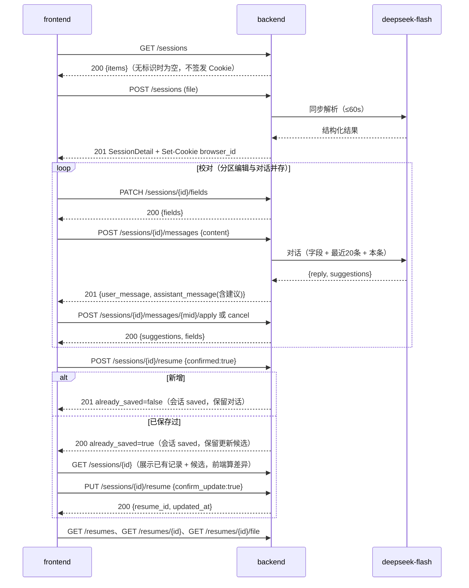

# 接口设计 — 简历信息收集（Backend）

## 文档版本

| 版本 | 日期 | 修改说明 | 作者 |
|------|------|----------|------|
| v0.1 | 2026-11-10 | 初始草稿（architecture-advisor Step 2.2） | Yin Yang（backend） |
| v0.1.0 | 2026-11-10 | 按契约审视 O-01..O-13 冻结 OpenAPI：O-01 滑动续期 Cookie；O-02 上传失败不动旧草稿；O-03 有效旧令牌重传成功即删旧草稿；O-04 仅 `+86` 后恰 11 位大陆号才去前缀；O-05 `phone` 加 `pattern`（前端即时校验唯一来源）；O-06 目录布局；O-07 清理间隔 1 小时；O-08 201/200 + `already_saved`；O-09 核心三项 `minLength: 1`；O-10 `draft_not_found` 前端按接口区分文案；O-11 区块整体状态；O-12 GET 404 为空态；O-13 无限流为已知风险。`info.version`: `0.1.0-draft` → `0.1.0` | Yin Yang（backend） |
| v0.1.1 | 2026-11-10 | 兼容修订（只加校验约束与澄清描述，不改接口结构、字段名、业务码）：G-01 `email` 加 `pattern: '^[^\s@]+@[^\s@]+\.[^\s@]+$'` 与 `maxLength: 254`；G-02 `phone` 的 `pattern` 针对提交值，客户端提交前须去空格与连字符，backend 校验前同样去除作为兜底；CR-01 补 `maxLength`/`maxItems`（name ≤ 100、phone ≤ 32、email ≤ 254、其他标量 ≤ 500、self_evaluation ≤ 5000；文本列表 ≤ 50 项、每项 ≤ 1000；经历区块 ≤ 20 条；条内字符串 ≤ 2000、条内列表 ≤ 30 项），超限 `details.reason = too_long`。`info.version`: `0.1.0` → `0.1.1` | Yin Yang（backend） |
| v0.2.0 | 2026-11-11 | v2/v2.1 增量（HR_PR-1-CRv2/CRv2.1）→ OpenAPI `0.1.1` → **`0.2.0` 草稿**（待 cross-workbench-reviewer 审视）：① 草稿接口（`/resume-drafts*`、`POST /resumes`）替换为会话接口（`/sessions*`），Cookie `draft_token` → `browser_id`，`draft_id` → `session_id`，去掉 `expires_at`；② 新增会话列表/读取/删除（204）、对话消息、建议应用/取消、确认更新、归档列表/详情/文件下载；③ 新增错误码 `session_not_found`（取代 `draft_not_found`）、`session_read_only`、`chat_failed`、`suggestion_unavailable`、`update_not_available`、`resume_not_found`、`file_not_available`；④ 对话消息 ≤ 2000 字符；⑤ `POST /sessions/{id}/resume` 保留 `already_saved`，命中后会话保留更新候选（X-06、v2.1）。v0.1.1 全文可由 git 历史追溯 | Yin Yang（backend） |

---

> **输入**：`01_requirements/requirements.md`（v2：REQ-BE-01..09）、HLD v2.1 §4、裁决 C-01..C-15 / D-01..D-06 / O-01..O-13（v1）与 X-01..X-10a / Y-01、Y-02（v2）、第二轮 TQ-v2-01..10、`rules/backend/api.md`、`02_schema/sql_ddl_resume.md`（v0.2.0）、frontend `00_impact_analysis.md` 第 7、11 节（数据/动作需求）。
> **契约载体**：`openapi.yaml`（OpenAPI 3.1.0，`info.version = 0.2.0`，已用 openapi-spec-validator 校验通过）。本文给出设计说明与决策；字段级细节以 `openapi.yaml` 为准，二者不重复双写。
> **状态**：**0.2.0 已冻结**（2026-11-11，经 Dev Lead 评审与 cross-workbench-reviewer 审视）。0.1.1 的 `/resume-drafts*` 与 `POST /resumes` 在 0.2.0 中被替换（v1 未交付，不保留兼容路由，TQ-v2-02）。字段长度上限、手机号/邮箱 `pattern` 沿用 0.1.1 的唯一来源原则（`ResumeFieldsUpdate`），本版不改。

---

## 一、接口清单

| # | 方法 + 路径 | 用途 | 关联 REQ | 成功状态 | 幂等 |
|---|---|---|---|---|---|
| 1 | `POST /api/v1/sessions` | 上传简历（multipart），同步解析，创建新会话；必要时签发浏览器标识 Cookie | REQ-BE-01、02、05.2 | 201 | 否（每次新建会话，不动其他会话） |
| 2 | `GET /api/v1/sessions` | 本浏览器的会话列表（名称、状态、最近活动时间） | REQ-BE-05.3 | 200 | 是（安全方法；不刷新活动时间） |
| 3 | `GET /api/v1/sessions/{session_id}` | 读取会话：字段（校对中含状态 / 已保存只含值）、对话记录、更新候选 | REQ-BE-03.1、05.4、09.1 | 200 | 是（安全方法） |
| 4 | `DELETE /api/v1/sessions/{session_id}` | 手动删除会话（两种情形） | REQ-BE-05.6 | 204 | 否（重复删除得 404） |
| 5 | `PATCH /api/v1/sessions/{session_id}/fields` | 分区校对：修正/补充/确认字段（部分更新） | REQ-BE-03.2–03.6 | 200 | 是（结果等同重复提交） |
| 6 | `POST /api/v1/sessions/{session_id}/messages` | 发送对话消息，得到回复与修改建议 | REQ-BE-07.1–07.6、07.8–07.10 | 201 | 否（每次产生新消息；失败不落库） |
| 7 | `POST /api/v1/sessions/{session_id}/messages/{message_id}/apply` | 应用一张建议卡片 | REQ-BE-07.7 | 200 | 否（已处理再请求得 409） |
| 8 | `POST /api/v1/sessions/{session_id}/messages/{message_id}/cancel` | 取消一张建议卡片 | REQ-BE-07.7 | 200 | 否（同上） |
| 9 | `POST /api/v1/sessions/{session_id}/resume` | 用户明确确认后保存简历记录与原始文件 | REQ-BE-04 | 201 新增 / 200 已保存过 | **是**（按规范化 姓名+手机号+邮箱，C-10/D-02） |
| 10 | `PUT /api/v1/sessions/{session_id}/resume` | 已保存过后，用户再次确认，用本次内容覆盖已有记录 | REQ-BE-09 | 200 | **是**（候选已应用再请求返回同一结果） |
| 11 | `GET /api/v1/resumes` | 已归档简历列表（全局只读） | REQ-BE-08.1 | 200 | 是 |
| 12 | `GET /api/v1/resumes/{resume_id}` | 已归档简历详情（只含值） | REQ-BE-08.2 | 200 | 是 |
| 13 | `GET /api/v1/resumes/{resume_id}/file` | 下载/打开原始文件 | REQ-BE-08.3 | 200 | 是 |

**未设计的接口（有意）**：修改/删除已归档简历（REQ-BE-04.9、REQ-BE-08.4；覆盖更新只经 #10）；归档搜索与分页（TQ-v2-09）；保存状态查询（C-05）；"下一个待确认字段/提问文案"（C-03）；对话中的保存/确认/更新动作（X-02、Y-01：用户说"确认提交/更新"只得到文本，动作只经 #9、#10）；流式对话（HLD）；会话重命名/批量删除（范围外）。

**路径设计**：会话是一等资源（X-08 统一称 `session`），路径中显式带 `session_id`，由浏览器标识 Cookie 校验归属，因此无需"当前会话"这种服务端状态；对话消息是会话的子资源；建议"卡片"以助手消息 id 定位，应用/取消是对该卡片的动作，用 `POST .../apply|cancel` 表达（动作无法映射为对资源的 CRUD）；保存与更新都作用于"会话对应的简历记录"，所以用 `POST`（创建）与 `PUT`（覆盖）同一子路径 `.../resume`，符合 `rules/backend/api.md`（资源名词、动作用 HTTP 方法）；归档接口以 `resumes` 为资源，只读。

---

## 二、公共约定

| 项 | 约定 |
|---|---|
| 前缀与版本 | `/api/v1`；OpenAPI `info.version = 0.2.0`（已冻结）；v1 内只做向后兼容的新增，破坏性变更须新版本并经 cross-workbench-reviewer。0.2.0 相对 0.1.1 是破坏性变更（v1 未交付，直接替换） |
| 数据格式 | JSON；字段 `snake_case`；时间 ISO 8601 UTC（`...Z`）；文件上传 `multipart/form-data`；文件下载为二进制 |
| 身份 | 无账号。**浏览器标识**经 Cookie `browser_id` 传递：`HttpOnly; SameSite=Lax; Path=/; Max-Age=34560000`（400 天，浏览器上限），**不强制 `Secure`**（C-06，POC 同源 localhost）。标识为 `secrets.token_urlsafe(32)` 随机值，库内只存 SHA-256，不含简历内容，前端不读取。**随每次带有效标识的成功响应续期**（`Set-Cookie` 属性完全一致才能覆盖）；上传时没有有效标识则先签发；列表接口无标识时返回空列表且不签发。标识格式不合法（长度/字符集）视为没有标识 |
| 会话归属 | 按会话 id 访问的接口都校验会话属于当前浏览器标识；**不存在与不属于本浏览器返回同一个 404 `session_not_found`**，不区分两种情形（ADR-008）；路径参数格式不合法同样按 404 处理，不返回 422 |
| 同源 | localhost 同源，Vite dev proxy 转发 `/api`；无 CORS（C-06） |
| 错误体 | `{code, message, request_id}` + 可选 `details: [{field, reason}]`（D-06）。HTTP 状态码表达错误类别，`code` 为字符串业务码。`message` 为面向用户的非敏感文案，前端只展示 `message` |
| 敏感信息 | 错误体、日志不含简历原文、对话内容、修改建议的值、模型原始返回、用户填写值（B-03）；`details` 只含字段名与原因代码 |
| `request_id` | 每个请求由中间件生成，写入响应错误体与日志 |
| 分页 | 无：会话列表、归档列表均不分页（POC，数据量小，TQ-v2-09） |
| 超时与重试 | 上传解析与对话各同步调用一次模型，模型读超时 **60 秒**（C-08）；前端请求超时 **75 秒**（X-01，大于模型超时加余量）；**服务端不自动重试模型调用**；对话失败不落库，前端重试前先重读会话核对，不设幂等键 |
| 最近活动时间 | 上传、分区编辑、发送消息、应用/取消建议、保存、确认更新刷新；**仅读取（列表、详情、下载）不刷新**（TQ-v2-05） |
| 速率限制 | 本期不设（O-13：**已知风险**，POC、localhost、约 5 人；上线前须另立需求处理） |
| 访问边界 | 归档接口 `/resumes*` 不做权限控制，服务只监听本机地址（ADR-009、X-09，已接受风险）；对外监听前必须先补访问控制 |

### 2.1 `details[].reason` 取值

| reason | 含义 |
|---|---|
| `required` | 必填字段缺失或为空（核心三项；或试图把核心字段置空） |
| `invalid_format` | 格式不合法（手机号、邮箱） |
| `invalid_type` | 类型不符 |
| `too_long` | 超出长度上限 |
| `unknown_field` | 请求包含未定义的字段 |

`details[].field`：顶层字段用键名（`phone`）；列表区块内用 `work_experiences[0].start_date` 形式。**只含字段名，不含值。**

---

## 三、接口详细设计

字段级请求/响应、示例与错误码见 `openapi.yaml`；本节只说明行为、校验顺序与设计要点。

### 3.1 `POST /api/v1/sessions` — 上传并同步解析（原 `POST /resume-drafts`）

关联 REQ-BE-01.1–01.6、REQ-BE-02、REQ-BE-05.2。请求体 `multipart/form-data` 的 `file`（PDF/JPG/JPEG/PNG，1 B–10 MB，魔数判定）。成功 **201** 返回 `SessionDetail`（`status=reviewing`、`messages=[]`、`fields` 含 22 个字段的值与状态、`resume`/`update_candidate` 为 null、`update_state=none`），并 `Set-Cookie: browser_id`。

- 与 v1 的差异：**不再删除旧草稿**；每次上传新建一个会话，其他会话（含"校对中"与"已保存"）不变；没有 `expires_at`。
- 失败（`file_missing/file_empty/file_content_mismatch/file_too_large/unsupported_file_type/parse_failed/parse_unavailable/parse_timeout/internal_error`，含义同 0.1.1）：不创建会话，不改动已有会话与 Cookie（O-02）。
- 部分字段结构非法/无依据 → 对应字段降级为 `uncertain/missing`，仍返回 201（REQ-BE-02.3）；整体不可解析才是 `parse_failed`。

### 3.2 `GET /api/v1/sessions` — 会话列表

关联 REQ-BE-05.3、X-04。返回 `{items: [{session_id, name, status, last_active_at}]}`，按 `last_active_at` 倒序。`name` 由后端读取时计算（`reviewing` 取当前姓名字段值，`saved` 取正式记录姓名；有姓名为"简历 · 姓名"，否则"未命名简历"），不落库。**无有效浏览器标识 → 200 + 空数组，不签发 Cookie**——首次打开是正常情况，不是错误（取代 v1 的 `GET /current` 404 空态，O-12 作废）。

### 3.3 `GET /api/v1/sessions/{session_id}` — 读取会话

关联 REQ-BE-03.1、05.4、09.1。返回 `SessionDetail`：

| 会话情形 | `fields` | `resume` | `update_state` | `update_candidate` |
|---|---|---|---|---|
| `reviewing` | 值 + 状态 | null | none | null |
| `saved`，首次保存 | null | 正式记录（只含值） | none | null |
| `saved`，命中幂等键（已保存过） | null | **已有记录**的内容（X-06 选 B） | pending | 冻结的"本次内容"（只含值）+ 文件信息 |
| `saved`，已确认更新 | null | 更新后的记录 | applied | null |

- `messages`：全部对话，时间序；每条助手消息带 `suggestions`（`old_value` 为读取时的当前值，仅 `reviewing` 且 `pending` 时返回）。`saved` 会话保留对话记录，建议的 `old_value` 为 null。
- **差异由前端算**（Y-02）：前端拿 `resume.fields` 与 `update_candidate.fields` 逐字段比较；候选里为空的字段确认更新后会清空已有值，差异必须列出（覆盖不是合并）。三项必填的幂等键本就相同，不存在规范化误报。
- 读取不刷新最近活动时间，不改变任何数据。

### 3.4 `DELETE /api/v1/sessions/{session_id}` — 删除会话

关联 REQ-BE-05.6、X-03。**204 无正文**；会话不存在/不属于本浏览器 → 404 `session_not_found`（重复删除得 404，前端按"已不存在"处理）。`reviewing`：删除会话、对话、建议、临时文件；`saved`：只删会话、对话、建议（有更新候选时一并删其临时文件），**不访问正式库与 file 目录**，已保存的简历仍可在归档中查看。

### 3.5 `PATCH /api/v1/sessions/{session_id}/fields` — 分区校对（原 `PATCH /resume-drafts/current`）

关联 REQ-BE-03.2–03.6。请求体 `{fields: ResumeFieldsUpdate}`，校验规则与 0.1.1 完全相同（`pattern`/`maxLength`/整体替换/`confirmed` 语义/核心三项不可置空）。成功 **200** 返回 `{session_id, fields: ResumeFields, updated_at}`（更新后的完整字段，不含对话记录）。`saved` 会话 → 409 `session_read_only`。只写会话草稿，不写正式库（B-04）。

### 3.6 `POST /api/v1/sessions/{session_id}/messages` — 发送对话消息

关联 REQ-BE-07。请求体 `{content}`，1–2000 字符。**仅 `reviewing` 会话**；`saved`（含更新候选期间）→ 409 `session_read_only`（TQ-v2-10）。

处理要点（B-02、B-03、B-04）：

1. 校验归属与状态 → 校验 `content`（空/全空白 `required`，超长 `too_long`，`details.field = content`）。
2. 读取字段快照与最近 20 条对话，**释放连接后**调用 `deepseek-flash`（只发结构化字段的值与状态、历史、本条消息，**不发原始文件**；简历内容与用户输入以分隔标记作数据传入并消毒）；同步等待，不流式。
3. 按固定 JSON 结构解析（回复文本 + 建议列表）；结构不合法/调用失败/超时 → **502 `chat_failed`，不写入任何内容**（X-01）。
4. 建议校验：字段白名单（19 个字段，不含三类经历）→ 复用分区编辑的字段规则（不通过 → `applicable=false` + `reason`）→ 姓名/手机号/邮箱的新值规范化后须出现在**本条用户消息**中，否则丢弃 → 与当前值相同的丢弃。
5. 单事务写入用户消息、助手回复、建议（先确认会话仍存在且仍 `reviewing`）；**成功 201** 返回 `{user_message, assistant_message}`。

**不提供任何保存/确认/更新动作**：输出解析白名单化；用户在对话中说"确认提交"得到文本引导，前端按 F-03 引导点现有确认入口（X-02 采纳 A，不加信号字段）。

### 3.7 `POST /sessions/{session_id}/messages/{message_id}/apply` 与 `.../cancel` — 建议卡片

关联 REQ-BE-07.7。**卡片 = 一条助手消息下的全部建议**。`apply`：事务内重读卡片下 `applicable=true 且 pending` 的建议并**重新校验**，全部通过才经与分区编辑相同的更新路径写入、字段置 `confirmed`、建议置 `applied`，否则全部不生效；`cancel`：置 `cancelled`，字段不变。均返回 `{message_id, suggestions, fields, updated_at}`（完整字段，前端无需重读）。已处理/已失效/无可应用建议 → 409 `suggestion_unavailable`；`saved` 会话 → 409 `session_read_only`；`message_id` 不属于该会话 → 404 `session_not_found`。`applicable=false` 的建议不参与。

### 3.8 `POST /api/v1/sessions/{session_id}/resume` — 确认并保存（原 `POST /resumes`）

关联 REQ-BE-04。请求体 `{confirmed}` 与响应 `{resume_id, already_saved, saved_at}` 的结构**与 0.1.1 相同**，变化在语义：

| HTTP | `already_saved` | 含义 |
|---|---|---|
| 201 | false | 新增记录；会话置 `saved` 并关联新记录，**保留会话与对话**，删除临时文件；**不清除 Cookie** |
| 200 | true | 幂等命中（含并发）：不新增、不覆盖已有记录；会话置 `saved` 并关联**已有**记录，**本次内容与文件冻结保留为更新候选**（`update_state=pending`）；前端重读会话即可展示已有记录内容（D-04 被 X-06 替代） |

校验顺序：`confirmed === true`（否则 422 `confirmation_required`）→ 会话归属（404）→ 会话状态（已 `saved` → 409 `session_read_only`，更新走 `PUT`）→ 核心三项合法（422 `validation_failed` + `details`）→ 规范化幂等键先查重 → 保存（顺序与补偿见 `sql_ddl_resume.md` §4.1）。失败 500 `save_failed`，已补偿，会话保持 `reviewing` 可重试。

### 3.9 `PUT /api/v1/sessions/{session_id}/resume` — 确认更新

关联 REQ-BE-09、ADR-004/005 v2.1 修订、Y-01、Y-02。请求体 `{confirm_update}`，必须为 `true`（否则 422 `confirmation_required`）。

- 触发在前端：对话流中"已保存过"提示下方的快捷回复"按本次内容更新"→ 展示差异卡片 → 用户点"确认更新"才调用本接口；已保存过的会话不开放自由文本输入、不经模型，**对话内容本身不能触发更新**。
- 前置：会话 `saved` 且 `update_state=pending`、核心三项合法、幂等键与已有记录一致；不满足 → 409 `update_not_available`（含会话为 `reviewing`、没有候选）。
- 行为：**覆盖而非合并**——用候选的全部字段（为空的清空已有值）与原始文件覆盖已有记录，记录 id、幂等键、首次保存时间不变，记录最近更新时间；不保留旧版本。顺序：新文件以唯一版本名暂存并提升 → 单事务覆盖主表并重建子表 → 提交后删旧文件（`sql_ddl_resume.md` §4.1a）。提交前失败 → 已有记录与文件不变，500 `save_failed`，会话仍 `pending` 可重试。
- 成功 200 `{resume_id, updated_at}`；会话 `update_state=applied`，候选与临时文件清除。**幂等**：已 `applied` 的会话再次请求返回同一 `resume_id` 与当前 `updated_at`，不再写入（前端超时后可安全重试，也可先重读会话核对）。

### 3.10 归档只读接口

| 接口 | 要点 |
|---|---|
| `GET /resumes` | `{items: [{resume_id, name, phone, email, job_title, saved_at}]}`，按**首次保存时间**倒序，不分页、不搜索；无记录 `items=[]`。无浏览器标识要求（全局可见，ADR-009） |
| `GET /resumes/{resume_id}` | `ArchivedResume`：`fields`（`ResumeValues`，**只含值**）、`original_file`、`file_available`、`saved_at`（首次保存）、`updated_at`（最近更新，从未更新则等于 `saved_at`）。文件缺失不影响信息展示；记录不存在 404 `resume_not_found` |
| `GET /resumes/{resume_id}/file` | 二进制。只按库内 `file_path` 读取并校验位于 file 目录内、拒绝符号链接；`Content-Type` 取库内类型，`Content-Disposition: attachment; filename*=UTF-8''…`，`X-Content-Type-Options: nosniff`，不回显内部路径。记录不存在 404 `resume_not_found`；文件缺失 404 `file_not_available`（X-05）。前端建议 blob 方式获取 |

所有归档接口只读；不提供修改与删除。

---

## 四、调用时序

---

## 五、业务码清单

| code | HTTP | 出现的接口 | 含义 | 触发与处理 |
|---|---|---|---|---|
| `file_missing` | 400 | 1 | 未携带文件 | 提示选择文件 |
| `file_empty` | 400 | 1 | 空文件 | 不调用模型 |
| `file_content_mismatch` | 400 | 1 | 魔数与扩展名不符/无法识别 | 不调用模型 |
| `file_too_large` | 413 | 1 | 超过 10 MB | 不调用模型 |
| `unsupported_file_type` | 415 | 1 | 非 PDF/JPG/JPEG/PNG | 不调用模型 |
| `parse_failed` | 502 | 1 | 模型拒绝输入/返回错误/整体不可解析 | 提示更换文件重传 |
| `parse_unavailable` | 503 | 1 | 模型能力/授权/凭证不可用 | 阻断；不回退（ADR-001） |
| `parse_timeout` | 504 | 1 | 模型调用超 60 秒（C-08） | 提示重新上传 |
| **`session_not_found`**（新，取代 `draft_not_found`） | 404 | 3–10 | 会话不存在，或不属于当前浏览器标识（不区分）；浏览器标识缺失/无效；`message_id` 不属于该会话 | 读取 → 回到列表；其余 → 提示刷新（O-10 沿用：前端按所调接口区分文案） |
| **`session_read_only`**（新） | 409 | 5–9 | 会话已 `saved`，不能修改、对话、应用建议或再次保存 | 更新走 `PUT .../resume` |
| `validation_failed` | 422 | 5、6、9、10 | 字段/消息校验不通过，带 `details: [{field, reason}]`（D-06） | 前端按字段提示，不回显值；消息为空/超长时 `details.field = content` |
| `confirmation_required` | 422 | 9、10 | 缺少明确确认（`confirmed` / `confirm_update` 缺失或非 true）（B-04） | 不写入 |
| **`chat_failed`**（新） | 502 | 6 | 对话模型调用失败/超时/输出结构不合法；未写入任何内容 | 提示稍后重试；已有信息不受影响 |
| **`suggestion_unavailable`**（新） | 409 | 7、8 | 卡片已处理、已失效（应用时重新校验未通过）或没有可应用的建议 | 提示刷新后查看 |
| **`update_not_available`**（新） | 409 | 10 | 没有可应用的更新候选（会话未保存/无候选/记录已不一致） | 提示无可更新内容 |
| **`resume_not_found`**（新） | 404 | 12、13 | 简历记录不存在 | 提示不存在 |
| **`file_not_available`**（新） | 404 | 13 | 记录存在但原始文件缺失 | 页面内提示"原始文件暂不可用"，简历信息仍可看（X-05） |
| `save_failed` | 500 | 9、10 | 保存/更新失败，已补偿（B-05），已有数据未改变 | 可重试 |
| `internal_error` | 500 | 全部 | 未预期错误 | 通用提示 |

**非错误的状态标识**：`already_saved`（`CreateResumeResponse` 布尔字段；201 新增 / 200 已保存过）；`update_state`（会话字段，`none/pending/applied`）。它们不是错误码，不进入错误体。共 19 个业务码（v1 13 个：−1 `draft_not_found`，+7）。

---

## 六、设计决策

| 决策项 | 决策 | 理由 | ADR |
|--------|------|------|-----|
| 会话定位 | 路径显式带 `session_id`，Cookie `browser_id` 只表示"哪个浏览器"，每次校验归属 | v2 一个浏览器多个会话，不能再用 Cookie 单值定位；不存在"当前会话"的服务端状态 | ADR-008 已覆盖 |
| 不存在与不属于同码 | 统一 404 `session_not_found`，路径参数格式不合法也 404 | 不暴露他人会话是否存在；无需另区分 422 路径错误 | ADR-008 已覆盖 |
| 直接替换 v1 路由 | `/resume-drafts*`、`POST /resumes`、`draft_token`、`draft_id`、`expires_at` 全部移除，不留兼容 | TQ-v2-02：v1 未交付、旧草稿不迁移；保留兼容会让 `token_hash` 唯一语义无法共存 | — |
| 命名统一 | 契约、存储、日志统一称"会话/`session_id`" | X-08 | — |
| 无浏览器标识的列表 | 200 + 空数组，不签发 Cookie | 首次打开是正常态，不应是错误（取代 O-12 的 404 空态）；只在创建会话时签发，避免无会话也产生标识 | ADR-008 已覆盖 |
| 保存与更新同路径、方法区分 | `POST .../resume` 创建，`PUT .../resume` 覆盖 | 同一"会话对应的简历记录"资源；`PUT` 天然表达幂等覆盖；请求体分别用显式布尔 `confirmed` / `confirm_update`，对话内容不能触发 | ADR-004 v2.1 已覆盖 |
| 对话为同步创建消息 | `POST .../messages` 同步返回用户消息与助手消息（含建议），失败不落库 | HLD：同步、不流式；X-01：成功才落库，避免超时重试产生重复消息 | ADR-007 已覆盖 |
| 建议卡片为应用单位 | 以助手消息 id 定位的 `apply`/`cancel`，整卡全部成功或全部不生效；不可应用的建议不参与 | PRD：同条建议逐项列出、选择"应用"；避免部分应用造成半成状态 | ADR-007 已覆盖 |
| 建议只传新值 | 响应的 `old_value` 读取时取当前值，且仅 `reviewing`+`pending` 返回 | 消除"过期原值"（Q-frontend-v2-05）；不信任模型给出的原值 | ADR-007 已覆盖 |
| 应用/取消响应带完整字段 | 返回 `{suggestions, fields, updated_at}` | 前端无需重读；字段是应用后的唯一事实来源 | — |
| 已保存内容只含值 | `ResumeValues`（无状态）用于归档详情、已保存会话、更新候选；校对中仍 `ResumeFields`（值 + 状态） | X-07；正式库不存字段状态 | — |
| 会话读取不加分页 | `messages` 全量返回 | 每会话不设消息上限但量级小；POC | — |
| 差异由前端算 | 后端返回已有记录与候选两份完整值 | Y-02 | — |
| 更新意图不经模型 | 前端快捷回复触发，已保存过会话不开放文本输入，`PUT` 才写入 | Y-01 | — |
| 覆盖更新语义 | 覆盖不是合并；失败已有记录不变；不保留版本 | ADR-004 v2.1；v2.1 PRD | ADR-004 v2.1 已覆盖 |
| 更新幂等 | `update_state=applied` 再请求返回同一结果 | 超时后重试安全（Q-frontend-v2-14） | — |
| 删除返回 204 | 成功无正文；重复删除 404 | X-03 | — |
| 下载为附件 | `Content-Disposition: attachment` + `nosniff`，不内联渲染 | 避免同源内联渲染用户上传的文件；前端 blob 方式不受影响 | ADR-009 已覆盖 |
| 新增 7 个错误码 | 见 §五 | frontend 数据需求 §7-11 要求可展示的会话不存在、消息过长（用 `validation_failed` 覆盖）、建议失效/不可应用、文件缺失 | — |
| 消息长度错误复用 `validation_failed` | `details: [{field: content, reason: too_long}]` | 不新增"消息过长"码；与字段级校验口径一致 | — |
| 分区更新路径 | `PATCH /sessions/{id}/fields`，响应仅 `{session_id, fields, updated_at}` | 更新语义不变；不必返回全量对话 | — |
| 无速率限制 | 沿用 O-13，仍为已知风险 | POC、localhost | — |

> ADR 判定在 Step 3 统一扫描：本步不起草 ADR。上表"已覆盖"指已有 ADR-004/005/007/008/009 的 v2/v2.1 修订覆盖；ADR-005 的 v2.1 修订（更新用唯一版本名）将在 Step 3 补写。

---

## 七、REQ 追溯

| REQ | 覆盖接口 / 设计点 |
|---|---|
| REQ-BE-01 | #1：AC1 校验与接收、AC2 拒绝与错误码、AC3 服务端命名（Schema §2.1）、AC4 单文件、AC5 新建会话与签发标识、AC6 不动其他会话 |
| REQ-BE-02 | #1：AC1 仅 `clients`→`deepseek-flash`、AC2 字段状态、AC3 降级、AC4 `parse_timeout`、AC5 `parse_unavailable`/`parse_failed`、AC6 同步返回会话 |
| REQ-BE-03 | #3（AC1）、#5（AC2/3/4/6）、AC5 活动时间规则见 §二 |
| REQ-BE-04 | #9：AC1 `confirmation_required`、AC2 `validation_failed`、AC3/4 一致性（Schema §4.1）、AC5/6 幂等键与 `already_saved`、AC7 保留会话不清 Cookie、AC8 `session_not_found`/`session_read_only`、AC9 无直接修改/删除接口 |
| REQ-BE-05 | #1 下发 Cookie（AC2）、#2（AC3）、#3（AC4）、#4（AC6）、AC5 不自动清理见 Schema §4.4、AC7 同码 404 |
| REQ-BE-06 | AC1–3 见 §二 与 B-01..B-03（日志白名单只含 ID/数字，对话内容、建议值不入日志）；AC4 错误体；AC5 本文即 OpenAPI 草稿；AC6 测试约束在 Step 3/4 落实 |
| REQ-BE-07 | #6（AC1–6、8–10）、#7/#8（AC7） |
| REQ-BE-08 | #11（AC1）、#12（AC2）、#13（AC3）；AC4 无修改/删除接口、仅监听本机 |
| REQ-BE-09 | #3（AC1 候选展示）、#10（AC2–6）；文件替换顺序见 Schema §4.1a |

---

## 八、frontend 数据/动作需求覆盖对照（`frontend-docs/HR_PR-1/00_impact_analysis.md` 第 7、11 节）

| frontend 需求 | 覆盖位置 | 说明 |
|---|---|---|
| 7-1 会话列表（标识、后端生成名称、状态、最近活动，倒序） | #2 `GET /sessions`；`SessionSummary` | 名称读取时计算（X-04） |
| 7-2 读取单个会话（字段含状态、文件信息、对话、状态；已保存来自正式库） | #3 `GET /sessions/{id}`；`SessionDetail` | 校对中 `fields`（值 + 状态）；已保存 `resume`（只含值，X-07）；`original_file`、`messages`、`status` |
| 7-3 创建会话（上传即进列表） | #1 `POST /sessions` | 201 返回完整 `SessionDetail` |
| 7-4 删除会话（成功响应、"已不存在"处理） | #4 `DELETE` | 204 无正文；重复删除 404 `session_not_found`（X-03） |
| 7-5 发送消息：回复 + 建议（字段、原值、新值、可否应用、原因）、"展示待保存信息"信号 | #6 `POST .../messages`；`Suggestion` | 原值读取时取当前值；**不提供"展示待保存信息"信号**（X-02 采纳 A：回复文本引导用户点现有确认入口） |
| 7-6 应用/取消建议；返回更新后字段；建议状态持久 | #7/#8；`SuggestionActionResponse`、`Suggestion.status` | 返回完整字段与卡片建议最新状态；状态在会话重读时保留 |
| 7-7 按会话的分区 PATCH 与最终保存（`already_saved`、`saved_at`、保存后会话状态） | #5、#9；`CreateResumeResponse` | 保存后会话 `saved`，不清 Cookie；`already_saved`/`saved_at` 语义不变 |
| 7-8 归档列表（字段、倒序、分页） | #11；`ResumeSummary` | 姓名、手机号、邮箱、求职意向岗位、首次保存时间；不分页（TQ-v2-09） |
| 7-9 归档详情（完整字段、是否带状态、文件名与类型、保存时间、文件可用标志） | #12；`ArchivedResume` | 字段只含值；`original_file`、`saved_at`、`updated_at`、`file_available` |
| 7-10 原始文件获取（二进制、响应头、缺失错误形态） | #13 | `Content-Type`、`attachment; filename*`、`nosniff`；缺失 404 `file_not_available`（X-05） |
| 7-11 对话文本上限、请求建议超时、错误码 | `SendMessageRequest`（≤ 2000）；§二 超时 75 秒；§五 | 会话不存在、消息过长（`validation_failed`/`too_long`）、建议失效/不可应用（`suggestion_unavailable`）、文件缺失（`file_not_available`）均有码 |
| 11 已保存过会话展示已有记录内容 | #3 `resume`（`update_state=pending`）；#9 `already_saved=true` 的 200 | X-06 选 B；与归档详情同结构 |
| 11 保留"本次内容"以备更新 | #3 `update_candidate`；Schema `sessions.update_state/fields_json` | 冻结保留，直到更新或删除会话 |
| 11 差异展示 | #3 返回两份完整值，**前端比较** | Y-02；"将被清空"的字段由前端列为差异 |
| 11 确认更新动作 | #10 `PUT .../resume`，`confirm_update=true` | 只有卡片按钮触发；对话文字不触发 |
| 11 更新成功响应（记录 id + 更新时间；重读或用响应内容） | `UpdateResumeResponse` | 前端重读会话取更新后内容 |
| 11 超时后重试是否安全 | #10 幂等：`applied` 再请求返回同一结果 | 也可先重读会话核对 `update_state` |
| 11 更新意图识别（自由文本） | **不覆盖（有意）** | Y-01：前端快捷回复入口，不经模型；已保存过会话不开放文本输入 |
| 11 更新失败文案"已有简历未改变" | #10 `save_failed`（已补偿） | 提交前失败已有记录不变 |

**未覆盖项**：仅"更新意图的自由文本识别"，属 Y-01 的有意决定（自然语言识别留作后续）。其余逐项均有覆盖位置。

---

## 九、v1 契约审视裁决记录（2026-11-10；其中涉及草稿/令牌/清理的条目已被 v2 取代，见 §六 与 `sql_ddl_resume.md`），来源 `cross-workbench-review.md`「契约审视」节）

原“需 DL 确认的点”已全部裁决，对应关系如下（O-01..O-13 全部采纳建议）：

| 编号 | 裁决 | 落点 |
|---|---|---|
| O-01 | 读取/更新成功时滑动续期 Cookie | §3.2、§3.3；`openapi.yaml` GET/PATCH |
| O-02 | 上传失败不建草稿、不动已有草稿与 Cookie | §3.1；`openapi.yaml` POST /resume-drafts |
| O-03 | 带有效旧令牌重传成功时立即删除旧草稿；无法定位的旧草稿由 7 天清理兜底（REQ-BE-01.6 按此补充） | §3.1；Schema §4.4 |
| O-04 | 仅 `+86` 后恰为 11 位大陆号才去前缀 | Schema §2.2.1 |
| O-05 | `phone` 加 `pattern`，作为 frontend 即时校验唯一来源 | §3.3；`openapi.yaml` `ResumeFieldsUpdate.phone` |
| O-06 | `DATA_DIR` = 仓库内 `data/`（`drafts.db`、`resumes.db`），`FILE_DIR` = 仓库内 `file/`；均可环境变量覆盖，加入 `.gitignore` | Schema §一、§4（本期不建仓库文件，实现阶段落实） |
| O-07 | 清理间隔 1 小时 | Schema §4.4 |
| O-08 | 201 新增 / 200 已保存过；前端只依赖 `already_saved` | §3.4；`openapi.yaml` POST /resumes |
| O-09 | name/phone/email `minLength: 1`；全空白服务层按 `required` 拒绝 | §3.3；`openapi.yaml` |
| O-10 | `draft_not_found` 前端按调用接口区分文案 | §五；`openapi.yaml` `DraftNotFound` |
| O-11 | 列表区块整体状态、整体替换（POC 接受） | §3.3；`openapi.yaml` PATCH |
| O-12 | GET 无草稿返回 404，前端作空态处理 | §3.2；`openapi.yaml` GET |
| O-13 | 无限流，记为已知风险（上线前另立需求） | §二、§六；`openapi.yaml` info |
