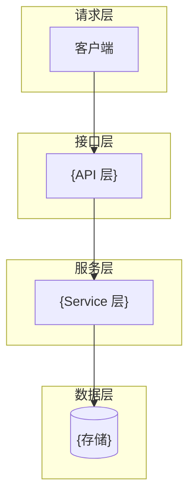
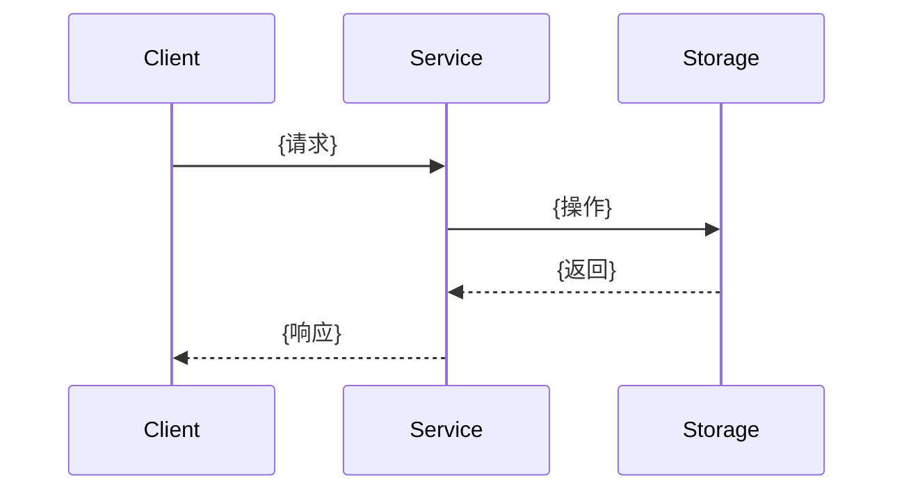

# {模块名称} — 详细设计文档

## 文档信息

| 项目 | 内容 |
|------|------|
| 所属服务 | {service-name} |
| 需求文档 | {需求文档路径}（REQ-{XX}01 ~ REQ-{XX}NN） |
| Schema 文档 | {02_schema/ 下文件路径；无则写"无"} |
| 接口/管道文档 | {03_api/ 或 03_pipeline/ 下文件路径；无则写"无"} |
| 设计日期 | {YYYY-MM-DD} |
| 版本 | v1.0 |

> 本文档**引用**Schema 与接口/管道文档，不重复其中的 DDL、字段清单、接口参数/响应/错误码。

---

## §1 设计决策表

> 只记技术设计层面的决策；Schema、接口/管道的决策已记在对应文档的「设计决策」表，此处不重复。
> 达到 ADR 门槛的决策在 ADR 列填编号，背景与备选方案见 ADR 正文，此处只写一句理由。

| 决策项 | 决策 | 理由 | ADR |
|--------|------|------|-----|
| {决策项} | {决策内容} | {为什么} | {ADR-N 或 —} |

---

## §2 系统架构图

<!-- TECH_SPECIFIC: 根据 Workbench 技术栈生成本 Workbench 在整体架构中的位置与组件关系 -->



<!-- /TECH_SPECIFIC -->

---

## §3 代码结构变更

<!-- TECH_SPECIFIC: 按本 Workbench 的分层 / Job / 组件粒度组织 -->

| 代码单元 | 路径 | 操作 | 职责 | 关联需求 |
|---------|------|------|------|---------|
| {类/模块/Job/组件} | {路径} | 新增/修改 | {职责} | REQ-{XX}01 |

<!-- /TECH_SPECIFIC -->

---

## §4 数据模型分析

> 表结构 / 字段定义见 Schema 文档，此处不重复；只补充关系、数据流向与查询模式。

- **实体关系**：{关系说明，必要时附 erDiagram}
- **数据流向**：{数据从哪里产生、经过哪些单元、写到哪里}
- **查询模式**：{主要查询及其使用的索引 / 分区}

---

## §5 核心业务流程

> 按需保留下列图示，不适用的删除。

```mermaid
flowchart TD
    A[{步骤1}] --> B{条件判断}
    B -->|{分支1}| C[{步骤2}]
    B -->|{分支2}| D[{步骤3}]
```

**状态机（如适用）**

```mermaid
stateDiagram-v2
    [*] --> {状态1}: {触发事件}
    {状态1} --> {状态2}: {触发事件}
```

| 当前状态 | 事件 | 目标状态 | 前置校验 | 后置动作 |
|---------|------|---------|---------|---------|
| {状态} | {事件} | {状态} | {校验} | {动作} |

**时序图（如适用）**



---

## §6 组件与实现设计

> 写各代码单元的内部实现要点。对外接口/管道契约（参数、响应、错误码）见接口/管道文档，此处只引用接口编号。

| 代码单元 | 实现要点（职责边界 / 关键逻辑 / 事务 / 幂等 / 并发） | 关联接口 / 需求 |
|---------|--------------------------------------------------|---------------|
| {单元} | {要点} | {接口编号} / REQ-{XX}01 |

---

## §7 错误处理设计

> 接口错误码清单见接口/管道文档，此处只写异常分类与处理策略。

- 业务异常：{项目的统一业务异常处理方式}
- 参数校验异常：{项目的参数校验失败处理方式}
- 系统异常：{兜底异常处理方式}

---

## §8 设计追溯矩阵

| 设计产物 | 对应需求 |
|---------|---------|
| {表/接口/组件} | REQ-{XX}01 |

---

## §9 测试策略

| 测试层级 | 测试对象 / 场景 | 测试重点 |
|---------|----------------|---------|
| 单元测试 | {Service/组件} | {重点} |
| 集成测试 | {场景} | {验证点} |
