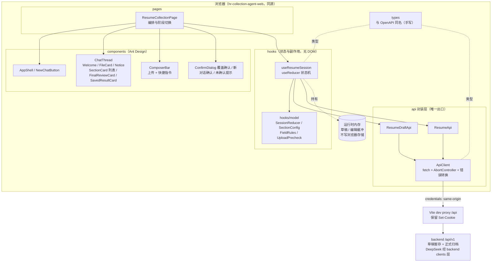
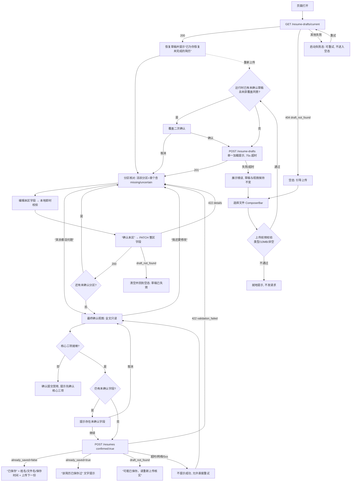
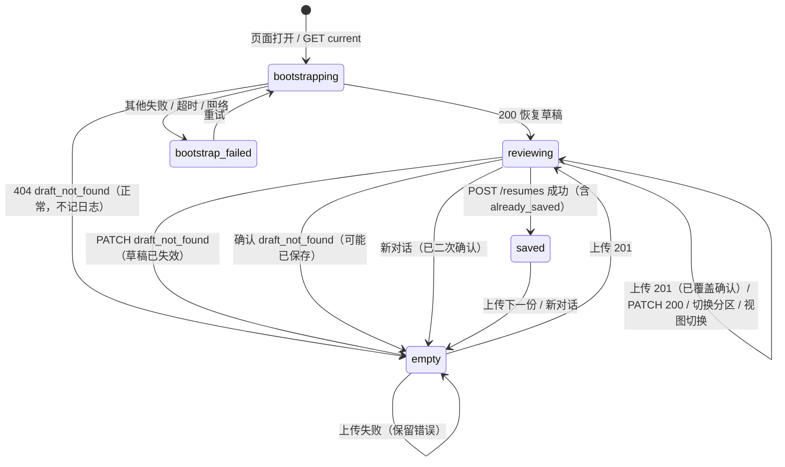
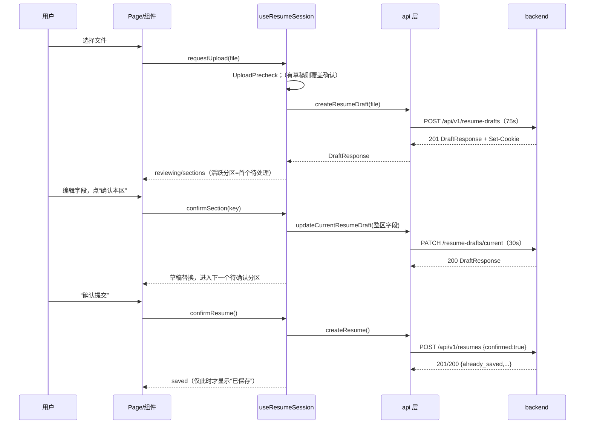

# 简历信息收集 — 详细设计文档（Frontend）

## 文档信息

| 项目 | 内容 |
|------|------|
| 所属服务 | hr-collection-agent-web（frontend Workbench） |
| 需求文档 | `frontend-docs/HR_PR-1/01_requirements/requirements.md`（REQ-FE-01 ~ REQ-FE-06，共 33 条验收标准） |
| Schema 文档 | 无（frontend 无数据存储职责，Step 2.1 跳过；浏览器不持久化简历内容，F-02） |
| 接口/管道文档 | `frontend-docs/HR_PR-1/03_api/interface_spec_resume.md`（接口消费规范）；契约来源 `backend-docs/HR_PR-1/03_api/openapi.yaml`（**0.1.1**，已含 G-01 / G-02 / CR-01 / CR-01a） |
| 输入裁决 | `01-requirements/HR_PR-1/prototype-review.md`（P-01..P-11）、`cross-workbench-review.md`（C/D/O/G/F）；原型 `global-info/prototype/`（仅作页面结构与交互参考，视觉参考 `style.css`） |
| 设计日期 | 2026-11-10 |
| 版本 | v1.2（已通过技术设计确认；对齐 OpenAPI 0.1.1；§4.4 补充空子项处理） |

> 本文档**引用**接口消费规范与 OpenAPI，不重复其中的字段清单、接口参数、响应与错误码表。
> 原型是参考，**与评审裁决冲突处以裁决为准**；设计中凡需改需求或契约之处，一律列在 §10「申请与待确认」，不自行修改。
> REQ-FE-03.1 将由主 agent 按 P-04 做澄清修订（由“逐项提问”改为“分区整区核对”）；本设计按 P-04 实现，§8 追溯矩阵对该条的映射以修订后的含义为准。

## 变更履历

| 版本 | 日期 | 变更（delta） | 驱动 |
|------|------|--------------|------|
| v1.0 | 2026-11-10 | 初始版本 | Step 3 |
| v1.1 | 2026-11-10 | ① 契约版本对齐 OpenAPI 0.1.1：邮箱 pattern + maxLength 254、手机号 maxLength 32（针对提交原值）、其余字段长度 / 条数上限填入 `FIELD_MAX_LENGTH`（§6.1，数值全部取自 OpenAPI，不自定）；② TD-07、§3.3 / §6 FieldRules、§8 REQ-FE-03.5 / 06.5、§9 `FieldRules` 用例同步；③ §10 申请项与 Q-DL 全部标记已裁决；④ ADR-006 状态 ACCEPTED（§11.1） | DL 通过技术设计确认；OpenAPI 0.1.1；CR-01 / CR-01a 裁决 |
| v1.2 | 2026-11-10 | §4.4 补充：提交分区时丢弃“完全为空”的新增子项（全空则提交 `[]`），校验错误仍按用户所见下标报告（实现偏差，第二批审查 DL 裁决接受） | 任务 2.5 偏差 ③；第二批审查 |

---

## §1 设计决策表

> 只记技术设计层面的决策；接口消费决策 DD-01..DD-11 已记在 `interface_spec_resume.md` §六，此处沿用不重复，编号接续为 TD-xx。

| 编号 | 决策项 | 决策 | 理由 | ADR |
|------|--------|------|------|-----|
| TD-01 | 校对交互模型 | 简历按 11 个分区（见 §4.2）整区核对。分区卡片内字段**就地结构化编辑**，点“确认本区”时对该分区的全部字段提交**一次** PATCH。输入框区域只承载上传与快捷指令，**不解析自由文本** | P-01 选 A（保持 C-03）；P-04 分区核对；O-11 要求列表整块提交，整区一次 PATCH 与之天然一致，并让“确认”以分区为单位 | ADR-006 |
| TD-02 | 会话状态管理 | 单一 `useReducer` 会话状态机（`useResumeSession`），状态仅存运行时内存；不引入状态库，不使用路由库（单页） | 项目约束（useState/useReducer）；流程是有限状态且转移受 backend 响应驱动，reducer 便于测试；单页无路由需求 | — |
| TD-03 | 未提交编辑缓冲 | 分区内的编辑暂存在会话状态的 `editBuffer`（内存），**只有 PATCH 成功后才进入权威草稿**；刷新页面即丢失未提交编辑，不落任何浏览器存储 | F-02；backend 为唯一数据权威（草稿以服务端为准）；POC 不为未提交输入做本地持久化 | — |
| TD-04 | 请求并发与过期响应 | 同一时刻只允许一个在途的上传 / PATCH / 确认请求（`busy` 标记，其余入口禁用）；每次“新对话”、重新上传、草稿失效递增 `epoch`，旧响应到达时按 epoch 丢弃 | 落实 DD-07；PATCH 响应整体替换草稿，并发会让旧响应覆盖新状态；禁用入口使“排队”变为“不可触发”，实现更简单 | — |
| TD-05 | 忙碌态与取消 | 忙碌期间“新对话”、上传入口、确认类按钮均禁用；不提供请求取消按钮（超时由 `AbortController` 结束） | 防重复提交（REQ-FE-01.3、04.8）；上传最长 75 秒，取消后 backend 是否已处理不可知，取消会制造歧义 | — |
| TD-06 | 业务规则存放 | 分区配置、字段规则（手机号 / 邮箱 / 上传预校验）、reducer 放在 `src/hooks/model/` 下的纯 TS 模块（PascalCase 文件名），不依赖 DOM；组件只消费结果 | 分层红线：组件不持有业务规则，hook 层不操作 DOM；`src` 仅限 5 个目录，不新增目录（若需新增见 §10 Q-DL-02） | — |
| TD-07 | 校验规则单一来源 | 手机号 pattern、邮箱 pattern 与 `maxLength` 以 OpenAPI 为准，在 `FieldRules.ts` 集中为常量并注明 OpenAPI 版本；字段长度 / 条数上限集中在 `FIELD_MAX_LENGTH` 表（数值全部取自 OpenAPI 0.1.1，见 §6.1，不自定），前端即时提示 `too_long`，422 `too_long` 兜底 | G-01、G-02 裁决；CR-01 待 DL 裁决，设计不自定数值 | — |
| TD-08 | 静态外壳 | 页面外壳只含产品标题与“＋ 新对话”入口；**不显示用户头像/姓名、历史会话列表**，也不提供静态占位的假历史 | P-02：无登录与账号；静态占位也会带来“可点击却无功能”的误导，选“去掉”而非“静态固定内容” | — |
| TD-09 | 输入区形态 | 底部为 `ComposerBar`：📎 上传按钮 + 拖拽区 + 快捷指令芯片（“确认无误”“其余都没问题”“确认提交”等，随阶段变化）；**无文本输入框** | P-01 选 A：输入框只用于上传和快捷指令；去掉文本框可避免用户以为可输入自然语言 | ADR-006 |
| TD-10 | 加载提示 | 上传时显示单一 `UploadProgressNotice`（“正在识别，最长约 1 分钟”），不分步骤、不显示耗时 | P-05；backend 同步接口无进度事件 | — |
| TD-11 | 保存后展示 | 保存成功卡只显示姓名、原始文件名、保存时间；清空其余简历内容。保存卡所需三项从“提交前一刻的草稿”摘出，存入 `savedSummary`，不含手机号与邮箱 | P-09（不显示记录编号）与 REQ-FE-04.4（清空运行时简历内容）的折中，见 §10 Q-DL-03 | — |
| TD-12 | “新对话”与服务端草稿 | 有未确认草稿或未提交编辑时，先二次确认；确认后清空界面但**不删除服务端草稿**（无丢弃接口）。确认框文案明示：刷新页面会恢复该草稿，再次上传会覆盖它；已在此确认框得到覆盖同意，后续首次上传不再重复弹覆盖确认 | P-08、C-07、ADR-003 | — |
| TD-13 | 兼容性与无障碍范围 | 浏览器：Chrome / Edge / Safari / Firefox 的最近两个主版本；窗口宽度 ≥ 360px，< 860px 时外壳折叠为顶栏。无障碍：键盘可达、`aria-live` 播报加载 / 错误 / 保存结果、状态用“文字 + 颜色”双通道、跨分区推进后焦点移到新分区标题 | 补齐影响分析遗留的“无障碍 / 兼容范围”；采用 Ant Design 自带语义与键盘支持，不做额外定制 | — |
| TD-14 | 视觉 | 采用原型 `style.css` 的配色（`--navy` `--blue` `--warn` `--ok` 等）作为 Ant Design `ConfigProvider` 主题 token；不引入原型的自写组件样式 | 参考原型视觉，组件使用 Ant Design | — |
| TD-15 | 超长/空白输入 | 文本输入前后 trim 后再提交；全空白视同空（核心三项不可为空，其余提交 `null`） | 与 OpenAPI 对核心字段的“全空白按 required 拒绝”一致，减少无意义 422 | — |

> ADR 扫描（draft-adr）结果见 §11：TD-01 / TD-09 合并为 ADR-006；其余未达门槛，只留在本表。

---

## §2 系统架构图



> 说明：前端不直连模型或存储（F-01）；`draft_token` 为 HttpOnly Cookie，前端不读取、不存储（C-06，F-02）。依赖方向：pages → components / hooks → api → types；components 不得依赖 api。

---

## §3 代码结构变更

> 仓库为新项目，全部为**新增**。文件名按仓库约定使用 PascalCase；注释使用英文；类型以接口契约命名。路径相对 `codes/hr-collection-agent-frontend/`。

### 3.1 types（`src/types/`）— 与 OpenAPI 同名，手写（F-02），文件头注明对应的 OpenAPI 版本

| 代码单元 | 路径 | 操作 | 职责 | 关联需求 |
|---------|------|------|------|---------|
| ResumeModel | `src/types/ResumeModel.ts` | 新增 | `FieldStatus`、`StringField` / `StringListField` 及三个经历列表字段、`WorkExperience` / `ProjectExperience` / `Education`、`ResumeFields`（22 字段）、`ResumeFieldsUpdate` | REQ-FE-02、03、06.5 |
| Draft | `src/types/Draft.ts` | 新增 | `OriginalFileInfo`、`DraftResponse`、`DraftUpdateRequest` | REQ-FE-02、05 |
| Resume | `src/types/Resume.ts` | 新增 | `CreateResumeRequest`、`CreateResumeResponse` | REQ-FE-04 |
| Errors | `src/types/Errors.ts` | 新增 | `ErrorCode`（13 值）、`ErrorDetail`、`ErrorResponse`；前端自有码 `ClientErrorCode = 'client_timeout' \| 'network_error' \| 'unknown_error'`（不混入契约枚举，F-05） | REQ-FE-06.4 |

### 3.2 api（`src/api/`）— 唯一的 backend 访问出口

| 代码单元 | 路径 | 操作 | 职责 | 关联需求 |
|---------|------|------|------|---------|
| ApiError | `src/api/ApiError.ts` | 新增 | `ApiError` 类：`status`、`code`（契约码或前端自有码）、`message`、`request_id`、可选 `details`；工厂：由响应体、超时、网络失败、非 JSON 响应构造 | REQ-FE-06.4、01.6 |
| ApiClient | `src/api/ApiClient.ts` | 新增 | 基于 fetch 的底层请求：前缀 `/api/v1`、`credentials: 'same-origin'`、JSON / FormData、`AbortController` 超时（上传 75s，其余 30s）、统一错误转换；日志只允许 `request_id`、`code`、HTTP 状态 | REQ-FE-06.1、06.3、06.4、01.4 |
| ResumeDraftApi | `src/api/ResumeDraftApi.ts` | 新增 | `createResumeDraft(file)`、`getCurrentResumeDraft()`（404 返回 `null`，O-12）、`updateCurrentResumeDraft(fields)` | REQ-FE-01、03、05 |
| ResumeApi | `src/api/ResumeApi.ts` | 新增 | `createResume()`（请求体固定 `{confirmed: true}`） | REQ-FE-04 |

### 3.3 hooks（`src/hooks/`）

| 代码单元 | 路径 | 操作 | 职责 | 关联需求 |
|---------|------|------|------|---------|
| useResumeSession | `src/hooks/useResumeSession.ts` | 新增 | 持有会话 reducer；暴露状态与动作：`bootstrap`、`retryBootstrap`、`requestUpload`、`confirmOverwriteAndUpload`、`editField`、`confirmSection`、`goFinal`、`backToSections`、`confirmResume`、`requestNewChat`、`confirmNewChat`、`resetAfterSaved`；调用 api 层；按 epoch 丢弃过期响应 | REQ-FE-01..05 |
| useChatScroll | `src/hooks/useChatScroll.ts` | 新增 | 阶段变化 / 新内容后滚动与焦点移动的**请求信号**（返回需要聚焦的区块 key；真正的 DOM 操作由组件完成，hook 不触碰 DOM 样式） | TD-13 |
| SessionReducer | `src/hooks/model/SessionReducer.ts` | 新增 | 纯函数 reducer 与状态类型（§5.2）；全部状态转移集中于此 | REQ-FE-01..05 |
| SectionConfig | `src/hooks/model/SectionConfig.ts` | 新增 | 11 个分区的有序配置：key、标题、所含字段、字段控件类型、是否含核心字段（§4.2）；子项字段配置（工作 / 项目 / 教育） | REQ-FE-02.1、03.3 |
| FieldRules | `src/hooks/model/FieldRules.ts` | 新增 | 手机号规范化（去空格与连字符）与 pattern；邮箱 pattern 与 `maxLength 254`（0.1.1）；核心三项非空；`FIELD_MAX_LENGTH` 上限表（0.1.1，§6.1）；`reason` → 文案映射；字段路径 `work_experiences[0].start_date` 解析 | REQ-FE-03.4、03.5、03.6 |
| UploadPrecheck | `src/hooks/model/UploadPrecheck.ts` | 新增 | 上传前预校验：单文件、扩展名（大小写不敏感）、MIME、≤ 10485760 字节、非空；返回可展示的拒绝原因 | REQ-FE-01.1、01.2 |
| SectionView | `src/hooks/model/SectionView.ts` | 新增 | 由草稿 + 编辑缓冲派生视图数据：各分区状态汇总（含 `missing` / `uncertain` 计数）、核心三项是否齐全且合法且已确认、是否存在未确认字段、是否存在未提交编辑 | REQ-FE-02.2、04.1、04.2 |

### 3.4 components（`src/components/`，Ant Design）

| 代码单元 | 路径 | 操作 | 职责 | 关联需求 |
|---------|------|------|------|---------|
| AppShell | `src/components/AppShell.tsx` | 新增 | 外壳：顶栏（Logo + 产品名）、左侧窄栏（仅“＋ 新对话”）、主区；< 860px 折叠左栏为顶栏按钮；无用户信息、无历史列表 | P-02、P-08、P-11 |
| NewChatButton | `src/components/NewChatButton.tsx` | 新增 | “＋ 新对话”；忙碌态禁用 | P-08 |
| ChatThread | `src/components/ChatThread.tsx` | 新增 | 对话滚动容器与 AI / 用户消息气泡布局；`aria-live` 区域 | TD-13 |
| WelcomePanel | `src/components/WelcomePanel.tsx` | 新增 | 空态：说明与“上传简历”引导（含 draft_not_found 提示位）；不含示例文件按钮、填写指南、隐私说明 | REQ-FE-05.3、P-11 |
| NoticeBanner | `src/components/NoticeBanner.tsx` | 新增 | 页面级提示：已恢复草稿、草稿已失效、可能已保存请核实、已保存过等（按 `notice.kind` 渲染 Ant Design `Alert`） | REQ-FE-04.5、04.7、05.2 |
| BootstrapErrorPanel | `src/components/BootstrapErrorPanel.tsx` | 新增 | 启动失败态：错误文案 + “重试”；不展示上传入口为主操作，避免覆盖真实草稿 | F-03（裁决）、REQ-FE-05 |
| FileCard | `src/components/FileCard.tsx` | 新增 | 展示文件类型图标、文件名、大小（用户消息气泡 / 已保存卡） | REQ-FE-01 |
| UploadProgressNotice | `src/components/UploadProgressNotice.tsx` | 新增 | 单一加载提示（Spin + 固定文案），`aria-live="polite"` | REQ-FE-01.3、P-05 |
| ErrorAlert | `src/components/ErrorAlert.tsx` | 新增 | 把 `ApiError` 展示为可读错误：契约错误只展示 `message`；前端自有码用固定文案；附 `request_id` 供排查 | REQ-FE-01.6、06.4 |
| ReviewSummary | `src/components/ReviewSummary.tsx` | 新增 | 识别 / 恢复完成后的概览：各状态字段计数、待处理分区跳转芯片 | REQ-FE-02.2 |
| SectionCard | `src/components/SectionCard.tsx` | 新增 | 分区卡：标题、分区状态标签、字段列表（只读或编辑态）、分区错误、“确认本区”按钮；活跃分区为编辑态，其余为只读紧凑态并带“修改”入口 | REQ-FE-02.1、03.2 |
| FieldRow | `src/components/FieldRow.tsx` | 新增 | 单个标量字段：标签、值（`Input` / `Input.TextArea`）、`FieldStatusTag`、就地校验提示、字段级后端错误 | REQ-FE-02.2、03.5、03.6 |
| FieldStatusTag | `src/components/FieldStatusTag.tsx` | 新增 | 四种状态标签：待确认 / 不确定、请确认（黄）/ 待补充 / 已确认（绿）；文字与颜色并用 | REQ-FE-02.2、02.3 |
| StringListEditor | `src/components/StringListEditor.tsx` | 新增 | 文本列表（个人优势、专业技能、证书与荣誉、语言能力）的新增 / 修改 / 删除 | REQ-FE-03.3 |
| ObjectListEditor | `src/components/ObjectListEditor.tsx` | 新增 | 经历类列表（工作 / 项目 / 教育）的多条子项新增 / 修改 / 删除；子项字段由 `SectionConfig` 驱动；工作经历子项含两个文本列表（职责、业绩） | REQ-FE-03.3 |
| ReadOnlySection | `src/components/ReadOnlySection.tsx` | 新增 | 分区的只读渲染（供非活跃分区与最终确认复用） | REQ-FE-02.1 |
| FinalReviewCard | `src/components/FinalReviewCard.tsx` | 新增 | 最终版本全文（只读）、未确认字段提示、“确认提交”“我还要修改”按钮 | REQ-FE-04.1、04.2、04.8 |
| SavedResultCard | `src/components/SavedResultCard.tsx` | 新增 | 保存成功卡（姓名、原始文件名、保存时间）或“该简历已保存过”文字；“上传下一份”按钮 | REQ-FE-04.3..04.5 |
| ComposerBar | `src/components/ComposerBar.tsx` | 新增 | 底部输入区：📎 上传（`<input type="file" accept>`）、拖拽区、`QuickReplyChips`、底部免责提示（“内容由 AI 识别，可能有误，请逐项核对”）；忙碌态禁用 | REQ-FE-01.1、01.3 |
| QuickReplyChips | `src/components/QuickReplyChips.tsx` | 新增 | 快捷指令芯片，只触发预定义动作，不接收自由文本 | TD-09 |
| ConfirmDialog | `src/components/ConfirmDialog.tsx` | 新增 | 通用二次确认（Ant Design `Modal`）：重新上传覆盖、新对话、存在未确认字段的最终确认、存在未提交编辑 | REQ-FE-01.5、04.2、P-08 |

### 3.5 pages 与入口

| 代码单元 | 路径 | 操作 | 职责 | 关联需求 |
|---------|------|------|------|---------|
| ResumeCollectionPage | `src/pages/ResumeCollectionPage.tsx` | 新增 | 页面编排：挂载时调用 `bootstrap`；按 `phase` / `view` 选择渲染内容；把 hook 状态与动作分发给组件；不直接请求接口 | REQ-FE-01..05 |
| App / main | `src/App.tsx`、`src/main.tsx` | 新增 | 应用入口、Ant Design `ConfigProvider`（主题 token，TD-14）、错误边界 | REQ-FE-06 |
| ErrorBoundary | `src/components/ErrorBoundary.tsx` | 新增 | 渲染异常兜底；展示通用文案，不输出简历内容（B-03） | REQ-FE-06.3 |
| Vite 配置 | `vite.config.ts` | 新增 | `server.proxy['/api']` 指向 `http://127.0.0.1:8000`；不设 `cookieDomainRewrite` / `cookiePathRewrite`；不设短于 75 秒的代理超时 | REQ-FE-05.1（C-06） |

### 3.6 组件树

```text
App (ConfigProvider, ErrorBoundary)
└─ ResumeCollectionPage
   ├─ AppShell
   │  └─ NewChatButton
   ├─ ChatThread
   │  ├─ [phase=bootstrapping]      UploadProgressNotice(“正在读取草稿…”)
   │  ├─ [phase=bootstrap_failed]   BootstrapErrorPanel → ErrorAlert
   │  ├─ [phase=empty]              WelcomePanel + NoticeBanner(失效/请核实) + ErrorAlert(上一次上传失败)
   │  ├─ [phase=reviewing, view=sections]
   │  │     FileCard · NoticeBanner(已恢复) · ReviewSummary
   │  │     └─ SectionCard ×11 (活跃=编辑；其余=ReadOnlySection)
   │  │           ├─ FieldRow ×n · FieldStatusTag
   │  │           ├─ StringListEditor
   │  │           └─ ObjectListEditor
   │  ├─ [phase=reviewing, view=final] FinalReviewCard (ReadOnlySection ×11)
   │  ├─ [busy=upload|save]         UploadProgressNotice / 提交中提示
   │  └─ [phase=saved]              SavedResultCard
   ├─ ComposerBar
   │  └─ QuickReplyChips
   └─ ConfirmDialog (覆盖 / 新对话 / 未确认提示 / 未提交编辑)
```

---

## §4 数据模型分析

> 字段、类型、枚举见 OpenAPI 与 `interface_spec_resume.md` §四，此处不重复；只补充分区映射、状态派生和数据流向。前端无存储，`has_storage = false`。

### 4.1 数据流向

```text
上传文件(File) ──multipart──▶ POST /resume-drafts ──201 DraftResponse──┐
页面打开 ──────────────────▶ GET  /resume-drafts/current ─200──────────┤
                                                                        ▼
                                              session.draft（权威草稿，运行时内存）
                                                        ▲        │ 派生
 分区“确认本区” ─ PATCH(整区字段) ─ 200 DraftResponse ───┘        ▼
                                                      SectionView（分区状态汇总 / 核心三项就绪 / 未确认计数）
 用户编辑 ──▶ session.editBuffer（未提交，内存）──覆盖显示──▶ 组件
 最终确认 ─ POST /resumes{confirmed:true} ─▶ 200/201 ─▶ savedSummary（姓名/文件名/保存时间）+ 清空 draft / editBuffer
```

- **权威来源**：`session.draft` 只由 backend 响应整体替换（上传、恢复、PATCH 成功）；前端不自行推断或改写字段状态，不补全任何值（REQ-FE-02.3）。
- **显示值** = `editBuffer[field]`（若存在）否则 `draft.fields[field].value`；状态标签始终取自 `draft`，另以“未提交修改”小标记提示缓冲存在，**不是**第五种字段状态。
- **不持久化**：`draft`、`editBuffer`、`pendingFile`、`savedSummary` 仅在 React 状态中；不使用 localStorage / sessionStorage / IndexedDB；`resume_id`、`draft_id` 不写入任何存储（F-02）。

### 4.2 22 个字段 → 11 个分区（P-04）

> 依据 `global-info/简历模板.md` 与 OpenAPI `ResumeFields` 的 22 个键；顺序固定，核心三项所在分区排第一。语言能力按 C-14 独立成区，补齐原型缺少的个人主页、性别、政治面貌、个人优势、自我评价。

| # | 分区 key | 标题 | 包含字段（OpenAPI 键） | 字段数 | 控件 | 含核心字段 |
|---|---|---|---|:--:|---|:--:|
| 1 | `basic` | 基本信息 | `name`、`phone`、`email`、`homepage` | 4 | 单行输入 | 是（三项） |
| 2 | `intent` | 求职意向 | `job_title`、`expected_city`、`expected_salary`、`available_time` | 4 | 单行输入 | 否 |
| 3 | `personal` | 个人信息 | `gender`、`birth_month`、`political_status`、`current_city`、`work_years`、`highest_education` | 6 | 单行输入 | 否 |
| 4 | `strengths` | 个人优势 | `strengths` | 1 | 文本列表 | 否 |
| 5 | `work` | 工作经历 | `work_experiences` | 1 | 多条子项（含职责 / 业绩两个文本列表） | 否 |
| 6 | `project` | 项目经历 | `project_experiences` | 1 | 多条子项 | 否 |
| 7 | `education` | 教育背景 | `educations` | 1 | 多条子项（含在校荣誉） | 否 |
| 8 | `skills` | 专业技能 | `skills` | 1 | 文本列表 | 否 |
| 9 | `certificates` | 证书与荣誉 | `certificates_honors` | 1 | 文本列表 | 否 |
| 10 | `languages` | 语言能力 | `languages` | 1 | 文本列表 | 否 |
| 11 | `self_evaluation` | 自我评价 | `self_evaluation` | 1 | 多行输入 | 否 |
| | | | **合计** | **22** | | |

### 4.3 状态映射与派生

| 来源 | 展示（REQ-FE-02.2） | 颜色 / 图标（文字始终同时出现） | 说明 |
|---|---|---|---|
| `recognized` | 待确认 | 蓝 | 不当作已确认（B-04） |
| `uncertain` | 不确定、请确认 | 黄（`--warn`） | 在分区内置顶高亮 |
| `missing` | 待补充 | 红 / 灰边框 | 值为 `null` / `[]`；置顶高亮 |
| `confirmed` | 已确认 | 绿（`--ok`） | |

- **分区状态**（徽标与跳转芯片用）：取该分区所有字段中优先级最高者：`missing` > `uncertain` > `recognized` > `confirmed`。
- **分区内排序**：同一分区内，`missing` / `uncertain` 字段排在前并高亮，其余保持固定顺序（P-04 “突出 missing / uncertain”）；列表类分区为单字段，高亮整块。
- **进入哪个分区**：上传 / 恢复成功后，活跃分区 = 第一个含 `missing` 或 `uncertain` 的分区；没有则第一个含 `recognized` 的分区；全部 `confirmed` 则直接进入最终确认视图。
- **核心三项就绪** = `name`、`phone`、`email` 的草稿状态均为 `confirmed` 且值通过 `FieldRules` 校验（REQ-FE-04.1）。
- **未确认字段数** = 草稿中状态非 `confirmed` 的字段数（REQ-FE-04.2）。

### 4.4 提交体构造（引用 OpenAPI `ResumeFieldsUpdate` 语义）

`confirmSection(key)` 对该分区**每一个字段**生成提交值：取 `editBuffer` 中的值，否则取草稿当前值（`missing` 标量为 `null`、列表为 `[]`，即“确认留空”）；手机号先去空格与连字符（G-02）；文本前后 trim，全空白标量提交 `null`（核心三项除外，核心三项空白在本地被拦截）。列表字段一律提交**完整新列表**（O-11）；子项没有 id，错误路径中的下标映射到界面中的同一行（用户编辑期间不重排，保证下标稳定）。

**空子项处理（v1.2）**：用户点“添加一条”后没有填写任何内容的子项（所有字符串为空 / `null`、所有子列表为空）不进入提交体；若整个列表因此为空，则提交 `[]`，即“确认留空”。文本前后先 trim，子项内的空白字符串转为 `null`，子列表中的空白行丢弃。本地校验在丢弃空子项**之前**按用户所见下标进行，所以字段错误（如 `educations[1].school`）始终指向界面上的同一行。文本列表（个人优势等）同样丢弃空白行，其错误下标指向清理后的列表。

---

## §5 核心业务流程

### 5.1 总体流程：上传 → 识别 → 分区核对 → 最终确认 → 结果



### 5.2 会话状态

```text
SessionState
  phase:  bootstrapping | bootstrap_failed | empty | reviewing | saved
  view:   sections | final                         （仅 phase=reviewing 有意义）
  busy:   null | upload | patch | confirm          （同一时刻至多一个在途请求）
  epoch:  number                                    （重置 / 失效时递增，丢弃过期响应）
  draft:  DraftResponse | null
  restored: boolean                                 （本次草稿是否来自恢复）
  activeSection: SectionKey
  editBuffer: Partial<ResumeFieldsUpdate>           （未提交编辑，内存）
  fieldErrors: Record<fieldPath, ErrorReason>       （来自 422 details 或本地校验）
  notice: { kind: 'restored' | 'draft_expired' | 'maybe_saved' | 'already_saved' } | null
  error:  { scope: 'bootstrap' | 'upload' | 'section' | 'confirm', cause: ApiError | LocalError } | null
  pendingFile: File | null                          （等待覆盖确认的文件）
  overwriteAcknowledged: boolean                    （新对话已得到覆盖同意）
  savedSummary: { name, filename, saved_at } | null
  dialog: null | 'overwrite' | 'new_chat' | 'unconfirmed' | 'unsubmitted_edits'
```



### 5.3 状态转移表

| 当前状态 | 事件 | 目标状态 | 前置校验 | 后置动作 |
|---------|------|---------|---------|---------|
| — | 页面挂载 | `bootstrapping` | — | 调 `getCurrentResumeDraft`（30s） |
| `bootstrapping` | GET 200 | `reviewing / sections` | — | `draft` 替换；`restored=true`；`notice=restored`；选活跃分区（§4.3）；全部 `confirmed` 则 `view=final` |
| `bootstrapping` | GET 404 | `empty` | — | `draft=null`；无错误、不记日志（O-12） |
| `bootstrapping` | GET 其他失败 | `bootstrap_failed` | — | `error{scope:bootstrap}`；上传入口禁用，仅“重试”（裁决 F-03） |
| `empty` / `reviewing` | 选择文件（📎 / 拖拽） | 不变 | `UploadPrecheck` 通过；`busy=null` | 不通过：`error{scope:upload, local}`，不发请求 |
| `reviewing`（`draft≠null` 且 `!overwriteAcknowledged`） | 预校验通过 | 不变 | — | `pendingFile=file`；`dialog=overwrite`（REQ-FE-01.5） |
| `reviewing` | 覆盖确认“继续” | 不变 | — | `busy=upload`；调 `createResumeDraft(pendingFile)`（75s） |
| `empty` / `reviewing`（已同意覆盖） | 预校验通过 | 不变 | — | `busy=upload`；调 `createResumeDraft`；显示单一加载提示 |
| 任意 + `busy=upload` | 201 | `reviewing / sections` | epoch 一致 | 草稿替换；`restored=false`；清空 `editBuffer` / `fieldErrors` / `notice` / `error` / `overwriteAcknowledged`；选活跃分区 |
| 任意 + `busy=upload` | 失败 / `client_timeout` | 不变（**保留原草稿与视图**，O-02） | — | `busy=null`；`error{scope:upload}`；超时文案“请重新上传”（REQ-FE-01.4） |
| `reviewing/sections` | 编辑字段 | 不变 | — | `editBuffer` 更新；清除该字段 `fieldErrors`；本地即时校验（手机号 / 邮箱 / 核心非空） |
| `reviewing/sections` | 点“确认本区”（或快捷指令“确认无误”） | 不变 | `busy=null`；本区本地校验通过；本区有可确认内容（核心字段非空） | `busy=patch`；调 `updateCurrentResumeDraft(整区字段)`（30s） |
| 任意 + `busy=patch` | 200 | `reviewing` | epoch 一致 | `draft` 替换；清除本区缓冲；活跃分区 → 下一个非 `confirmed` 分区；无则 `view=final` |
| 任意 + `busy=patch` | 422 `validation_failed` | 不变 | — | `fieldErrors` ← `details`；保留缓冲；`error{scope:section}` 通用文案 |
| 任意 + `busy=patch` | `draft_not_found` | `empty` | — | 清空草稿与缓冲；`notice=draft_expired`（“草稿已失效，请重新上传简历”，O-10） |
| 任意 + `busy=patch` | 其他失败 / 超时 | 不变 | — | 保留缓冲与视图；本区显示错误，可重试 |
| `reviewing/sections` | “其余都没问题” / 全部已确认 | `reviewing/final` | 无未提交编辑；否则 `dialog=unsubmitted_edits`（“放弃修改并继续”“返回”） | `view=final` |
| `reviewing/final` | “我还要修改” | `reviewing/sections` | — | `view=sections`，活跃分区 = 首个非 `confirmed` 分区或第 1 区 |
| `reviewing/final` | 点“确认提交” | 不变 | 核心三项就绪；`busy=null`；无未提交编辑 | 有未确认字段：`dialog=unconfirmed`；否则直接 `busy=confirm` 发送 |
| `reviewing/final` + `dialog=unconfirmed` | “继续确认” | 不变 | — | `busy=confirm`；调 `createResume()`（30s）；视为确认当前显示的全部内容（D-03） |
| 任意 + `busy=confirm` | 成功 `already_saved=false` | `saved` | epoch 一致 | `savedSummary`←姓名 / 文件名 / `saved_at`；清空 `draft` / `editBuffer`（REQ-FE-04.3、04.4） |
| 任意 + `busy=confirm` | 成功 `already_saved=true` | `saved` | — | `notice=already_saved`；`savedSummary=null`；清空 `draft` / `editBuffer` |
| 任意 + `busy=confirm` | `draft_not_found` | `empty` | — | `notice=maybe_saved`（“可能已保存，请重新上传核实”）；清空 `draft`；**不显示成功**（D-01、O-10） |
| 任意 + `busy=confirm` | 422 `validation_failed` | `reviewing/sections` | — | `fieldErrors` ← `details`；活跃分区 = 首个出错字段所在分区 |
| 任意 + `busy=confirm` | 超时 / 网络 / 5xx / `save_failed` / `confirmation_required` / `unknown_error` | 不变（`final`） | — | `busy=null`；`error{scope:confirm}`；**不提示成功**；确认按钮可立即重试；不查询保存状态（C-05） |
| `reviewing`（`draft≠null` 或有缓冲） | 点“＋ 新对话” | 不变 | `busy=null` | `dialog=new_chat` |
| `new_chat` 对话框 | “继续” | `empty` | — | epoch++；清空 `draft` / `editBuffer` / `error`；`overwriteAcknowledged=true`（TD-12） |
| `empty` / `saved` | 点“＋ 新对话” / “上传下一份” | `empty` | — | 无需确认（无草稿）；清空 `savedSummary` / `notice` |

### 5.4 时序：上传 → 分区确认 → 最终确认（正常流）



---

## §6 组件与实现设计

> 对外接口契约（参数、响应、错误码）见 `interface_spec_resume.md` 与 OpenAPI，此处只写单元内实现要点。

| 代码单元 | 实现要点 | 关联接口 / 需求 |
|---------|---------|---------------|
| ApiClient | `fetch` 包装：`credentials: 'same-origin'`；JSON 请求设 `Content-Type: application/json`，FormData 不手设 Content-Type；超时用 `AbortController`，区分“超时”与“网络失败”（超时抛 `client_timeout`，fetch reject 抛 `network_error`）；响应非 2xx 时尝试解析 `ErrorResponse`，缺 `code` / `message` / `request_id` 或非 JSON 则 `unknown_error`（DD-10）；**不输出请求体 / 响应体**，仅在出错时记录 `request_id`、`code`、HTTP 状态；`GET current` 的 404 在 `ResumeDraftApi` 中转换为 `null` 且不记日志 | 全部接口；REQ-FE-06.1、06.3、06.4 |
| ResumeDraftApi | 三个函数各固定 URL 与超时（上传 75s、其余 30s）；`createResumeDraft` 以 `FormData` 字段 `file` 上传；`updateCurrentResumeDraft` 请求体 `{fields}`；返回类型即 `DraftResponse` | createResumeDraft / getCurrentResumeDraft / updateCurrentResumeDraft |
| ResumeApi | `createResume()` 请求体写死 `{confirmed: true}`；调用方只在用户明确点击最终确认后调用 | createResume；REQ-FE-04 |
| SessionReducer | 纯函数，输入 `(state, action)`；所有 §5.3 转移都在这里；带 `epoch` 的响应动作若 epoch 不一致直接返回原状态；不含副作用与 DOM | REQ-FE-01..05 |
| useResumeSession | 用 `useReducer` 驱动；每个动作先 dispatch 开始事件，再 await api，随后 dispatch 结果事件（携带发起时的 `epoch`）；挂载时自动 `bootstrap`（`useEffect` 内用标志避免 StrictMode 双调用产生重复请求副作用）；动作内检查 `busy`，非空则忽略（TD-04）；暴露 `selectors`（来自 `SectionView`） | REQ-FE-01..05 |
| SectionConfig | 常量数组，11 个分区，每个字段含 `key`、`label`、`kind: 'text' \| 'textarea' \| 'stringList' \| 'objectList'`、`core: boolean`；子项配置含各子字段的标签与控件；标签文案取自 `global-info/简历模板.md` 的中文名称 | §4.2；REQ-FE-02.1 |
| FieldRules | `normalizePhone(v)` 去空格与连字符；`PHONE_PATTERN = /^(1\d{10}\|\+\d{6,15})$/`（来源 OpenAPI `phone.pattern`）；`EMAIL_PATTERN = /^[^\s@]+@[^\s@]+\.[^\s@]+$/`、`EMAIL_MAX_LENGTH = 254`（来源 OpenAPI 0.1.1 `email`，G-01）；手机号 `maxLength 32` 针对**提交前的原值**（含空格 / 连字符），规范化后再按 pattern 校验（G-02）；超过 `FIELD_MAX_LENGTH` 的输入在字段旁即时提示“内容过长”；`validateCore(fields)` 返回 `{field: reason}`；`reasonText` 映射 5 个 `reason`：`required` 必填 / `invalid_format` 格式不正确 / `invalid_type` 类型不符 / `too_long` 内容过长 / `unknown_field` 按通用错误；`FIELD_MAX_LENGTH`（初始为空表）。邮箱与手机号校验在**输入失焦与提交前**触发，输入过程中不抢先报错 | REQ-FE-03.4、03.5；G-01、G-02 |
| UploadPrecheck | `file.name` 取扩展名（小写）∈ `.pdf .jpg .jpeg .png`；`file.type` ∈ 三种 MIME（`file.type` 为空时仅按扩展名判定，以 backend 魔数校验为准）；`size > 10485760` 或 `size === 0` 拒绝；多文件拖入时只取第一个并提示“一次只能上传一个文件”（REQ-FE-01.1） | REQ-FE-01.1、01.2 |
| SectionView | `sectionStatus(section, draft)`、`firstTodoSection(draft)`、`coreReady(draft, buffer)`、`unconfirmedCount(draft)`、`hasUnsubmittedEdits(buffer)`；全部为纯函数 | REQ-FE-02.2、04.1、04.2 |
| ResumeCollectionPage | 只做编排：按 `phase` / `view` / `busy` 选组件，把 hook 的状态与动作作为 props 传下去；对话框开关由 `state.dialog` 决定 | REQ-FE-01..05 |
| AppShell / NewChatButton | 外壳无身份信息；`< 860px` 用 Ant Design `Drawer` 或顶栏按钮承载“＋ 新对话”；忙碌态按钮 `disabled` | P-02、P-08 |
| ChatThread | 使用 `aria-live="polite"` 区域播报加载 / 保存结果；`role="alert"` 用于错误；内容追加后将焦点请求交给 `useChatScroll` 返回的 key，由组件调用 `scrollIntoView` / `focus()`（hook 本身不碰 DOM） | TD-13 |
| WelcomePanel | 空态文案 + 突出的“上传简历”按钮；如存在 `notice`（草稿失效 / 请核实），其上方渲染 `NoticeBanner` | REQ-FE-05.3、04.7 |
| NoticeBanner | 文案：`restored`=“已为你恢复未完成的简历”；`draft_expired`=“草稿已失效，请重新上传简历”；`maybe_saved`=“可能已保存，请重新上传核实”；`already_saved`=“该简历已保存过”。`restored` 可手动关闭；其余常驻到下次上传 | REQ-FE-05.2、04.5、04.7 |
| UploadProgressNotice | 单一提示：“正在识别，最长约 1 分钟”；识别期间 `ComposerBar` 与“新对话”禁用；不展示步骤、不展示用时 | REQ-FE-01.3、P-05 |
| ReviewSummary | 展示“共 22 项：待确认 x / 不确定 y / 待补充 z / 已确认 w”，并为含 `missing` / `uncertain` 的分区提供跳转芯片 | REQ-FE-02.2 |
| SectionCard | 活跃分区编辑态：子组件渲染 `FieldRow` / 列表编辑器；高亮 `missing` / `uncertain`；底部“确认本区”按钮（含核心字段的分区在核心字段为空或非法时禁用并就地说明）；分区内存在 `missing` 的非核心字段时，按钮旁提示“空项将按‘留空’确认”；已确认且无缓冲时按钮显示“已确认”，有缓冲则“确认修改”；非活跃分区渲染 `ReadOnlySection` 与“修改”按钮 | REQ-FE-02.1、03.2、03.4 |
| FieldRow | 受控输入；值显示 `editBuffer ?? draft` 的值；手机号**完整显示**不脱敏（P-10）；`null` 值显示占位“（未提供）”；字段级错误在输入下方显示（本地或后端 `details`，不回显用户值） | REQ-FE-03.5、03.6 |
| StringListEditor | 行内编辑、删除、新增；删空后列表为 `[]`（可作“确认留空”）；空白行在提交时过滤；每次改动整体写入 `editBuffer` | REQ-FE-03.3 |
| ObjectListEditor | 子项以可折叠卡片展示，支持新增 / 删除 / 修改，不支持拖拽重排；子项字段全部可空；删除子项后下标重排，`fieldErrors` 中该分区的下标类错误同时清除，避免错位 | REQ-FE-03.3 |
| FinalReviewCard | 全文只读展示 11 区及状态标签；顶部显示“未确认字段 n 项”（n>0 时）；按钮：“确认提交”（核心三项未就绪或 `busy` 时禁用并说明原因）、“我还要修改”；提交失败时在卡内显示 `ErrorAlert`，按钮保持可点击以直接重试 | REQ-FE-04.1、04.2、04.6、04.8 |
| SavedResultCard | `already_saved=false`：显示“已保存”、姓名、原始文件名、保存时间（本地时区格式化 `saved_at`）；`already_saved=true`：仅显示“该简历已保存过”，不显示任何记录内容；均不显示 `resume_id`；“上传下一份”按钮 | REQ-FE-04.3..04.5、P-09 |
| ComposerBar | 隐藏的 `<input type="file" accept=".pdf,.jpg,.jpeg,.png,application/pdf,image/jpeg,image/png">`（单选）；整个页面接收 `dragover` / `drop`，仅当 `busy=null` 且 `phase ∈ {empty, reviewing}` 时生效；底部固定免责提示；无 `textarea` | REQ-FE-01.1、01.3 |
| QuickReplyChips | 随阶段/视图给出芯片：`sections` →“确认无误”“其余都没问题”；`final` →“确认提交”“我还要修改”；点击等价于对应按钮动作，受同样的禁用条件约束；点击后不向对话区追加“用户消息”（避免伪造自由文本对话） | TD-09、REQ-FE-03.2 |
| ConfirmDialog | 覆盖确认文案：“将用新文件覆盖当前未确认的简历内容（含未提交的修改），是否继续？”；新对话文案见 TD-12；未确认提示：“还有 n 项字段未确认，继续将视为确认当前显示的全部内容。”；未提交编辑：“有未提交的修改：放弃修改并继续 / 返回”。 | REQ-FE-01.5、04.2 |

### 6.1 字段长度 / 条数上限表（`FIELD_MAX_LENGTH`，全部来源 OpenAPI 0.1.1 `ResumeFieldsUpdate` 及子 schema）

| 范围 | maxLength | maxItems | 来源 |
|---|---|---|---|
| `name` | 100 | — | `ResumeFieldsUpdate.name` |
| `phone`（提交原值，含空格 / 连字符） | 32 | — | `ResumeFieldsUpdate.phone`（pattern 作用于规范化后的值） |
| `email` | 254 | — | `ResumeFieldsUpdate.email`（G-01） |
| `job_title` `expected_city` `expected_salary` `available_time` `homepage` `gender` `birth_month` `political_status` `current_city` `work_years` `highest_education` | 500 | — | 同上 |
| `self_evaluation` | 5000 | — | 同上 |
| `strengths` `skills` `certificates_honors` `languages`（每项） | 1000 | 50 | 同上 |
| `work_experiences` / `project_experiences` / `educations` | — | 20 | 同上 |
| `WorkExperience` 各字符串子字段；`responsibilities` / `achievements` 每项 | 2000 | `responsibilities` / `achievements` 各 30 | `WorkExperience`（CR-01a） |
| `ProjectExperience`、`Education` 各字符串子字段 | 2000 | — | CR-01a |

> 表是 OpenAPI 的手工镜像（TD-07 / F-02）：文件头标注 OpenAPI 版本 0.1.1，契约变更时同步核对；单元测试对表中的每一个上限做边界断言（恰好等于上限通过、超 1 失败）。条数达到上限时，“新增”按钮禁用并提示。

---

## §7 错误处理设计

> 错误码清单见 OpenAPI / `interface_spec_resume.md`；此处写异常分类、处理策略与加载 / 空 / 错误三态。**术语区分**：下文“约束 F-03”指架构约束（用户明确确认前不得提示已保存）；“裁决 F-03 / F-04 / F-05”指 cross-workbench-review 第二轮 F 项（启动失败不当空态 / 上传超时孤儿草稿 / 前端自有错误码）。

### 7.1 分类与处理

| 类别 | 触发 | 策略 | 展示位置 | 关联 |
|---|---|---|---|---|
| 本地预校验 | 类型 / 大小 / 空文件 / 多文件 | 阻止上传，不发请求；backend 结果为最终结论 | `ComposerBar` 上方 `ErrorAlert`（scope=upload） | REQ-FE-01.2 |
| 上传与解析错误 | `file_*`、`unsupported_file_type`、`parse_failed`、`parse_unavailable`、`parse_timeout` | 只展示 backend `message`；**不改变现有草稿与 Cookie**（O-02）；`parse_unavailable` 不暗示其他解析方式（ADR-001） | 对话区 `ErrorAlert` | REQ-FE-01.6 |
| 上传超时 | 75 秒未返回（`client_timeout`） | 结束等待，提示“识别时间过长，请重新上传”；不假设草稿是否已创建；裁决 F-04：孤儿草稿由 7 天清理兜底，POC 接受 | 对话区 `ErrorAlert` | REQ-FE-01.4；裁决 F-04 |
| 启动失败（裁决 F-03） | `GET current` 返回 404 以外的失败 | 进入 `bootstrap_failed`：显示可重试错误态，隐藏上传主入口；**不退化为空态**，防止用户重新上传覆盖真实草稿 | `BootstrapErrorPanel` | REQ-FE-05；裁决 F-03、DD-04 |
| 无可恢复草稿（O-12） | `GET current` 404 `draft_not_found` | 当作正常空态：不报错、不弹窗、**不记日志** | `WelcomePanel` | REQ-FE-05.3；O-12 |
| 草稿失效（O-10，PATCH 场景） | PATCH 返回 `draft_not_found` | 清空草稿与缓冲，回到空态，常驻提示“草稿已失效，请重新上传简历” | `WelcomePanel` + `NoticeBanner` | O-10；DD-11 |
| 可能已保存（O-10，确认场景） | `POST /resumes` 返回 `draft_not_found` | **不回空态成功页、不显示成功**；回到空态并常驻提示“可能已保存，请重新上传核实” | `WelcomePanel` + `NoticeBanner` | REQ-FE-04.7；D-01、O-10 |
| 字段校验错误 | 本地：核心三项空 / 手机号 / 邮箱格式；后端：422 `details[{field,reason}]` | 就地显示在字段下方，按 `reason` 映射文案；不回显用户值；本地不合法时禁用“确认本区”与最终确认；`unknown_field` 视为前端缺陷，按通用错误处理并展示 `request_id` | `FieldRow` | REQ-FE-03.5、03.6；D-06 |
| 确认失败（超时 / 网络 / 5xx / `save_failed`） | `POST /resumes` | **不提示成功、不做乐观更新**；按钮立即可重试（幂等）；不调用任何保存状态查询 | `FinalReviewCard` 内 `ErrorAlert` | REQ-FE-04.6；约束 F-03、C-05 |
| 确认请求前置异常 | `confirmation_required` | 视为前端缺陷：通用错误文案 + `request_id` | 同上 | 接口消费 3.4 |
| 分区提交失败（超时 / 网络 / 5xx） | PATCH | 保留 `editBuffer` 与视图，本区显示错误，可重试 | `SectionCard` 内 `ErrorAlert` | REQ-FE-03.2 |
| 非 JSON / 无错误体（代理 413/502/504 等） | 任意接口 | 统一 `unknown_error`，使用固定通用文案，不展示原始响应体（DD-10） | 视请求场景 | REQ-FE-06.4 |
| 渲染异常 | 组件抛错 | `ErrorBoundary` 展示通用文案，提供“刷新页面”；不输出简历内容 | 全页 | REQ-FE-06.3 |

### 7.2 文案与日志约束

- 契约错误只展示 backend 的 `message`；前端自有码（`client_timeout` / `network_error` / `unknown_error`，裁决 F-05）用固定文案，不与契约枚举混用。
- 面向用户的错误可附 `request_id` 以便排查；控制台与日志只允许 `request_id`、`code`、HTTP 状态，**不输出请求体、响应体、字段值、文件名以外的简历内容**（B-03、REQ-FE-06.3）。
- 测试与开发时同样禁止 `console.log` 响应体；ESLint 增加 `no-console`（`warn` 级，仅允许 `console.error` 记录上述三项）。

### 7.3 加载态 / 空态 / 错误态清单（页面必须处理）

| 场景 | 加载态 | 空态 | 错误态 |
|---|---|---|---|
| 页面启动 | `bootstrapping`：骨架 / 轻量 Spin | `empty`：WelcomePanel | `bootstrap_failed`：可重试 |
| 上传识别 | 单一加载提示；输入区禁用 | — | `ErrorAlert`（保留原视图） |
| 分区提交 | 按钮 `loading`；其余确认类入口禁用 | — | 分区内 `ErrorAlert` / 字段级错误 |
| 最终确认 | 按钮 `loading` 并禁用 | — | `FinalReviewCard` 内 `ErrorAlert`，可重试 |
| 保存后 | — | `saved` 后“上传下一份” → `empty` | — |

### 7.4 超时与重试

沿用 DD-05、DD-06：上传 75s，其余 30s；api 层不自动重试；重试均由用户触发（重新上传 / 重试启动 / 再点确认本区 / 再点确认提交）。

---

## §8 设计追溯矩阵

> 覆盖 REQ-FE-01..06 共 **33 条**验收标准，逐条映射到设计产物。REQ-FE-03.1 以 P-04 澄清修订后的含义（分区整区核对，突出 `missing` / `uncertain`）为准。

| 需求 / 验收标准 | 设计产物（本文 §） | 说明 |
|---|---|---|
| REQ-FE-01.1 只允许选择单个 PDF/JPG/JPEG/PNG | `ComposerBar`（`accept` + 单选 + 拖拽取第一个）、`UploadPrecheck`；§6 | 多文件拖入只取第一个并提示 |
| REQ-FE-01.2 类型不支持或超 10 MB 上传前提示并阻止；backend 为最终结论 | `UploadPrecheck`、`ErrorAlert`；§5.3、§7.1 | 预校验不替代魔数校验；backend 错误照常展示 |
| REQ-FE-01.3 提交上传显示单一加载提示并禁止重复提交 | `UploadProgressNotice`、`busy=upload`、TD-04/05/10；§5.3、§6 | 识别期间输入区与“新对话”禁用 |
| REQ-FE-01.4 上传超过 75 秒结束等待并提示重新上传 | `ApiClient`（`AbortController` 75s、`client_timeout`）、`ErrorAlert`；§7.1 | 裁决 F-04 孤儿草稿接受 |
| REQ-FE-01.5 已有未确认草稿再上传先二次确认覆盖 | `ConfirmDialog(overwrite)`、`pendingFile`、`overwriteAcknowledged`、TD-12；§5.1、§5.3 | 无草稿时直接上传 |
| REQ-FE-01.6 上传错误只展示 `message`，不展示或记录文件内容 | `ErrorAlert`、`ApiClient` 日志约束；§7.1、§7.2 | 日志仅 `request_id` / `code` / 状态 |
| REQ-FE-02.1 按全部分类展示字段，经历类多条展示 | `SectionConfig`（11 区 / 22 字段）、`SectionCard`、`ReadOnlySection`、`ObjectListEditor`；§4.2 | 全部分区常驻可见，活跃分区可编辑 |
| REQ-FE-02.2 按字段状态区分展示四种文案 | `FieldStatusTag`、`ReviewSummary`、`SectionView`；§4.3 | 文字 + 颜色；P-06 |
| REQ-FE-02.3 不把 `recognized` 当已确认，不自行补全 | §4.1 数据流向（状态只取自 `draft`）、`FieldStatusTag`；TD-03 | 本地编辑仅显示“未提交修改”，不改状态 |
| REQ-FE-02.4 非核心字段可为空，仅三项为保存门槛 | `FieldRules.validateCore`、`coreReady`、§4.4（非核心提交 `null`）、`SectionCard` 提示 | 空项按“确认留空”提交 |
| REQ-FE-03.1 按字段状态组织校对并优先处理 missing/uncertain（P-04 修订：分区整区核对，突出 missing/uncertain） | §4.2 分区表、§4.3 活跃分区与分区内排序、`ReviewSummary` 跳转芯片、`SectionCard` | 修订由主 agent 完成，本设计仅注明 |
| REQ-FE-03.2 以结构化字段编辑提交并以 backend 返回更新界面，其余保持原状态 | TD-01、`confirmSection`、`updateCurrentResumeDraft`、`draft` 整体替换；§4.4、§5.3 | 同一分区字段随“确认本区”一并确认（P-04）；其他分区不受影响 |
| REQ-FE-03.3 多条子项新增 / 修改 / 删除 | `StringListEditor`、`ObjectListEditor`；§4.4（列表整块提交 O-11） | 子项无 id，下标稳定 |
| REQ-FE-03.4 姓名 / 手机号 / 邮箱缺失时引导补充 | `SectionCard`（基本信息排第一、核心字段缺失时按钮禁用并就地说明）、`ReviewSummary`、`validateCore`；§4.3 | 活跃分区首选含 `missing` 的分区 |
| REQ-FE-03.5 手机号 / 邮箱即时格式提示 | `FieldRules`（手机号 pattern + 规范化；邮箱 pattern + 254，G-01/G-02）、`FieldRow`；TD-07 | 邮箱规则取自 OpenAPI 0.1.1（G-01） |
| REQ-FE-03.6 带 `details` 的字段级错误在字段旁展示原因 | `fieldErrors`、`reasonText`、`FieldRow`；§5.3（422）、§7.1 | 字段路径 `a[0].b` 映射到行 |
| REQ-FE-04.1 独立“最终确认”，核心三项齐全合法且已确认才可点 | `FinalReviewCard`、`coreReady`、`SectionView`；§5.3 | 否则禁用并说明原因 |
| REQ-FE-04.2 仍有未确认字段时先提示，继续即确认当前显示全部内容 | `ConfirmDialog(unconfirmed)`、`unconfirmedCount`；§5.3 | 存在未提交编辑时另行拦截（`unsubmitted_edits`） |
| REQ-FE-04.3 成功前不显示“已保存”，无乐观更新 | `SavedResultCard` 仅在 `phase=saved`；§5.3、§7.1；约束 F-03 | 失败 / 超时均停留在 `final` |
| REQ-FE-04.4 成功显示“已保存”+“上传下一份”并清空运行时简历内容 | `SavedResultCard`、`savedSummary`、TD-11；§5.3 | 仅保留姓名 / 文件名 / 保存时间；见 §10 Q-DL-03 |
| REQ-FE-04.5 `already_saved` 只显示“该简历已保存过”，不展示已有记录 | `SavedResultCard`（`already_saved=true` 分支）、DD-03；§5.3 | 以 `already_saved` 判定，不看 HTTP 状态（O-08） |
| REQ-FE-04.6 超时 / 网络失败不提示成功并可直接重试，不查询状态 | `FinalReviewCard` + `ErrorAlert`；§5.3、§7.1；C-05、DD-06 | 确认接口幂等 |
| REQ-FE-04.7 `draft_not_found` 提示“可能已保存，请重新上传核实” | `NoticeBanner(maybe_saved)`；§5.3、§7.1；D-01、O-10 | 与 PATCH 场景文案区分（DD-11） |
| REQ-FE-04.8 确认请求期间防止重复点击 | `busy=confirm`、按钮 `loading` + `disabled`、动作内忽略；TD-04 | 双保险：UI 禁用 + hook 忽略 |
| REQ-FE-05.1 页面打开调草稿读取接口，`same-origin`，前端不读令牌 | `bootstrap`、`ResumeDraftApi.getCurrentResumeDraft`、`ApiClient`、Vite proxy；§5.3、§3.5 | 不使用 `include` |
| REQ-FE-05.2 存在可恢复草稿时自动恢复并展示内容与状态 | `bootstrap` 200 分支、`NoticeBanner(restored)`；§5.3、§4.3 | 活跃分区选取规则同上传成功 |
| REQ-FE-05.3 无可恢复草稿显示空态并引导上传 | `WelcomePanel`；§5.3；O-12 | 404 不记日志；非 404 失败不属于此项（裁决 F-03） |
| REQ-FE-06.1 仅通过统一 api 封装调用 `/api/v1`，无凭证，不直连外部服务 | `ApiClient` / `ResumeDraftApi` / `ResumeApi`；§3.2、§6；分层红线 | 页面 / 组件 / hook 内无 `fetch`（ESLint `no-restricted-globals` 约束，见 §9） |
| REQ-FE-06.2 不使用 localStorage / sessionStorage / IndexedDB 保存简历 | TD-02/03；§4.1 | ESLint 禁用这三个全局对象（§9） |
| REQ-FE-06.3 控制台与日志不输出简历内容或响应体 | `ApiClient` 日志约束、`ErrorBoundary`；§7.2 | `no-console` 规则 |
| REQ-FE-06.4 错误统一解析为 `{code, message, request_id}` + 可选 `details` | `ApiError`、`ApiClient` 错误转换；§3.2、§6、§7.1 | 含前端自有码 |
| REQ-FE-06.5 types 与 api 在 OpenAPI 冻结后与之对齐 | `src/types/*`（同名手写，文件头标注 OpenAPI 版本，F-02）；§3.1 | 已对齐 0.1.1；契约再变更须同步核对 |
| REQ-FE-06.6 Vitest + React Testing Library + ESLint，测试数据只用合成简历 | §9 测试策略 | 样例见 §9.3 |

**覆盖统计**：REQ-FE-01（6/6）、02（4/4）、03（6/6）、04（8/8）、05（3/3）、06（6/6），合计 **33/33**。

**裁决与设计反向追溯（原型对照 P-01..P-11）**

| 裁决 | 设计落点 |
|---|---|
| P-01 选 A | TD-01、TD-09、`QuickReplyChips`、`ComposerBar` 无文本框 |
| P-02 | TD-08、`AppShell`（无用户信息与历史会话） |
| P-03 10 MB | `UploadPrecheck`、`ComposerBar` 提示文案 |
| P-04 | §4.2 分区表（22 字段 / 11 区）、§4.3 排序规则 |
| P-05 | TD-10、`UploadProgressNotice` |
| P-06 | `FieldStatusTag`、§4.3 |
| P-07 | §5.3（恢复草稿、恢复失败重试、覆盖确认、已保存过、`draft_not_found`、上传 / 解析错误、超时、字段校验错误） |
| P-08 | TD-12、`ConfirmDialog(new_chat)` |
| P-09 | `SavedResultCard` 不显示记录编号 / `resume_id` |
| P-10 | `FieldRow` 完整显示手机号；脱敏仅限日志 / 错误信息 |
| P-11 | `AppShell`、`WelcomePanel` 不含填写指南、隐私说明、示例文件按钮、评审快捷条 |

---

## §9 测试策略

> 工具：Vitest + React Testing Library + ESLint（REQ-FE-06.6）。使用 mock backend 契约：测试中以 `fetch` mock（或 MSW，若引入需先评估依赖；默认手写 `fetch` mock 工厂）返回与 OpenAPI 示例一致的响应体；响应样例随契约版本维护。测试数据只用合成简历（姓名 / 手机号 / 邮箱均为虚构，B-06），不提交真实简历。

### 9.1 测试层级

| 测试层级 | 测试对象 / 场景 | 测试重点 |
|---------|----------------|---------|
| 单元：`FieldRules` | 手机号规范化与 pattern；邮箱 pattern + 254；核心非空；`reasonText` | 手机号用 OpenAPI 示例 `13800138000`、`+85212345678` 与反例（10 位、含字母、`+` 位数不足）；`FIELD_MAX_LENGTH` 各上限的边界（等于通过、超 1 失败，§6.1）；`138 0013 8000` / `138-0013-8000` 规范化后通过；邮箱 `a@b.co` 通过，`a@b`、`a b@c.d`、255 字符拒绝 |
| 单元：`UploadPrecheck` | 扩展名大小写、MIME、10485760 边界、0 字节、多文件 | 恰好 10 MB 通过，10 MB + 1 字节拒绝；`.PDF` 通过；`.docx` 拒绝 |
| 单元：`SectionView` / `SectionConfig` | 22 字段完整映射到 11 区；分区状态优先级；活跃分区选取；`coreReady`；未确认计数 | 配置字段集合与 `ResumeFields` 的 22 个键一一对应（防漏项） |
| 单元：`SessionReducer` | §5.3 全部转移；epoch 丢弃过期响应；`busy` 互斥 | 失败不清空旧草稿（O-02）；`draft_not_found` 在 PATCH / 确认下走不同 `notice`；`already_saved` 分支不保留内容 |
| 单元：api 层（mock fetch） | `ApiClient` 错误转换、超时、非 JSON；`ResumeDraftApi` 404→`null`；FormData 不设 Content-Type；`credentials: same-origin` | 超时区分于网络失败；日志不含响应体（spy `console`） |
| 组件 | `FieldStatusTag`、`FieldRow`、`StringListEditor`、`ObjectListEditor`、`SectionCard`、`FinalReviewCard`、`SavedResultCard`、`ConfirmDialog`、`ComposerBar`、`NoticeBanner` | 四种状态文案；缺失字段高亮；手机号完整显示；子项增删改；按钮禁用条件；无“已保存”文案在成功前出现；`ComposerBar` 无 `textarea` |
| 交互流程（页面级） | 主流程：上传 → 分区确认 → 最终确认 → 已保存 | 每个 PATCH 请求体只含当前分区字段；列表分区提交完整新列表；成功前不出现“已保存”；保存后内存内容清空 |
| 交互流程 | 草稿恢复：200 恢复 / 404 空态 / 500 可重试 | 404 不报错且无错误日志；500 不出现上传主入口；重试成功后恢复 |
| 交互流程 | 覆盖确认与新对话确认 | 有草稿时上传先弹确认，取消则不发请求；新对话确认后清空界面；未确认草稿存在时刷新（重新 bootstrap）会再恢复 |
| 交互流程 | 错误与边界 | 上传 75s 超时（用 fake timers）；确认超时 / 5xx 后可重试且无成功提示；`already_saved=true` 仅文字；PATCH `draft_not_found` → 空态 + “草稿已失效”；确认 `draft_not_found` → “可能已保存”；422 `details` 就地显示；存在未提交编辑时进入最终确认被拦截 |
| 安全性（静态） | ESLint 规则 | 禁用 `localStorage` / `sessionStorage` / `indexedDB`；页面 / 组件 / hook 内禁用 `fetch`（`no-restricted-globals`，api 目录豁免）；`no-console` |
| 无障碍（基础） | RTL 查询按角色与名称；键盘操作 | 核心按钮可通过键盘触达；加载 / 错误 / 保存结果在 `aria-live` / `role=alert` 中 |

### 9.2 与门禁相关的重点用例（HIGH_RISK，受约束 F-03 约束）

- 确认保存成功前：任何情况下界面不得出现“已保存”或成功提示（包括请求进行中、超时、网络失败、5xx、422）。
- `draft_not_found`（确认场景）不得出现成功提示，且文案为“可能已保存，请重新上传核实”。
- `already_saved=true` 时不得渲染任何已有记录内容。
- 待校对结果必须在最终确认前完整可见，`recognized` 字段不得显示为“已确认”。

### 9.3 合成数据

姓名 `测试用户甲`、手机号 `13800138000`、邮箱 `test.user@example.com`；样例文件使用程序生成的最小 PDF / PNG 字节（仅测上传预校验，不含真实内容）；`DraftResponse` 样例覆盖四种字段状态与空列表。

### 9.4 不在前端自测范围

模型识别准确率、魔数校验、幂等判定、草稿清理任务、Cookie 的服务端属性：由 backend 与跨 Workbench 联调验证。

---

## §10 申请与待确认

### 10.1 申请项（需 DL 或对应方裁决，frontend 不自行修改）

| 编号 | 申请 | 对象 | 影响 | 当前处理 |
|---|---|---|---|---|
| RQ-01 | REQ-FE-03.1 按 P-04 做澄清修订（分区整区核对） | 主 agent / 需求文档 | §8 对该条的映射含义 | ✅ 已修订（REQ-FE-03.1 v1.1，主 agent） |
| CR-01 / CR-01a | 字段长度 / 条数上限写入 OpenAPI（含经历区块内部 2000 / 30） | backend 申请 | `FieldRules.FIELD_MAX_LENGTH` | ✅ 已裁决并落地于 OpenAPI 0.1.1，见 §6.1 |
| OA-0.1.1 | OpenAPI 0.1.1 发布（G-01 邮箱 `pattern` + `maxLength 254`、G-02 手机号描述） | backend | 邮箱即时校验 | ✅ 已发布；邮箱按 0.1.1 实现，不再有“仅非空判断”的过渡期 |
| REQ-AGENTS-01 | Step 5 补全 frontend 仓库 `AGENTS.md` 的目录与命名（含 `src/hooks/model/` 约定、`no-console` 与禁用浏览器存储的 ESLint 规则） | architecture-advisor Step 5 / DL 复核 | 仓库约定 | 待办：Step 5 处理（任务清单确认后） |

### 10.2 DL 确认事项（Q-DL-01..06 已于 2026-11-10 全部采纳）

| 编号 | 问题 | 建议 |
|---|---|---|
| Q-DL-01 | **输入区不含文本框**（TD-09）：P-01 说“输入框只用于上传和快捷指令”，设计理解为“底部输入区”仅含 📎 上传 + 拖拽 + 快捷指令芯片，不保留任何 textarea | ✅ 已裁决（DL，2026-11-10）：采纳 |
| Q-DL-02 | **纯逻辑模块放 `src/hooks/model/`**（TD-06）：仓库约定只有 5 个目录。是否同意此放置，或批准新增 `src/domain/`（需改 AGENTS.md） | ✅ 已裁决（DL，2026-11-10）：采纳 |
| Q-DL-03 | **保存成功卡保留姓名 / 原始文件名 / 保存时间**（TD-11）：REQ-FE-04.4 写“清空运行时内存中的简历内容”，P-09 要求保存卡显示这三项；设计只保留这三项，手机号 / 邮箱等其余内容全部清空 | ✅ 已裁决（DL，2026-11-10）：采纳 |
| Q-DL-04 | **“新对话”后刷新会恢复旧草稿**（TD-12）：因无丢弃接口，这是已知行为；确认框已明示。是否接受 | ✅ 已裁决（DL，2026-11-10）：采纳 |
| Q-DL-05 | **兼容与无障碍范围**（TD-13）：最近两个主版本的 Chrome / Edge / Safari / Firefox；基础键盘与 `aria-live`，不做屏幕阅读器专项验收 | ✅ 已裁决（DL，2026-11-10）：采纳 |
| Q-DL-06 | **TD-08 去掉而非静态占位**：用户信息与历史会话选“去掉”（P-02 两个选项之一） | ✅ 已裁决（DL，2026-11-10）：采纳 |

---

## §11 ADR 扫描与约束核对

### 11.1 ADR 扫描（draft-adr，全流程唯一一次）

汇总 `interface_spec_resume.md` 的 DD-01..DD-11（均已评审通过，已判定不起草 ADR）与本文 TD-01..TD-15，按门槛筛选（影响其他 Workbench 或契约；难以回退；引入新技术；偏离约束 / ADR / 团队惯例）：

| 决策 | 是否达门槛 | 理由 |
|---|---|---|
| TD-01 + TD-09 校对交互模型 | **是 → ADR-006** | 偏离原型（及其用户期望的“自然语言修改”）与 PRD 对话式体验的常见实现；影响 PATCH 的提交粒度（整区一次，与 O-11 / backend 契约的使用方式相关）；上线后改为自由文本需修订 C-03 并重做交互，回退成本高 |
| TD-02 / TD-03 / TD-04 / TD-05 状态与请求管理 | 否 | 遵循既有约束（useReducer、F-02），可回退，纯内部实现 |
| TD-06 / TD-07 规则存放与校验来源 | 否 | 内部结构；契约来源已由 G-01 / G-02 / F-02 裁决 |
| TD-08 / TD-10 / TD-11 / TD-12 界面取舍 | 否 | 已由 P-02 / P-05 / P-08 / P-09 裁决，本文仅落实 |
| TD-13 / TD-14 / TD-15 | 否 | 常规实现选择 |
| DD-01..DD-11 | 否 | Step 2.2 已判定并经跨 Workbench 评审通过 |

结果：新增 **ADR-006**（已于 2026-11-10 经 DL 确认为 ACCEPTED），见 `project-memory/adrs/ADR-006-structured-section-review.md` 与 `adr_index.md` 追加条目。

### 11.2 ADR 合规

| ADR | 结论 |
|---|---|
| ADR-001 获批模型 | ✅ 无冲突：`parse_unavailable` 仅展示 message，不暗示其他解析方式 |
| ADR-002 同步解析 | ✅ 单一加载提示 + 75s 超时 |
| ADR-003 草稿暂存与 Cookie | ✅ 前端不存储、不读取令牌；`same-origin`；“新对话”不删除服务端草稿 |
| ADR-004 幂等键 / `already_saved` | ✅ 仅依据 `already_saved` 展示；不展示已有记录 |
| ADR-005 归档顺序 | ✅ 与前端无直接交互 |

### 11.3 架构约束扫描

| 约束 | 结论 |
|---|---|
| 仅通过 backend HTTP 接口（跨 Workbench BLOCK） | ✅ api 层唯一出口 |
| 契约以 backend 为准、变更经 cross-workbench-reviewer | ✅ 本文不改契约；缺口列为申请（§10.1） |
| 解析结果经用户确认后才写库；未识别字段须请用户补充，不得猜测（B-04） | ✅ 不补全值；`missing` 高亮、核心三项门槛 |
| F-01 无密钥 / 凭证 / 直连 | ✅ |
| F-02 不使用浏览器本地存储 | ✅ 编辑缓冲仅内存；ESLint 静态约束 |
| F-03 清楚展示待校对结果、确认前不提示“已保存” | ✅ §8 REQ-FE-04.3；§9.2 |
| B-03 日志与错误响应不含简历内容 | ✅ §7.2 |
| B-06 测试数据只用合成简历 | ✅ §9.3 |
| 分层红线：页面 / 组件不请求接口、组件不持有业务规则、hook 不操作 DOM 样式 | ✅ TD-06；`useChatScroll` 仅返回信号 |
