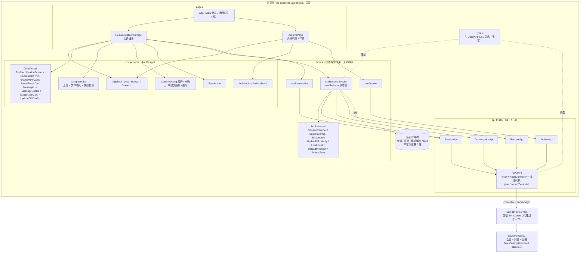
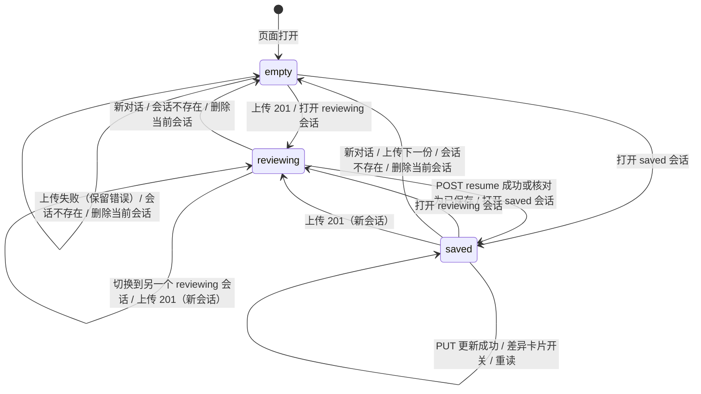
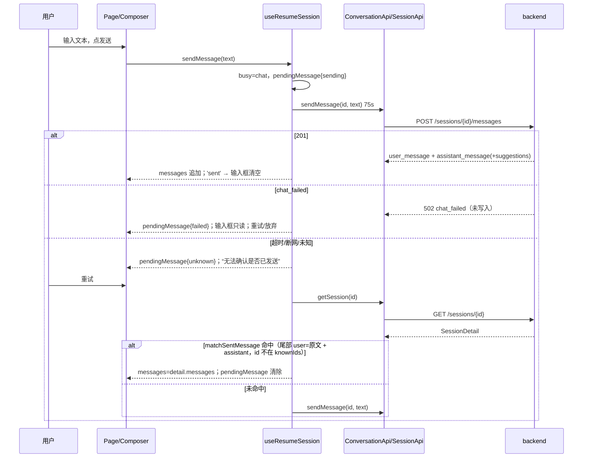
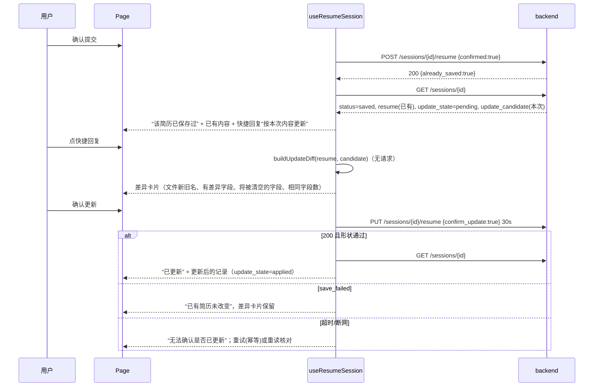

# 简历信息收集 — 详细设计文档（Frontend）

## 文档信息

| 项目 | 内容 |
|------|------|
| 所属服务 | hr-collection-agent-web（frontend Workbench） |
| 需求文档 | `frontend-docs/HR_PR-1/01_requirements/requirements.md`（**v2.0.2**，REQ-FE-01 ~ REQ-FE-09，共 54 条验收标准）<!-- 变更 v2 / v2.1 --> |
| Schema 文档 | 无（frontend 无数据存储职责，Step 2.1 跳过；浏览器不持久化简历与对话内容，F-02） |
| 接口/管道文档 | `frontend-docs/HR_PR-1/03_api/interface_spec_resume.md`（接口消费规范 **v0.3**，DD-01..DD-22）；契约来源 `backend-docs/HR_PR-1/03_api/openapi.yaml`（**0.2.0**，13 个操作，已冻结）<!-- 变更 v2 / v2.1 --> |
| 输入裁决 | `01-requirements/HR_PR-1/prototype-review.md`（P-01..P-11，其中 P-01/P-02 被 v2 替代）、`cross-workbench-review.md`（C/D/O/G/F + v2 的 X-01..X-10、Y-01、Y-02、O2-01..05、G2-02..04）；`frontend-docs/HR_PR-1/00_impact_analysis.md`（v2、v2.1）；原型 `global-info/prototype/`（仅作页面结构与交互参考） |
| 设计日期 | 2026-11-10（v1）；2026-11-11（v2） |
| 版本 | **v2.0**（本次增量：会话化、对话修改与问答、历史会话、已归档简历页、已保存过后的确认更新；v1 全文快照 `_history/design.v1.md`） |

> 本文档**引用**接口消费规范与 OpenAPI，不重复其中的字段清单、接口参数、响应与错误码表。
> 原型是参考，**与评审裁决冲突处以裁决为准**；设计中凡需改需求或契约之处，一律列在 §10「申请与待确认」，不自行修改。
> 增量约定：变更处就近标 `<!-- 变更 v2 -->` / `<!-- 变更 v2.1 -->`；未标注的 v1 内容保持有效。被 v2 替代的 v1 设计在原位置以"~~删除线~~ + 替代说明"保留，便于追溯。

## 变更履历

| 版本 | 日期 | 变更（delta） | 驱动 |
|------|------|--------------|------|
| v1.0 | 2026-11-10 | 初始版本 | Step 3 |
| v1.1 | 2026-11-10 | ① 契约版本对齐 OpenAPI 0.1.1：邮箱 pattern + maxLength 254、手机号 maxLength 32（针对提交原值）、其余字段长度 / 条数上限填入 `FIELD_MAX_LENGTH`（§6.1，数值全部取自 OpenAPI，不自定）；② TD-07、§3.3 / §6 FieldRules、§8 REQ-FE-03.5 / 06.5、§9 `FieldRules` 用例同步；③ §10 申请项与 Q-DL 全部标记已裁决；④ ADR-006 状态 ACCEPTED（§11.1） | DL 通过技术设计确认；OpenAPI 0.1.1；CR-01 / CR-01a 裁决 |
| v1.2 | 2026-11-10 | §4.4 补充：提交分区时丢弃“完全为空”的新增子项（全空则提交 `[]`），校验错误仍按用户所见下标报告（实现偏差，第二批审查 DL 裁决接受） | 任务 2.5 偏差 ③；第二批审查 |
| **v2.0** | 2026-11-11 | **会话化重设计**（对齐 OpenAPI 0.2.0、接口规范 v0.3、requirements v2.0.2）：① 状态模型由"单草稿"改为"当前会话 + 会话列表 + 消息/建议"，`SessionReducer` 新增 Busy/Dialog/Notice/ErrorScope 取值、结果未知后的"重读核对"路径（G2-04）；② 输入区增加文本输入与"思考中"，对话流、修改建议卡片、应用与分区编辑共存；③ 历史会话栏（窄屏 Drawer）、切换、删除二次确认；④ 已保存/已保存过视图与只读组件"不显示状态"开关；⑤ v2.1：差异卡片与确认更新（"将清空"字段必列、F-03 的"已更新"）；⑥ 已归档简历页（不引入路由库、两页保持挂载、blob 下载与通用文件名）；⑦ api 层增加 PUT/DELETE、204/blob 响应模式、对话 75s；⑧ X-10 脚本核查结论（§6.2）；⑨ §1 新增 TD-16..TD-31，TD-01/08/09/11/12 被修订或替代；§8 追溯 54/54；§9 红线点测试清单；§10/§11 更新 | HR_PR-1-CRv2、CRv2.1；重跑清单 7b |

---

## §1 设计决策表

> 只记技术设计层面的决策；接口消费决策 DD-01..DD-22 已记在 `interface_spec_resume.md` §七，此处沿用不重复，编号接续为 TD-xx。

| 编号 | 决策项 | 决策 | 理由 | ADR |
|------|--------|------|------|-----|
| TD-01 | 校对交互模型 | 简历按 11 个分区（见 §4.2）整区核对。分区卡片内字段**就地结构化编辑**，点“确认本区”时对该分区的全部字段提交**一次** PATCH。~~输入框区域只承载上传与快捷指令，不解析自由文本~~ <!-- 变更 v2 -->：**分区编辑保留**，并与对话修改并存——自由文本由 backend 经模型理解，前端**仍不解析自由文本**，只展示回复与修改建议；两种方式写同一份会话字段 | P-01 选 A（保持 C-03）；P-04 分区核对；O-11 要求列表整块提交；v2：ADR-007 替代"不设文本框"部分，ADR-006 分区部分继续有效 | ADR-006（v2 修订）、ADR-007 |
| TD-02 | 会话状态管理 | 单一 `useReducer` 会话状态机（`useResumeSession`），状态仅存运行时内存；不引入状态库，不使用路由库（单页，归档页用 `useState` 切换，TD-25） | 项目约束（useState/useReducer）；流程是有限状态且转移受 backend 响应驱动，reducer 便于测试 | — |
| TD-03 | 未提交编辑缓冲 | 分区内的编辑暂存在会话状态的 `editBuffer`（内存），**只有 PATCH 成功后才进入权威草稿**；刷新页面即丢失；不落任何浏览器存储。<!-- 变更 v2 -->建议"应用"成功时，清除 `editBuffer` 中被应用字段对应的未提交编辑（以应用结果为准，REQ-FE-07.5） | F-02；backend 为唯一数据权威 | — |
| TD-04 | 请求并发与过期响应 | 同一时刻只允许一个在途请求（`busy` 标记，其余入口禁用）；<!-- 变更 v2 -->`epoch` 在"切换会话 / 新对话 / 删除当前会话 / 会话不存在"时递增，旧响应到达时按 epoch 丢弃 | 落实 DD-07；响应整体替换本地状态，并发会让旧响应覆盖新状态 | — |
| TD-05 | 忙碌态与取消 | 忙碌期间“新对话”、上传、发送、应用/取消、切换会话、删除、确认类按钮均禁用；不提供请求取消按钮（超时由 `AbortController` 结束）<!-- 变更 v2：禁用范围扩大 --> | 防重复提交；取消后 backend 是否已处理不可知，取消会制造歧义 | — |
| TD-06 | 业务规则存放 | 分区配置、字段规则、reducer 及 v2 新增的差异计算、对话核对等纯逻辑放在 `src/hooks/model/` 下的纯 TS 模块（PascalCase），不依赖 DOM；组件只消费结果 | 分层红线：组件不持有业务规则，hook 层不操作 DOM 样式；`src` 仅限 5 个目录 | — |
| TD-07 | 校验规则单一来源 | 手机号 / 邮箱 pattern 与 `maxLength` 以 OpenAPI 为准，集中在 `FieldRules.ts`；字段长度 / 条数上限集中在 `FIELD_MAX_LENGTH`（§6.1，值在 0.2.0 中未变，Step 4 核对文件头版本号） | G-01、G-02、CR-01 | — |
| TD-08 | ~~静态外壳~~ | ~~只含产品标题与“＋ 新对话”入口，不显示历史会话列表~~ **被 v2 替代** <!-- 变更 v2 -->：外壳含产品标题、“对话 / 已归档简历”切换、会话栏（`SessionList`）与“＋ 新对话”；仍**不显示用户头像/姓名**（无账号） | P-02 的"去掉历史会话"被 PRD #6 替代；无账号仍成立 | ADR-008 |
| TD-09 | ~~输入区形态~~ | ~~无文本输入框~~ **被 v2 替代** <!-- 变更 v2 -->：底部为 `ComposerBar`：📎 上传 + 拖拽 + **文本输入与发送** + 快捷指令芯片（随阶段变化）+ 免责提示。文本输入见 TD-20 | ADR-007 替代 ADR-006 的"不设文本框" | ADR-007 |
| TD-10 | 加载提示 | 上传时显示单一 `UploadProgressNotice`；v2 增加对话的"思考中"（`ThinkingNotice`，同为单一提示，不分步骤、不显示耗时） | P-05；backend 同步接口无进度事件 | — |
| TD-11 | 保存后展示 | 保存成功卡（`SavedResultCard`）显示姓名、原始文件名、保存时间，不含手机号与邮箱；<!-- 变更 v2 -->会话**保留**并转为只读"已保存"视图（重读会话，内容来自正式库，TD-18/TD-22），卡片由保存响应与重读结果合成，不再清空会话 | P-09、REQ-FE-04.4（v2）；Q-DL-03 的三项摘要保留 | — |
| TD-12 | ~~“新对话”与服务端草稿~~ | ~~有未确认草稿时二次确认；确认后不删除服务端草稿；再次上传覆盖~~ **被 v2 替代** <!-- 变更 v2 -->：上传永远新建会话，不覆盖；"新对话"仅清空当前视图，会话不删除、仍在列表中。**仅在有未提交编辑时**弹出"未提交的修改将丢失"确认（TD-29） | 覆盖语义在 v2 消失（REQ-FE-01.5、05.4） | — |
| TD-13 | 兼容性与无障碍范围 | 浏览器：Chrome / Edge / Safari / Firefox 的最近两个主版本；窗口宽度 ≥ 360px，< 860px 时外壳折叠为顶栏；基础键盘可达，`aria-live` 播报，状态用“文字 + 颜色”。<!-- 变更 v2 -->窄屏下会话列表经 Drawer 到达；差异卡片 / 建议卡片出现时焦点移动（TD-31） | 沿用 | — |
| TD-14 | 视觉 | 原型 `style.css` 配色作为 Ant Design `ConfigProvider` 主题 token | 沿用 | — |
| TD-15 | 超长/空白输入 | 分区文本输入前后 trim 后提交，全空白视同空；<!-- 变更 v2 -->对话消息 trim 后判空，超过 2000 字符禁用发送并提示（不截断） | 与 OpenAPI 对核心字段 / `content` 的规则一致 | — |
| **TD-16** | hook 拆分 <!-- 变更 v2 --> | 三个互不嵌套的 hook：`useResumeSession`（当前会话状态机）、`useSessionList`（列表加载状态，`loading\|ready\|error`，`reload()`）、`useArchive`（归档列表 / 详情 / 文件）。会话 hook 通过入参回调 `onActivity()` 通知页面"最近活动已变化"，由页面触发 `useSessionList.reload()` | 列表是独立数据源，失败不应阻塞主区（DD-04 修订）；避免把 3 种数据塞进一个 reducer | — |
| **TD-17** | Busy 扩展与互斥 <!-- 变更 v2 --> | `Busy = null\|upload\|read\|patch\|chat\|suggest\|confirm\|update\|delete`；任一非 null 时其他会话操作全部禁用。`read` 同时覆盖"打开会话"和"结果未知后的重读核对"（带 `readPurpose`） | 沿用 v1 互斥模型，不引入并行请求 | — |
| **TD-18** | 会话视图数据模型 <!-- 变更 v2 --> | `SessionState` 以 `sessionId` 标识当前会话；`reviewing` 用 `draft = { original_file, fields }`（保留 v1 字段名与全部 `SectionView` 选择器，减少改动）；`saved` 用 `saved = { resume, update_state, update_candidate }`；`messages` 为对话记录。读取响应通过单一入口 `enterSession(detail)` 装入，按 `status` 分流（互斥一致性已由 api 层形状校验保证） | `fields` 与 `resume` 互斥（OpenAPI `SessionDetail`）；复用 v1 选择器 | — |
| **TD-19** | 结果未知后的核对（G2-04） | 对话 / 保存 / 更新三类请求遇到 `client_timeout`、`network_error`、`unknown_error` 或（保存时）`session_read_only` → 先 `GET` 会话再决定，核对规则是 `hooks/model/Verify.ts` 的纯函数：对话看"消息尾部是否出现待发原文 + 其后助手消息且 id 均不在发送前已知集合"；保存看 `status`；更新看 `update_state`。不设客户端幂等键 | 契约无幂等键（X-01）；保存对已保存会话不再幂等（G-04）；REQ-FE-04.6、07.3、09.4（v2.0.2） | — |
| **TD-20** | 对话输入 | 文本框受控，`autoComplete="off"`；Enter 发送、Shift+Enter 换行，`isComposing` / composition 事件期间 Enter 不发送；字数 > 2000 或 trim 后为空时发送禁用；发送开始即进入 `pendingMessage`，**成功才清空输入框**；失败或未知后输入框只读，`pendingMessage` 气泡提供"重试 / 放弃"（放弃 = 原文回填输入框供编辑） | REQ-FE-07.1、07.3；F-02；避免"重试时用户已改文本"的歧义 | — |
| **TD-21** | 修改建议卡片 | 卡片 = 一条助手消息（O2-01）；应用 / 取消整卡；`applicable=false` 的项只展示原因；卡片状态由 backend 返回的 `Suggestion.status` 归纳（`cardStatus`），前端不推断；应用成功用响应中的 `fields` 整体替换（DD-15），**不自动跳转分区**，已应用卡片提供"查看 X 分区"芯片（走现有 `SECTION_SELECTED`） | REQ-FE-07.4..07.6；避免界面被动跳转 | — |
| **TD-22** | 已保存内容展示 | `ReadOnlySection` 增加 `showStatus` 与 `emptyText`：已保存 / 归档用 `showStatus=false`、`emptyText='未填写'`；`校对中` 保持 `showStatus=true`、`（未提供）`。`ResumeValues` 经 `valuesAsFields()` 适配为带占位状态的 `ResumeFields`（仅供渲染，不上送） | X-07、DD-17；复用 v1 渲染（含列表 / 经历子项） | — |
| **TD-23** | 更新差异计算 | 前端在 `UpdateDiff.ts` 纯函数中比较 `resume` 与 `update_candidate`（Y-02）：标量 `null/空白` 视为同一"空"；字符串先 trim；文本列表逐项 trim 并丢弃空项，顺序有意义；经历子项缺失键与 `null` 视为相同；有差异的逐项给出；候选为空而已有值非空的标记 `clears=true` 且**必列**；相同字段只计数；附原始文件新旧名称 | REQ-FE-09.2；后端无规范化差异接口 | — |
| **TD-24** | "已更新"的时机 | 仅在 `UPDATE_SUCCEEDED`（PUT 2xx 且形状校验通过）或核对路径读到 `update_state=applied`（本次更新流程内）时置 `notice='updated'`；差异卡片出现、请求发出、对话文字、重新打开 `applied` 会话（只显示静态一行"已按本次内容更新"）都不触发该提示。`already_saved` 响应既不是"已保存"也不是"已更新" | F-03、REQ-FE-09.4 | — |
| **TD-25** | 归档页与两页保持挂载 | `App` 持有 `view: 'chat'\|'archive'`（`useState`），两页**同时挂载**，非当前页用 `hidden` 隐藏；`ComposerBar` 在页面不可见时 `disabled`（其全局拖放监听仍取消浏览器默认，但不上传）；归档页在 `active` 由 false→true 时重读列表。不引入路由库 | REQ-FE-08.1；卸载会丢 `editBuffer`、输入与当前会话 | — |
| **TD-26** | 外壳与会话栏 | `AppShell` 增加 `nav`（"对话 / 已归档简历"，Ant Design `Segmented`）、`sidebar`（`SessionList`）两个插槽；< 860px 侧栏折叠，顶栏出现"会话"按钮打开 `Drawer`（Ant Design，已有依赖）；归档页复用 `AppShell`（无侧栏内容） | REQ-FE-05.2 窄屏可达；不新增依赖 | — |
| **TD-27** | 原始文件下载 | `ArchiveApi.downloadResumeFile` 以 blob 模式取回；组件层 `saveBlob(blob, filename)` 创建临时 `<a download>` 触发保存并 `revokeObjectURL`；文件名为通用名（`原始简历.pdf/.jpg/.png`，按 `content_type`），不含姓名、不取 `Content-Disposition`；失败 / `file_available=false` 在页面内提示 | REQ-FE-06.2/06.3、08.4；O2-03、X-05 | — |
| **TD-28** | api 层扩展与模块拆分 | `ApiClient.request()` 增加 `PUT/DELETE`、`responseMode: 'json'\|'none'\|'blob'`、`CHAT_TIMEOUT_MS=75_000`；路径参数一律 `encodeURIComponent`；模块：`SessionApi`、`ConversationApi`、`ResumeApi`（按会话）、`ArchiveApi`；删除 `ResumeDraftApi`。形状校验在 `ResponseShapes.ts` 扩展，**校验失败 = `unknown_error`，不得进入成功分支** | DD-12、DD-22；F-03 的基础 | — |
| **TD-29** | 离开确认 | 切换会话 / 新对话 / 上传新文件三类"离开当前会话"动作，仅当 `editBuffer` 非空时弹 `leave` 对话框"未提交的修改将丢失"，确认后执行原动作；否则直接执行。对话框保存意图 `LeaveIntent = switch(id)\|new_chat\|upload(file)` | REQ-FE-05.4；上传同属"新建会话"，行为一致 | — |
| **TD-30** | 列表刷新 | 上传、对话、应用/取消、保存、更新、删除成功后各触发一次 `reload()`；读取类操作（含核对重读）不触发；刷新失败只影响列表区，不影响主流程 | REQ-FE-05.6；读取不刷新最近活动 | — |
| **TD-31** | 焦点键扩展 | `useChatScroll` 的输入增加 `lastMessageId`、`diffOpen`：新消息 → `message:last`；差异卡片打开 → `update-diff`；已保存视图 → `saved`；其余沿用 `saved/final/section:*` | TD-13 | — |

> ADR 扫描（draft-adr）结果见 §11：TD-01 / TD-09 对应的 ADR-006 已被 ADR-006（v2 修订）与 ADR-007 覆盖；TD-16..TD-31 未达门槛，不新起草 ADR。

---

## §2 系统架构图



> 说明：前端不直连模型或存储（F-01）；浏览器标识 Cookie `browser_id` 为 HttpOnly，前端不读取、不存储（C-06，F-02）。依赖方向：pages → components / hooks → api → types；components 不得依赖 api。<!-- 变更 v2 -->

---

## §3 代码结构变更

> 路径相对 `codes/hr-collection-agent-frontend/`；文件名 PascalCase；注释使用英文；类型以接口契约命名。<!-- 变更 v2 -->本节只列 v2 相对 v1 代码的**新增 / 修改 / 删除**；未列出的文件不变（见 3.7）。行号以 v1 代码为准。

### 3.1 types（`src/types/`）— 文件头注明 OpenAPI **0.2.0**

| 代码单元 | 路径 | 操作 | 职责 | 关联需求 |
|---------|------|------|------|---------|
| ResumeModel | `src/types/ResumeModel.ts` | 修改 | 保留 `ResumeFields` / `ResumeFieldsUpdate` 等；新增 `ResumeValues`（22 字段仅值）；`SuggestionField`（19 个白名单字段） | REQ-FE-02、03、08 |
| Draft | `src/types/Draft.ts` | **删除** | `DraftResponse`、`DraftUpdateRequest`（含 `draft_id` `expires_at`）随 v1 草稿接口移除；`OriginalFileInfo` 移入 `Session.ts` | — |
| Session | `src/types/Session.ts` | 新增 | `SessionStatus`、`UpdateState`、`SessionSummary`、`SessionListResponse`、`SessionDetail`、`UpdateCandidate`、`SessionFieldsUpdateRequest`、`SessionFieldsResponse`、`OriginalFileInfo` | REQ-FE-02、05 |
| Conversation | `src/types/Conversation.ts` | 新增 | `ChatRole`、`ChatMessage`、`Suggestion*`、`SendMessageRequest/Response`、`SuggestionActionResponse` | REQ-FE-07 |
| Archive | `src/types/Archive.ts` | 新增 | `ArchivedResume`、`ResumeSummary`、`ResumeListResponse` | REQ-FE-08 |
| Resume | `src/types/Resume.ts` | 修改 | 保留 `CreateResumeRequest/Response`；新增 `UpdateResumeRequest/Response` | REQ-FE-04、09 |
| Errors | `src/types/Errors.ts` | 修改 | `ErrorCode` 13 → 19 值（删 `draft_not_found`；增 `session_not_found`、`session_read_only`、`chat_failed`、`suggestion_unavailable`、`update_not_available`、`resume_not_found`、`file_not_available`）；前端自有码不变 | REQ-FE-06.4 |

### 3.2 api（`src/api/`）

| 代码单元 | 路径 | 操作 | 职责 | 关联需求 |
|---------|------|------|------|---------|
| ApiClient | `src/api/ApiClient.ts` | 修改 | `RequestOptions.method` 增加 `PUT\|DELETE`（v1 `:12`）；新增 `responseMode`（`json` 默认 / `none` 期望 204 / `blob` 校验 `Content-Type` 属 pdf、jpeg、png）；错误体在三种模式下均按 JSON 解析（v1 `:50-69` 的"无 JSON → unknown_error"仅对 `json` 模式成立）；`CHAT_TIMEOUT_MS = 75_000`（v1 `:7-9` 旁）；`quietCodes` 增加 `DELETE` 的 `session_not_found` | REQ-FE-05.5、06、07.3、08.4 |
| ApiError | `src/api/ApiError.ts` | 修改 | 码表随 `ErrorCode` 更新；其余不变 | REQ-FE-06.4 |
| ResponseShapes | `src/api/ResponseShapes.ts` | 修改 | 删 `isDraftResponse`（v1 `:69-70` 强制 `expires_at`）；新增 `isSessionDetail`（含 status / update_state / fields·resume·update_candidate 互斥一致性）、`isSessionList`、`isSendMessageResponse`、`isSuggestionActionResponse`、`isSessionFieldsResponse`、`isUpdateResumeResponse`、`isArchivedResume`、`isResumeList`；`isCreateResumeResponse` 不变 | TD-28；F-03 |
| ResumeDraftApi | `src/api/ResumeDraftApi.ts` | **删除** | 被 `SessionApi` 取代；`/current` 404→`null` 的特例（O-12）一并消失 | — |
| SessionApi | `src/api/SessionApi.ts` | 新增 | `createSession(file)`、`listSessions()`、`getSession(id)`、`deleteSession(id)`（`none` 模式）、`updateSessionFields(id, fields)` | REQ-FE-01、03、05 |
| ConversationApi | `src/api/ConversationApi.ts` | 新增 | `sendMessage(id, content)`（75s）、`applySuggestions(id, mid)`、`cancelSuggestions(id, mid)` | REQ-FE-07 |
| ResumeApi | `src/api/ResumeApi.ts` | 修改 | `createResume(sessionId)`（v1 `:9-12`，路径改为按会话，体仍固定 `{confirmed:true}`）；新增 `updateResume(sessionId)`（体固定 `{confirm_update:true}`） | REQ-FE-04、09 |
| ArchiveApi | `src/api/ArchiveApi.ts` | 新增 | `listResumes()`、`getResume(id)`、`downloadResumeFile(id)`（`blob` 模式，返回 `Blob`） | REQ-FE-08 |

### 3.3 hooks（`src/hooks/`）与 model

| 代码单元 | 路径 | 操作 | 职责 | 关联需求 |
|---------|------|------|------|---------|
| useResumeSession | `src/hooks/useResumeSession.ts` | 修改 | 去掉 `bootstrap` / `confirmOverwrite` / `getCurrentResumeDraft`（v1 `:32-50`、`:98`）；新增 `openSession`、`sendMessage`、`retryMessage`、`discardPendingMessage`、`applySuggestions`、`cancelSuggestions`、`openUpdateDiff`、`closeUpdateDiff`、`confirmUpdate`、`requestDelete`、`confirmDelete`、`confirmLeave`；入参 `{ onActivity }`；核对重读 `verifyBy*`（TD-19） | REQ-FE-01..05、07、09 |
| useSessionList | `src/hooks/useSessionList.ts` | 新增 | 会话列表加载 / 刷新 / 错误态（TD-16） | REQ-FE-05.1、05.2、05.6 |
| useArchive | `src/hooks/useArchive.ts` | 新增 | 归档列表、选中详情、文件获取（blob）；入参 `active`，激活时重读 | REQ-FE-08 |
| useChatScroll | `src/hooks/useChatScroll.ts` | 修改 | `focusKeyOf` 输入增加 `lastMessageId`、`diffOpen`（v1 `:14-18`，TD-31） | TD-13 |
| SessionReducer | `src/hooks/model/SessionReducer.ts` | 修改 | 状态与转移见 §5.2 / §5.3：`Busy`（`:24`）、`ErrorScope`（`:26`）、`DialogKind`（`:27`）、`NoticeKind`（`:25`）更新；删 `BOOTSTRAP_*`、`OVERWRITE_*`、`overwriteAcknowledged`、`restored`（v1 `:54,64,203-235`）；`CONFIRM_SUCCEEDED`（`:337`）、`NEW_CHAT_*`（`:393`）改写 | REQ-FE-01..05、07、09 |
| UpdateDiff | `src/hooks/model/UpdateDiff.ts` | 新增 | `buildUpdateDiff(resume, candidate)`（TD-23） | REQ-FE-09.2 |
| Verify | `src/hooks/model/Verify.ts` | 新增 | `matchSentMessage(messages, knownIds, text)`、`decideAfterConfirmRead(detail)`、`decideAfterUpdateRead(detail)`、`cardStatus(suggestions)` | REQ-FE-04.6、07.3、09.4 |
| SectionConfig | `src/hooks/model/SectionConfig.ts` | 修改 | 新增 `labelOfField(key)`（建议 / 差异字段标签，遇白名单外字段抛错由形状校验兜底） | REQ-FE-07.4、09.2 |
| SectionView | `src/hooks/model/SectionView.ts` | 修改 | 新增 `valuesAsFields(values)`（TD-22 适配器） | REQ-FE-08.3 |
| FormatTime | `src/hooks/model/FormatTime.ts` | 新增 | `formatDateTime(iso)`（由 `SavedResultCard.tsx:5` 的 `formatSavedAt` 上移；列表、消息、归档共用） | REQ-FE-05.2 |
| FieldRules / UploadPrecheck | `src/hooks/model/` | 不变 | — | — |

### 3.4 components（`src/components/`，Ant Design）

| 代码单元 | 路径 | 操作 | 职责 | 关联需求 |
|---------|------|------|------|---------|
| AppShell | `AppShell.tsx` | 修改 | 增加 `nav`、`sidebar` 插槽；窄屏顶栏增加"会话"按钮与 `Drawer`（v1 `:19-34`，TD-26） | REQ-FE-05.2、08.1 |
| SessionList | `SessionList.tsx` | 新增 | 列表项：名称、状态标签（校对中 / 已保存，文字 + 颜色）、`formatDateTime(last_active_at)`、删除按钮（`aria-label`）；`loading / error（重试）/ 空` 三态；`disabled` 时不可选 / 删 | REQ-FE-05.2、05.5 |
| ComposerBar | `ComposerBar.tsx` | 修改 | 增加文本输入（`Input.TextArea`，`autoComplete="off"`）、发送按钮、字数提示、IME 守卫、只读态（TD-20）；注释"无文本输入（ADR-006）"（v1 `:25`）改为 ADR-007；上传、拖拽逻辑不变 | REQ-FE-07.1 |
| MessageList / MessageBubble | `MessageList.tsx`、`MessageBubble.tsx` | 新增 | 渲染 `messages` + `pendingMessage` + 助手气泡后的 `SuggestionCard`；用户 / 助手气泡 + 时间 | REQ-FE-07 |
| SuggestionCard | `SuggestionCard.tsx` | 新增 | 一张卡片：`ChangeRows`（字段 / 原值 / 新值）、不可应用项原因、"应用 / 取消"、已应用 / 已取消状态与"查看分区"芯片 | REQ-FE-07.4..07.6 |
| ChangeRows | `ChangeRows.tsx` | 新增 | 共用展示层：一组 `{label, old, new, note}` 行；值渲染复用 `ReadOnlySection` 导出的 `ValueView`；供 `SuggestionCard` 与 `UpdateDiffCard` 使用（TD-21/23） | REQ-FE-07.4、09.2 |
| ThinkingNotice | `ThinkingNotice.tsx` | 新增 | 对话"思考中"（`role="status"`，`aria-live="polite"`） | REQ-FE-07.2 |
| UpdateDiffCard | `UpdateDiffCard.tsx` | 新增 | 差异卡片：文件新旧名称、有差异字段（`ChangeRows`，`clears` 标"将被清空"）、相同字段数量、"确认更新 / 取消"；更新失败的 `ErrorAlert` | REQ-FE-09.2、09.3 |
| SavedSessionView | `SavedSessionView.tsx` | 新增 | 已保存 / 已保存过会话体：`FileCard`、`SavedResultCard`、只读分区（`ReadOnlySection`，`showStatus=false`）、`MessageList`（只读）、`UpdateDiffCard` | REQ-FE-04.4、04.5、05.3、09 |
| ReadOnlySection | `ReadOnlySection.tsx` | 修改 | 增加 `showStatus`、`emptyText` 属性；导出 `ValueView`；`:8` 空值文案参数化、`:77,85` 状态读取 / `FieldStatusTag` 受 `showStatus` 控制 | REQ-FE-08.3 |
| SavedResultCard | `SavedResultCard.tsx` | 修改 | 三种形态：`saved`（姓名 / 文件名 / 保存时间）、`already_saved`（"该简历已保存过"，**内容由 `SavedSessionView` 展示**，不再单独只显示一句）、`updated`（"已更新"）；`formatSavedAt` 上移（见 FormatTime）；"上传下一份" | REQ-FE-04.4、04.5、09.4 |
| NoticeBanner | `NoticeBanner.tsx` | 修改 | 删 `restored` / `draft_expired` / `maybe_saved`（v1 `:9-11`）；新增 `session_gone`（"该会话已不存在"）；`already_saved` / `updated` 由结果卡展示，不作横幅 | REQ-FE-04.7 |
| WelcomePanel | `WelcomePanel.tsx` | 修改 | 去掉 `draft_not_found` 提示位 | REQ-FE-05.1 |
| ArchivePage 部分 | `ArchiveList.tsx`、`ArchiveDetail.tsx` | 新增 | 列表（`Table`：姓名、手机号、邮箱、求职意向、保存时间；空态"暂无记录"）；详情（`Drawer`：分区只读、文件名、保存时间、最近更新、"打开原始文件"按钮 + 页面内提示）；`saveBlob` 工具 | REQ-FE-08 |
| BootstrapErrorPanel | `BootstrapErrorPanel.tsx` | **删除** | 启动不再读单草稿；列表错误态由 `SessionList` 内联（TD-16） | — |
| ConfirmDialog / ErrorAlert / FileCard / FinalReviewCard / SectionCard / FieldRow / 编辑器 / ReviewSummary / QuickReplyChips / UploadProgressNotice / ErrorBoundary / NewChatButton / ChatThread | 同名文件 | 不变 | `FinalReviewCard` 的"可能已保存……草稿不存在"文案（v1 `:60`）改为 v2 口径，见 §7 | — |

### 3.5 pages 与入口

| 代码单元 | 路径 | 操作 | 职责 | 关联需求 |
|---------|------|------|------|---------|
| ResumeCollectionPage | `src/pages/ResumeCollectionPage.tsx` | 修改 | 删除 `bootstrapping / bootstrap_failed` 分支（v1 `:74-85`）与 overwrite / new_chat 对话框（`:192-211`）；`reviewing` 分支加入消息区（插在 `{pending}` 之前，`:138`）；`saved` 分支（`:142-146`）改渲染 `SavedSessionView`；`showComposer`（`:151`）与 ComposerBar 参数（`:174-182`）改造；quick replies（`:154-165`）增加"按本次内容更新"；新增 `leave` / `delete` 对话框；接受 `visible` 属性（TD-25） | REQ-FE-01..05、07、09 |
| ArchivePage | `src/pages/ArchivePage.tsx` | 新增 | 归档页编排：`useArchive({active})`；列表 + 详情 | REQ-FE-08 |
| App / main | `src/App.tsx` | 修改 | 持有 `view`；两页同时挂载（TD-25）；`nav` 传入各页 `AppShell`（v1 `:26` 仅渲染一页） | REQ-FE-08.1 |
| Vite 配置 | `vite.config.ts` | 不变 | 代理 `/api`、保留 `Set-Cookie`、超时 ≥ 75s | — |

### 3.6 组件树

```text
App (ConfigProvider, ErrorBoundary, view)
├─ ResumeCollectionPage (hidden when view=archive)
│  ├─ AppShell (nav = 对话 / 已归档简历)
│  │  ├─ sidebar: NewChatButton + SessionList        （窄屏：顶栏“会话”按钮 → Drawer）
│  │  └─ ChatThread
│  │     ├─ [phase=empty]               WelcomePanel + ErrorAlert(上一次上传失败)
│  │     ├─ [busy=read, phase=empty]    加载提示（打开会话中）
│  │     ├─ [phase=reviewing, view=sections]
│  │     │     FileCard · ReviewSummary · SectionCard ×11 · MessageList(MessageBubble · SuggestionCard · pending · ThinkingNotice)
│  │     ├─ [phase=reviewing, view=final] FinalReviewCard · MessageList
│  │     └─ [phase=saved] SavedSessionView
│  │           FileCard · SavedResultCard · ReadOnlySection ×11(分区) · MessageList(只读) · UpdateDiffCard
│  ├─ ComposerBar (上传 + 文本输入 + QuickReplyChips)
│  └─ ConfirmDialog (leave / unconfirmed / unsubmitted_edits / delete)
└─ ArchivePage (hidden when view=chat)
   └─ AppShell (nav) → ArchiveList · ArchiveDetail(Drawer)
```

### 3.7 不变清单（v2 不需改动）

`FieldRules`、`UploadPrecheck`、`SectionCard`、`FieldRow`、`FieldStatusTag`、`StringListEditor`、`ObjectListEditor`、`FileCard`、`FinalReviewCard`（仅文案）、`ReviewSummary`、`QuickReplyChips`、`ConfirmDialog`、`ErrorAlert`、`ErrorBoundary`、`UploadProgressNotice`、`NewChatButton`、`ChatThread`、`usePreventFileDropNavigation`、`useStableKeys`、`useNarrowScreen`、构建 / lint 配置。

---

## §4 数据模型分析

> 字段、类型、枚举见 OpenAPI 与 `interface_spec_resume.md` §五，此处不重复；只补充分区映射、状态派生和数据流向。前端无存储，`has_storage = false`。

### 4.1 数据流向 <!-- 变更 v2 -->

```text
上传文件(File) ──multipart──▶ POST /sessions ──201 SessionDetail──┐
选择会话 / 核对重读 ─────────▶ GET  /sessions/{id} ─200───────────┤
                                                                   ▼ enterSession(detail)
                      reviewing: draft{original_file, fields(值+状态)}   saved: saved{resume(仅值), update_state, update_candidate}
                                 + messages[]（两者共有）
 分区“确认本区” ─ PATCH /sessions/{id}/fields ─ 200 fields ──▶ draft.fields 整体替换
 发送消息 ─ POST …/messages ─ 201 {user_message, assistant_message} ─▶ messages 追加
 应用 / 取消 ─ POST …/messages/{mid}/apply|cancel ─ 200 {suggestions, fields} ─▶ 该卡片建议 + draft.fields 整体替换
 最终确认 ─ POST /sessions/{id}/resume{confirmed:true} ─▶ 201/200 ─▶ 重读会话 ─▶ saved（含 already_saved 的 pending 情形）
 确认更新 ─ PUT  /sessions/{id}/resume{confirm_update:true} ─▶ 200 ─▶ 重读会话 ─▶ saved{update_state=applied}
 会话列表 ─ GET /sessions ─▶ useSessionList.items（独立于会话状态机）
 归档 ─ GET /resumes、/resumes/{id}、/resumes/{id}/file(blob) ─▶ useArchive（独立）
 用户编辑 ──▶ session.editBuffer（未提交，内存）──覆盖显示──▶ 组件
```

- **权威来源**：`draft.fields`、`saved`、`messages` 只由 backend 响应整体替换；前端不自行推断或改写字段状态、建议状态，不补全任何值（REQ-FE-02.3、07.6）。
- **显示值** = `editBuffer[field]`（若存在）否则 `draft.fields[field].value`；状态标签始终取自 `draft`，另以"未提交修改"小标记提示缓冲存在，**不是**第五种字段状态。
- **不持久化**：`draft`、`saved`、`messages`、`editBuffer`、`pendingMessage`、`pendingFile`、`savedSummary`、输入框文本、列表数据、下载 blob 仅在 React 内存中；不使用 localStorage / sessionStorage / IndexedDB；`resume_id`、`session_id`、`message_id` 不写入任何存储，不进入 URL、`document.title`（F-02、B-03）。

### 4.2 22 个字段 → 11 个分区（P-04）

> 依据 `global-info/简历模板.md` 与 OpenAPI `ResumeFields` 的 22 个键；顺序固定，核心三项所在分区排第一。语言能力按 C-14 独立成区，补齐原型缺少的个人主页、性别、政治面貌、个人优势、自我评价。

| # | 分区 key | 标题 | 包含字段（OpenAPI 键） | 字段数 | 控件 | 含核心字段 |
|---|---|---|---|:--:|---|:--:|
| 1 | `basic` | 基本信息 | `name`、`phone`、`email`、`homepage` | 4 | 单行输入 | 是（三项） |
| 2 | `intent` | 求职意向 | `job_title`、`expected_city`、`expected_salary`、`available_time` | 4 | 单行输入 | 否 |
| 3 | `personal` | 个人信息 | `gender`、`birth_month`、`political_status`、`current_city`、`work_years`、`highest_education` | 6 | 单行输入 | 否 |
| 4 | `strengths` | 个人优势 | `strengths` | 1 | 文本列表 | 否 |
| 5 | `work` | 工作经历 | `work_experiences` | 1 | 多条子项（含职责 / 业绩两个文本列表） | 否 |
| 6 | `project` | 项目经历 | `project_experiences` | 1 | 多条子项 | 否 |
| 7 | `education` | 教育背景 | `educations` | 1 | 多条子项（含在校荣誉） | 否 |
| 8 | `skills` | 专业技能 | `skills` | 1 | 文本列表 | 否 |
| 9 | `certificates` | 证书与荣誉 | `certificates_honors` | 1 | 文本列表 | 否 |
| 10 | `languages` | 语言能力 | `languages` | 1 | 文本列表 | 否 |
| 11 | `self_evaluation` | 自我评价 | `self_evaluation` | 1 | 多行输入 | 否 |
| | | | **合计** | **22** | | |

### 4.3 状态映射与派生

| 来源 | 展示（REQ-FE-02.2） | 颜色 / 图标（文字始终同时出现） | 说明 |
|---|---|---|---|
| `recognized` | 待确认 | 蓝 | 不当作已确认（B-04） |
| `uncertain` | 不确定、请确认 | 黄（`--warn`） | 在分区内置顶高亮 |
| `missing` | 待补充 | 红 / 灰边框 | 值为 `null` / `[]`；置顶高亮 |
| `confirmed` | 已确认 | 绿（`--ok`） | |

- **分区状态**（徽标与跳转芯片用）：取该分区所有字段中优先级最高者：`missing` > `uncertain` > `recognized` > `confirmed`。
- **分区内排序**：同一分区内，`missing` / `uncertain` 字段排在前并高亮，其余保持固定顺序（P-04 “突出 missing / uncertain”）；列表类分区为单字段，高亮整块。
- **进入哪个分区**：上传成功 / 打开校对中会话后<!-- 变更 v2 -->，活跃分区 = 第一个含 `missing` 或 `uncertain` 的分区；没有则第一个含 `recognized` 的分区；全部 `confirmed` 则直接进入最终确认视图。
- **核心三项就绪** = `name`、`phone`、`email` 的草稿状态均为 `confirmed` 且值通过 `FieldRules` 校验（REQ-FE-04.1）。
- **未确认字段数** = 草稿中状态非 `confirmed` 的字段数（REQ-FE-04.2）。

### 4.4 提交体构造（引用 OpenAPI `ResumeFieldsUpdate` 语义）

`confirmSection(key)` 对该分区**每一个字段**生成提交值：取 `editBuffer` 中的值，否则取草稿当前值（`missing` 标量为 `null`、列表为 `[]`，即“确认留空”）；手机号先去空格与连字符（G-02）；文本前后 trim，全空白标量提交 `null`（核心三项除外，核心三项空白在本地被拦截）。列表字段一律提交**完整新列表**（O-11）；子项没有 id，错误路径中的下标映射到界面中的同一行（用户编辑期间不重排，保证下标稳定）。

**空子项处理（v1.2）**：用户点“添加一条”后没有填写任何内容的子项（所有字符串为空 / `null`、所有子列表为空）不进入提交体；若整个列表因此为空，则提交 `[]`，即“确认留空”。文本前后先 trim，子项内的空白字符串转为 `null`，子列表中的空白行丢弃。本地校验在丢弃空子项**之前**按用户所见下标进行，所以字段错误（如 `educations[1].school`）始终指向界面上的同一行。文本列表（个人优势等）同样丢弃空白行，其错误下标指向清理后的列表。

### 4.5 对话与差异的数据派生 <!-- 变更 v2 / v2.1 -->

| 派生量 | 来源 | 规则 |
|---|---|---|
| 卡片状态 `cardStatus(suggestions)` | 同一助手消息下的 `Suggestion[]` | 存在 `applicable=true ∧ status=pending` → `pending`（显示"应用 / 取消"，仅 `reviewing`）；否则存在 `applied` → `applied`；否则存在 `cancelled` → `cancelled`；否则（全部 `applicable=false`）→ `none`（只展示原因） |
| 建议行显示 | `Suggestion` | 标签 = `labelOfField(field)`；`pending` 且 `reviewing`：原值 = `old_value`（`null` 显示"（空）"）、新值 = `new_value`；已应用 / 已取消 / `saved`：`old_value` 恒为 `null`，只显示新值并标状态 |
| 建议字段范围 | OpenAPI `SuggestionField` | 19 个白名单字段（不含三类经历）；白名单外的 `field` 视为形状错误（`unknown_error`） |
| 差异 `buildUpdateDiff` | `saved.resume.fields`（`ResumeValues`）与 `saved.update_candidate.fields` | 归一规则见 TD-23；输出 `{ changed: DiffItem[], sameCount, file: {oldName, newName}, onlyFileDiffers }`；`DiffItem = { field, oldValue, newValue, clears }`；`changed` 按 `SECTIONS` 顺序排列；全部字段相同时 `changed=[]`，卡片提示"除文件外无字段差异"，仍可确认更新 |
| 保存卡摘要 `savedSummary` | 保存响应（`saved_at`）+ 提交前一刻的 `draft`（姓名、`original_file.filename`） | 与 v1 相同，仅用于 `already_saved=false` 的保存成功卡；重读会话后内容区以 `saved.resume` 为准 |
| `already_saved` 展示 | `CreateResumeResponse.already_saved` + 重读结果 | `notice='already_saved'`；内容区 = `saved.resume`（已有记录）；`update_state='pending'` 时出现快捷回复"按本次内容更新"；不展示记录编号（P-09） |

---

## §5 核心业务流程 <!-- 变更 v2 / v2.1 -->

### 5.1 总体流程

```mermaid
flowchart TD
    A[页面打开] --> L[useSessionList: GET /sessions]
    A --> E[主区: 空态 WelcomePanel，不自动打开任何会话]
    L -->|200| LS[会话栏显示列表]
    L -->|失败| LE[列表区错误态 + 重试；主区仍可新建对话]
    E --> U
    LS -->|选择会话| LV{editBuffer 非空?}
    LV -->|是| LD[leave 对话框]
    LD -->|取消| R
    LD -->|继续| OP
    LV -->|否| OP[GET /sessions/id  busy=read]
    OP -->|404| GONE[“该会话已不存在” → 空态 + 刷新列表]
    OP -->|reviewing| R
    OP -->|saved| SV[已保存视图（只读，TD-22）]
    U[选择文件 ComposerBar] --> PC{UploadPrecheck}
    PC -->|不通过| UE[就地提示]
    PC -->|通过| UL{editBuffer 非空?}
    UL -->|是| LD
    UL -->|否| UP[POST /sessions  75s]
    UP -->|201| R[分区核对 + 对话；活跃分区=首个待处理]
    UP -->|失败/超时| UF[错误提示，当前视图不变]
    R --> S[分区编辑 → 确认本区 → PATCH]
    R --> M[文本输入 → 发送 → POST messages  75s  “思考中”]
    M -->|201| MB[气泡 + 修改建议卡片]
    MB -->|应用| AP[POST apply → 整体替换 fields，清除对应 editBuffer]
    MB -->|取消| CA[POST cancel]
    M -->|chat_failed| MR[原文保留，可直接重试]
    M -->|超时/断网/未知| MV[先 GET 会话核对尾部消息，再决定是否重发]
    S --> R
    R --> F[最终确认视图]
    F --> POST[POST /sessions/id/resume {confirmed:true}]
    POST -->|201 already_saved=false| OK[“已保存” → 重读会话 → 已保存视图]
    POST -->|200 already_saved=true| AS[“该简历已保存过” → 重读会话 → 展示已有记录 + 快捷回复“按本次内容更新”]
    POST -->|409 / 超时 / 网络| PV[先 GET 会话核对: 已保存→渲染结果；否则允许重试]
    AS -->|点快捷回复| DF[差异卡片: 前端比较 resume 与 update_candidate]
    DF -->|取消| AS
    DF -->|确认更新| PUT[PUT /sessions/id/resume {confirm_update:true}]
    PUT -->|200 形状通过| UD[“已更新” → 重读会话]
    PUT -->|save_failed| UFAIL[“已有简历未改变”，卡片保留可重试]
    PUT -->|超时/断网| UV[“无法确认是否已更新” → 重试(幂等)或重读核对]
    SV -->|删除| DEL[二次确认 → DELETE 204/404]
```

### 5.2 会话状态

```text
SessionState                                   （v2；删除项以 ~~ ~~ 标出）
  phase:  empty | reviewing | saved             （~~bootstrapping | bootstrap_failed~~：启动只读会话列表，由 useSessionList 承担）
  view:   sections | final                      （仅 phase=reviewing 有意义）
  busy:   null | upload | read | patch | chat | suggest | confirm | update | delete
  epoch:  number                                （切换会话 / 新对话 / 删除当前会话 / 会话不存在时递增）
  sessionId: string | null                      （当前会话；empty 为 null）
  draft:  { original_file, fields: ResumeFields } | null          （phase=reviewing）
  saved:  { resume: ArchivedResume, update_state, update_candidate } | null   （phase=saved；重读失败时可为 null）
  messages: ChatMessage[]                       （对话记录，reviewing / saved 共有）
  activeSection: SectionKey
  editBuffer: Partial<ResumeFieldsUpdate>       （未提交编辑，内存）
  fieldErrors: Record<fieldPath, ErrorReason>
  pendingMessage: { text, knownIds: string[], stage: 'sending'|'failed'|'unknown' } | null
  diff:   UpdateDiff | null                     （v2.1 差异卡片）
  notice: null | 'already_saved' | 'updated' | 'session_gone'     （~~restored | draft_expired | maybe_saved~~）
  error:  { scope: 'upload'|'read'|'section'|'chat'|'suggest'|'confirm'|'update'|'delete', cause: ApiError|LocalError, messageId?: string } | null
  pendingFile: File | null                      （上传进行中展示）
  savedSummary: { name, filename, saved_at } | null
  dialog: null | 'leave' | 'unconfirmed' | 'unsubmitted_edits' | 'delete'       （~~overwrite | new_chat~~）
  dialogTarget: LeaveIntent | { id, status } | null
  （~~restored~~、~~overwriteAcknowledged~~ 删除）
```



### 5.3 状态转移表

> 通用规则：所有"响应动作"带发起时的 `epoch`，不一致或 `busy` 不匹配则丢弃（TD-04）；动作入口在 `busy≠null` 或 `dialog≠null` 时被忽略。"成功后"均触发 `onActivity()`（TD-30），除读取类。

**A. 会话读取与切换**

| 当前状态 | 事件 | 目标状态 | 前置校验 | 后置动作 |
|---------|------|---------|---------|---------|
| 任意 | 页面挂载 | `empty` | — | `useSessionList.load()`；不打开会话 |
| 任意 | 选择会话 `id` | 不变 | `busy=null`、`dialog=null` | `editBuffer` 非空 → `dialog=leave`（target=switch(id)）；否则 `busy=read`，`epoch++` |
| `dialog=leave` | "继续" | 按 target | — | switch → `busy=read`；new_chat → 清空；upload → 开始上传（见 C） |
| `dialog=leave` | "取消" / 关闭 | 不变 | — | `dialog=null` |
| `busy=read` | `READ_SUCCEEDED(detail)` | `reviewing` 或 `saved` | epoch 一致 | `enterSession(detail)`：清空 `editBuffer` / `fieldErrors` / `diff` / `pendingMessage` / `error`；`messages=detail.messages`；`reviewing`：选活跃分区（§4.3），全部已确认则 `view=final`；`saved`：`saved={resume,update_state,update_candidate}`，`update_state=pending` 时 `notice=already_saved`；`savedSummary=null` |
| `busy=read` | `session_not_found` | `empty` | — | `SESSION_GONE`：`notice=session_gone`，`epoch++`，`onActivity()` |
| `busy=read` | 其他失败 | 不变（保留原视图） | — | `busy=null`；`error{scope:read}`（含"重试"） |
| 任意会话类请求 | `session_not_found`（非 DELETE） | `empty` | — | 同 `SESSION_GONE`（REQ-FE-04.7） |

**B. 上传（沿用 v1，去掉覆盖确认）**

| 当前状态 | 事件 | 目标状态 | 前置校验 | 后置动作 |
|---------|------|---------|---------|---------|
| `empty` / `reviewing` / `saved` | 选择文件 | 不变 | `UploadPrecheck` 通过；`busy=null` | 不通过：`error{upload, local}`；通过：`editBuffer` 非空 → `dialog=leave`（upload）；否则 `busy=upload`，`pendingFile=file` |
| `busy=upload` | 201 `SessionDetail` | `reviewing` | epoch 一致 | `epoch++`；`enterSession(detail)`（新会话，`messages=[]`）；`onActivity()` |
| `busy=upload` | 失败 / `client_timeout` | 不变（**保留原视图**，O-02） | — | `busy=null`；`pendingFile=null`；`error{upload}`；超时文案"请重新上传" |

**C. 分区编辑与确认（沿用 v1，PATCH 改按会话）**

| 当前状态 | 事件 | 目标状态 | 前置校验 | 后置动作 |
|---------|------|---------|---------|---------|
| `reviewing/sections` | 编辑字段 | 不变 | `busy=null` | `editBuffer` 更新；清除该字段 `fieldErrors` |
| `reviewing/sections` | "确认本区"（含快捷回复"确认无误"） | 不变 | `busy=null`；本区本地校验通过 | `busy=patch`；`PATCH /sessions/{id}/fields` 整区（30s） |
| `busy=patch` | 200 `SessionFieldsResponse` | `reviewing` | epoch 一致 | `draft.fields` 整体替换；清本区缓冲；活跃分区 → 下一个非 `confirmed`；无则 `view=final`；`onActivity()` |
| `busy=patch` | 422 | 不变 | — | `fieldErrors` ← `details`；保留缓冲 |
| `busy=patch` | `session_read_only` | `saved` | — | 触发核对重读（TD-19）→ `SESSION_SYNCED(detail)`，按 `saved` 渲染并展示 `message` |
| `busy=patch` | 其他失败 | 不变 | — | 保留缓冲；本区错误，可重试 |
| `reviewing/sections` | "其余都没问题" | `reviewing/final` | 无未提交编辑；否则 `dialog=unsubmitted_edits` | `view=final` |
| `reviewing/final` | "我还要修改" | `reviewing/sections` | — | 活跃分区 = 首个非 `confirmed` 或第 1 区 |

**D. 对话（v2 新增）**

| 当前状态 | 事件 | 目标状态 | 前置校验 | 后置动作 |
|---------|------|---------|---------|---------|
| `reviewing` | 发送消息 `text` | 不变 | `busy=null`；`pendingMessage=null`；trim 非空且 ≤ 2000 | `busy=chat`；`pendingMessage={text, knownIds=现有 messages 的 id, stage:'sending'}` |
| `busy=chat` | 201 | `reviewing` | epoch 一致；形状校验通过 | `messages += [user, assistant]`；`pendingMessage=null`；`busy=null`；`onActivity()`；`sendMessage` 返回 `'sent'`，页面清空输入框 |
| `busy=chat` | `chat_failed` / 422（`content`） | 不变 | — | `busy=null`；`pendingMessage.stage='failed'`；`error{chat}` 展示 `message`；输入框只读；"重试 / 放弃" |
| `busy=chat` | `client_timeout` / `network_error` / `unknown_error` | 不变 | — | `pendingMessage.stage='unknown'`；`error{chat}`"无法确认是否已发送"；"重试 / 放弃" |
| `pendingMessage.stage='failed'` | "重试" | 不变 | `busy=null` | `busy=chat`；**直接重发**（后端保证未写入） |
| `pendingMessage.stage='unknown'` | "重试" | 不变 | `busy=null` | `busy=chat`；hook 先 `GET /sessions/{id}`：`matchSentMessage` 命中 → `MESSAGE_VERIFIED(detail)`：`messages=detail.messages`、`pendingMessage=null`、`busy=null`；未命中 → 重发 |
| `pendingMessage≠null` | "放弃" | 不变 | `busy=null` | `pendingMessage=null`，`error=null`；`discardPendingMessage()` 返回原文，页面回填输入框 |
| `busy=chat` | `session_read_only` | `saved` | — | 核对重读 → `SESSION_SYNCED(detail)` |
| `reviewing` | 点"应用" `mid` | 不变 | `busy=null`；`cardStatus(mid)=pending` | `busy=suggest`；`POST …/apply` |
| `reviewing` | 点"取消" `mid` | 不变 | 同上 | `busy=suggest`；`POST …/cancel` |
| `busy=suggest` | 200 `SuggestionActionResponse` | `reviewing` | epoch 一致 | 该卡片建议 ← `suggestions`；`draft.fields` ← `fields`（整体替换）；**应用**时清除 `editBuffer` / `fieldErrors` 中本次转为 `applied` 的字段对应项；`busy=null`；`onActivity()` |
| `busy=suggest` | `suggestion_unavailable` | 不变 | — | 展示 `message`；hook 核对重读 → `SESSION_SYNCED(detail)` 刷新卡片与字段（保留 `editBuffer`） |
| `busy=suggest` | 超时 / 网络 / 其他 | 不变 | — | 卡片保持待处理，`error{suggest, messageId}`；可重试（重试得 409 → 已处理，重读） |

**E. 最终确认与保存（沿用 v1 + 会话化）**

| 当前状态 | 事件 | 目标状态 | 前置校验 | 后置动作 |
|---------|------|---------|---------|---------|
| `reviewing/final` | "确认提交"（含快捷回复） | 不变 | 核心三项就绪；`busy=null`；无未提交编辑 | 有未确认字段：`dialog=unconfirmed`；否则 `busy=confirm`，`POST …/resume` |
| `dialog=unconfirmed` | "继续确认" | 不变 | — | `busy=confirm`（D-03） |
| `busy=confirm` | 201 `already_saved=false` | `saved` | 形状校验通过 | `savedSummary` ← 姓名 / 文件名 / `saved_at`；重读会话 → `CONFIRM_SUCCEEDED(response, detail)`：`saved` ← detail；清空 `draft`、`editBuffer`；`onActivity()` |
| `busy=confirm` | 200 `already_saved=true` | `saved` | — | `notice=already_saved`；`savedSummary=null`；重读会话得到已有记录与 `update_candidate`；快捷回复"按本次内容更新"出现 |
| 上述两行 | 保存成功但**重读失败** | `saved` | — | `saved=null`；仍显示"已保存 / 已保存过"（来自 POST 响应，已被 backend 确认）；`error{read}` 提供"重新读取" |
| `busy=confirm` | 422 `validation_failed` | `reviewing/sections` | — | `fieldErrors` ← `details`；活跃分区 = 首个出错字段所在分区 |
| `busy=confirm` | `save_failed` / `internal_error` | 不变（`final`） | — | `busy=null`；`error{confirm}`；会话仍 `reviewing`，可重试 |
| `busy=confirm` | `session_read_only` / 超时 / 网络 / `unknown_error` | 视核对结果 | — | hook 先 `GET` 会话：`status=saved` → `CONFIRM_VERIFIED(detail)`：进入 `saved`，`update_state=pending` 则 `notice=already_saved`，否则按已保存展示（`savedSummary` 由 `resume` 的姓名 / 文件名 / `saved_at` 合成）；`status=reviewing` → `error{confirm}`"无法确认是否已保存"，允许重试 |
| 任意 | 任何路径 | — | — | **"已保存"只出现在 `saved` 相，且来源是 POST 成功响应或 GET 读到 `status=saved`；对话、建议、请求发出均不是依据**（F-03） |

**F. 确认更新（v2.1 新增）**

| 当前状态 | 事件 | 目标状态 | 前置校验 | 后置动作 |
|---------|------|---------|---------|---------|
| `saved`（`update_state=pending`） | 点快捷回复"按本次内容更新" | 不变 | `busy=null`；`saved.update_candidate≠null` | `diff=buildUpdateDiff(resume, candidate)`（纯函数，无请求） |
| `saved` + `diff≠null` | "取消" | 不变 | — | `diff=null`，已有内容不变 |
| `saved` + `diff≠null` | "确认更新" | 不变 | `busy=null` | `busy=update`，`error=null`；`PUT …/resume {confirm_update:true}`（30s） |
| `busy=update` | 200 且形状校验通过 | `saved` | epoch 一致 | 重读会话 → `UPDATE_SUCCEEDED(response, detail)`：`notice=updated`，`diff=null`，`saved` ← detail（`update_state=applied`）；`onActivity()` |
| `busy=update` | 成功但重读失败 | `saved` | — | `notice=updated`，`diff=null`；`error{read}`"重新读取"（内容以重读成功为准） |
| `busy=update` | `save_failed` | 不变 | — | `error{update}`，文案"更新未完成，已有简历未改变"；**`diff` 保留**，可重试 |
| `busy=update` | `update_not_available` | 视核对结果 | — | hook 重读 → `UPDATE_VERIFIED(detail)`：`applied` → `notice=updated`，`diff=null`；否则 `diff=null`，展示 `message` |
| `busy=update` | 超时 / 网络 / `unknown_error` | 不变 | — | `error{update}`"无法确认是否已更新"；**不说成功也不说失败**；"重试"（PUT，幂等）与"重新读取核对"（`UPDATE_VERIFIED`：`update_state=applied` 即成功） |
| `busy=update` | 422 / `internal_error` | 不变 | — | 通用文案；`diff` 保留；展示内容不变 |

**G. 删除与新对话**

| 当前状态 | 事件 | 目标状态 | 前置校验 | 后置动作 |
|---------|------|---------|---------|---------|
| 任意 | 点会话删除 `id` | 不变 | `busy=null`、`dialog=null` | `dialog=delete`，`dialogTarget={id, status}`；文案按 `status` 区分（REQ-FE-05.5） |
| `dialog=delete` | "确认删除" | 不变 | — | `busy=delete`；`DELETE`（204） |
| `busy=delete` | 204 或 404 | 视是否当前会话 | — | 若 `id=sessionId` → 回 `empty`，`epoch++`；否则保持；`dialog=null`；`onActivity()` |
| `busy=delete` | 其他失败 | 不变 | — | `error{delete}`；会话保留，可重试 |
| 任意 | 点"＋ 新对话"/ saved 的"上传下一份" | `empty` | `busy=null` | `editBuffer` 非空 → `dialog=leave`（new_chat）；否则 `epoch++`，清空视图；**不删除任何会话**（TD-12 v2） |

### 5.4 时序：对话（含结果未知后的核对）



### 5.5 时序：已保存过 → 差异 → 确认更新



---

## §6 组件与实现设计 <!-- 变更 v2 / v2.1 -->

> 对外接口契约（参数、响应、错误码）见 `interface_spec_resume.md` 与 OpenAPI，此处只写单元内实现要点。仅列 v2 新增或有改动的单元；未列出的 v1 单元实现要点不变（`FieldRules`、`UploadPrecheck`、`SectionCard`、`FieldRow`、编辑器、`FinalReviewCard` 等，见 `_history/design.v1.md` §6）。

| 代码单元 | 实现要点 | 关联接口 / 需求 |
|---------|---------|---------------|
| ApiClient | 在 v1 要点上增加：`method` 含 `PUT`、`DELETE`；`responseMode`：`json`（默认，沿用 v1 解析与形状校验）、`none`（期望 `204`；其他 2xx 视为 `unknown_error`）、`blob`（2xx 时 `await response.blob()` 并校验 `Content-Type` ∈ pdf / jpeg / png，不符 `unknown_error`）；**三种模式下非 2xx 都按 JSON 错误体解析**（`file_not_available` 是 JSON）；超时：上传、对话 `75_000`，其余 `30_000`；`quietCodes`：仅 `DELETE` 的 `session_not_found`；日志仍只记 `request_id` / `code` / 状态 | 全部接口；DD-12；REQ-FE-06.3 |
| SessionApi / ConversationApi / ResumeApi / ArchiveApi | 每个函数固定 URL、方法、超时、`responseMode`、`validate`；路径参数 `encodeURIComponent`；请求体固定（`{confirmed:true}`、`{confirm_update:true}`、`{content}`、`{fields}`）；返回类型即 OpenAPI 同名类型；**不含任何 UI 文案** | DD-22；REQ-FE-01..09 |
| SessionReducer | 纯函数；§5.3 全部转移；新增动作：`SESSION_OPEN_REQUESTED`、`READ_SUCCEEDED/FAILED`、`SESSION_SYNCED`、`SESSION_GONE`、`MESSAGE_SEND_REQUESTED`、`MESSAGE_SUCCEEDED/FAILED/VERIFIED`、`MESSAGE_DISCARDED`、`SUGGEST_*`、`CONFIRM_VERIFIED`、`UPDATE_DIFF_OPENED/CLOSED`、`UPDATE_REQUESTED/SUCCEEDED/FAILED/VERIFIED`、`DELETE_*`、`LEAVE_CONFIRMED/CANCELLED`；`enterSession(detail)` 为唯一装入口；`busy` 或 `epoch` 不匹配的响应动作返回原状态；无副作用、无 DOM | §5；REQ-FE-01..05、07、09 |
| useResumeSession | `useReducer` 驱动；每个异步动作"先 dispatch 开始事件 → await api → dispatch 结果事件（携带发起时 epoch）"；`verify` 类流程（对话 / 保存 / 更新）在同一 `busy` 期间先 `getSession` 再决定下一步（TD-19），决策由 `Verify.ts` 纯函数给出；`sendMessage(text)` 返回 `'sent' \| 'failed'`，页面据此清空输入框；成功路径调用 `onActivity()`；StrictMode 双调用无副作用（不再有启动请求） | REQ-FE-01..05、07、09 |
| useSessionList | `useState` 管理 `{ status: 'loading'\|'ready'\|'error', items, error }`；`load()`/`reload()` 用请求序号丢弃过期响应；失败只置 `error`，不抛；不依赖会话 reducer | REQ-FE-05.1、05.2、05.6 |
| useArchive | 入参 `active`；`active` 由 false→true 时 `reload()`；`selectedId`、`detail`（`loading/ready/error`）、`openFile(id)`（blob，成功后返回 `{blob, filename}` 交组件保存；`file_not_available`/`resume_not_found` 映射页面内提示）；状态 `useState` | REQ-FE-08 |
| UpdateDiff | `buildUpdateDiff(resume: ArchivedResume, candidate: UpdateCandidate): UpdateDiff`；对 22 个键遍历（顺序按 `SECTIONS`）；归一规则 TD-23；对象列表项逐键比较（键集合取 `SectionConfig` 中该列表的 `item.fields`）；纯函数，易于表驱动断言 | REQ-FE-09.2 |
| Verify | `matchSentMessage(messages, knownIds, text)`：尾部连续两条为 `user(content===text)` + `assistant`，且二者 `message_id` 均 ∉ `knownIds`；`decideAfterConfirmRead(detail)` → `saved{already: update_state==='pending'}` \| `still_reviewing`；`decideAfterUpdateRead(detail)` → `applied \| pending \| other`；`cardStatus(suggestions)`（§4.5） | REQ-FE-04.6、07.3、09.4 |
| ComposerBar | 文本区：`Input.TextArea`（`autoSize` 1–5 行，`autoComplete="off"`，`maxLength` 不设（超长禁发而非截断）），`onKeyDown` 在 `event.nativeEvent.isComposing` 或 `compositionstart..end` 期间不发送；右下字数 `n/2000`；发送按钮禁用条件：`disabled`、trim 空、`>2000`、`readOnly`（有 `pendingMessage`）；页面不可见（TD-25）或 `busy` 时整体 `disabled`；`phase=empty` 时文本区禁用并提示"请先上传简历"；`phase=saved` 时禁用并提示"已保存的会话不能再对话"（`update_state=pending` 同样不开放，改走快捷回复）；上传、拖拽、`isFileDrag` 守卫保持 v1 | REQ-FE-07.1；Y-01 |
| MessageList / MessageBubble | 以 `created_at` 顺序渲染；用户右、助手左；内容以**纯文本**渲染（不解析 Markdown / HTML，防注入）；助手气泡后若 `suggestions.length>0` 渲染一张 `SuggestionCard`；`pendingMessage` 渲染为"发送中 / 发送失败 / 无法确认"气泡并带"重试 / 放弃"；`busy=chat` 时末尾追加 `ThinkingNotice`；列表容器 `aria-live="polite"`，新消息触发 `message:last` 焦点键 | REQ-FE-07.2..07.4 |
| SuggestionCard | 逐行 `ChangeRows`（字段标签 / 原值 / 新值）；`applicable=false` 行显示 `reason` 文案（`required` 必填 / `invalid_format` 格式不正确 / `invalid_type` 类型不符 / `too_long` 内容过长）且无应用；按钮仅在 `cardStatus=pending ∧ phase=reviewing ∧ !busy` 时显示；`applied` 卡片显示"已应用 ✓"与"查看 X 分区"芯片（`onJump`）；`cancelled` 显示"已取消"；本卡片的请求错误以 `ErrorAlert` 显示（`error.messageId` 匹配） | REQ-FE-07.4..07.6 |
| ChangeRows | 受控展示组件，入参 `rows: {label, oldValue?, newValue, note?}[]`；值用 `ValueView` 渲染（文本、文本列表 `ul`、经历子项 `ol`，沿用 `ReadOnlySection` 的渲染函数）；空值显示"（空）"；`note` 用于"将被清空" | REQ-FE-07.4、09.2 |
| UpdateDiffCard | 头部：原始文件"原：x → 新：y"；正文：`ChangeRows`（`clears` 行高亮并标"将被清空"）；`sameCount>0` 时一行"其余 N 项相同"；`changed=[]` 时"除文件外无字段差异"；按钮"确认更新"（`busy=update` 时 `loading`+禁用）、"取消"；失败：`ErrorAlert`（`save_failed` 追加"已有简历未改变"；未知结果追加"重试 / 重新读取核对"）；`data-focus-key="update-diff"` | REQ-FE-09.2..09.5 |
| SavedSessionView | 组合：`FileCard`（`resume.original_file`）→ `SavedResultCard`（按 `notice` 选形态）→ 分区只读（`ReadOnlySection`，`showStatus=false`，`emptyText='未填写'`，字段由 `valuesAsFields(resume.fields)` 适配）→ 静态一行（`update_state=applied` 时"已按本次内容更新"）→ `MessageList`（只读，建议卡片无按钮）→ `UpdateDiffCard`（`diff≠null` 时）；`saved=null`（重读失败）时只显示结果卡 + "重新读取" | REQ-FE-04.4、04.5、05.3、09 |
| ReadOnlySection | `showStatus`（默认 true）：false 时不渲染 `FieldStatusTag` 与 attention 高亮、不读 `fields[key].status`；`emptyText`（默认"（未提供）"）；导出 `ValueView`。校对中的行为与 v1 完全相同 | REQ-FE-08.3；TD-22 |
| SavedResultCard | `kind: 'saved' \| 'already_saved' \| 'updated'`；`saved`：姓名 / 原始文件名 / 保存时间（`formatDateTime`，不显示 `resume_id`）；`already_saved`：只显示"该简历已保存过"，**内容由 `SavedSessionView` 在其下展示**（D-04 被 X-06 替代）；`updated`：显示"已更新"；均有 `data-focus-key="saved"` | REQ-FE-04.3..04.5、09.4 |
| SessionList | 受控列表；每项主按钮选择会话（`aria-current` 标当前），次按钮删除（`aria-label="删除会话 {name}"`）；状态用"文字 + 颜色"；时间 `formatDateTime`；`loading` 骨架、`error` 显示 `ErrorAlert` + "重试"、空列表显示"暂无历史会话"；`disabled`（`busy≠null`）时不响应 | REQ-FE-05.2、05.5 |
| AppShell | `useNarrowScreen()` 为 true 时：侧栏不渲染，顶栏显示"会话"按钮（打开 `Drawer`，内含 `sidebar` 插槽）与"＋ 新对话"；选择会话后关闭 Drawer；`nav` 渲染在顶栏标题旁 | REQ-FE-05.2 |
| ConfirmDialog 文案 <!-- 变更 v2 --> | `leave`："有未提交的修改，继续将放弃这些修改。是否继续？"；`delete`（校对中）："删除后，这份简历的信息与已上传文件将一并删除，且无法恢复。"；`delete`（已保存）："只删除这个会话的对话记录；已归档的简历和原始文件会保留，仍可在“已归档简历”中查看。"；`unconfirmed`、`unsubmitted_edits` 同 v1 | REQ-FE-05.4、05.5 |
| ArchiveList / ArchiveDetail / saveBlob | 列表 `Table`（`rowKey=resume_id`，不显示 id）：姓名、手机号、邮箱、求职意向（`null` 显示"未填写"）、`formatDateTime(saved_at)`；空态"暂无记录"；详情 `Drawer`：11 分区只读（同上）、文件名、保存时间、最近更新（`updated_at≠saved_at` 时）；"打开原始文件"按钮：`file_available=false` 时禁用并提示"原始文件暂不可用"；点击后 `useArchive.openFile` → `saveBlob(blob, genericName)`（临时 `<a download>`、`click()`、`URL.revokeObjectURL`）；手机号 / 邮箱仅渲染，不进日志、标题、URL | REQ-FE-08；TD-27 |
| App | `useState<'chat'\|'archive'>`；`<div hidden={view!=='chat'}>` 与 `<div hidden={view!=='archive'}>` 同时包裹两页；`nav = <Segmented options=[对话, 已归档简历] />`；`ResumeCollectionPage` 收 `visible`，`ArchivePage` 收 `active` | REQ-FE-08.1；TD-25 |
| FinalReviewCard 文案 <!-- 变更 v2 --> | v1 `:60` 的"如果提示草稿不存在，说明可能已经保存"改为"可以再试一次，系统会先核对该会话的保存状态"；其余不变 | REQ-FE-04.6 |

### 6.1 字段长度 / 条数上限表（`FIELD_MAX_LENGTH`，全部来源 OpenAPI `ResumeFieldsUpdate` 及子 schema）<!-- 变更 v2：数值在 0.2.0 中未变，文件头版本号改为 0.2.0，Step 4 核对 -->

| 范围 | maxLength | maxItems | 来源 |
|---|---|---|---|
| `name` | 100 | — | `ResumeFieldsUpdate.name` |
| `phone`（提交原值，含空格 / 连字符） | 32 | — | `ResumeFieldsUpdate.phone`（pattern 作用于规范化后的值） |
| `email` | 254 | — | `ResumeFieldsUpdate.email`（G-01） |
| `job_title` `expected_city` `expected_salary` `available_time` `homepage` `gender` `birth_month` `political_status` `current_city` `work_years` `highest_education` | 500 | — | 同上 |
| `self_evaluation` | 5000 | — | 同上 |
| `strengths` `skills` `certificates_honors` `languages`（每项） | 1000 | 50 | 同上 |
| `work_experiences` / `project_experiences` / `educations` | — | 20 | 同上 |
| `WorkExperience` 各字符串子字段；`responsibilities` / `achievements` 每项 | 2000 | `responsibilities` / `achievements` 各 30 | `WorkExperience`（CR-01a） |
| `ProjectExperience`、`Education` 各字符串子字段 | 2000 | — | CR-01a |
| 对话消息 `content` <!-- 变更 v2 --> | 2000 | — | `SendMessageRequest.content`（TQ-v2-06） |

> 表是 OpenAPI 的手工镜像（TD-07 / F-02）：契约变更时同步核对；单元测试对表中的每一个上限做边界断言（恰好等于上限通过、超 1 失败）。条数达到上限时，“新增”按钮禁用并提示。

### 6.2 X-10：`scripts/drill_resume.py`、`scripts/selftest_resume.py` 核查 <!-- 变更 v2：新增 -->

核查范围：`codes/hr-collection-agent-frontend/scripts/` 下两个脚本（v1 开发期浏览器演练 / 自测工具，经 `orca` CLI 驱动浏览器，不属于 `src/`）。**结论：两者都依赖 v1 单草稿契约，v2 落地后会失效，需改写或退役；不影响 `src/` 与 `npm test`。**

| 位置 | 依赖的 v1 内容 | v2 的变化 |
|---|---|---|
| `drill_resume.py:98` | `fetch('/api/v1/resume-drafts/current')` 取草稿用于核对识别结果 | 端点已删；应改读 `GET /sessions/{id}`（需先从页面或列表取得会话 id）或直接读页面 DOM |
| `drill_resume.py:239-245` | 只读打开 `drafts.db`，`select count(*) from drafts` | `drafts.db` 仍存在但 v2 表为 `sessions` / `chat_messages` / `chat_suggestions`，`drafts` 表被丢弃（backend schema §4.6） |
| `drill_resume.py:238-264` | `resumes.db` 的 `resumes` 与子表字段顺序 | 正式库 schema 未变（`user_version` 仍 1），预期仍可用，⚠️ 以 backend 实现为准 |
| `selftest_resume.py:165` | 断言无可读 `draft_token` Cookie | 标识 Cookie 改名 `browser_id`（同为 HttpOnly，脚本本就读不到）；断言应改名 |
| `selftest_resume.py:193` | 统计 `GET /resume-drafts/current` 次数（启动恢复） | v2 启动只 `GET /sessions` |
| `selftest_resume.py:205` | `POST /api/v1/resume-drafts`（上传，含 formdata 键名断言） | 改为 `POST /api/v1/sessions` |
| `selftest_resume.py:290-307` | `POST /api/v1/resumes`（延迟注入、次数、`keys=confirmed`） | 改为 `POST /api/v1/sessions/{id}/resume`；路径含会话 id，匹配规则需改 |
| `selftest_resume.py:313` | `drafts.db` 行数 | 同上，改读 `sessions` |
| 两脚本的页面操作 | 依赖 UI 文案 / 控件（如"新对话"确认、覆盖确认、"已为你恢复未完成的简历"） | 覆盖确认、恢复提示在 v2 删除；新增会话栏、输入框 |

不属于本设计范围的处理（交 Step 4 / 11b 自测任务与 DL 决定，见 §10 Q-TD-01）：脚本是否随 v2 改写、改写到什么程度、或退役并以 Vitest + 浏览器实测替代。**本步不修改脚本。**

---

## §7 错误处理设计 <!-- 变更 v2 / v2.1 -->

> 错误码清单与逐码映射见 `interface_spec_resume.md` §四（22 条）；此处写异常分类、处理策略与加载 / 空 / 错误三态。**术语区分**：下文“约束 F-03”指架构约束（用户明确确认前不得提示已保存）；“裁决 F-03 / F-04 / F-05”指 cross-workbench-review 第二轮 F 项。

### 7.1 分类与处理

| 类别 | 触发 | 策略 | 展示位置 | 关联 |
|---|---|---|---|---|
| 本地预校验 | 类型 / 大小 / 空文件 / 多文件 | 阻止上传，不发请求；backend 为最终结论 | `ComposerBar` 上方 `ErrorAlert`（scope=upload） | REQ-FE-01.2 |
| 上传与解析错误 | `file_*`、`unsupported_file_type`、`parse_*` | 只展示 backend `message`；**失败不创建会话、不改变已有会话与 Cookie**（O-02）；`parse_unavailable` 不暗示其他解析方式（ADR-001） | 对话区 `ErrorAlert` | REQ-FE-01.6 |
| 上传超时 | 75 秒（`client_timeout`） | 结束等待，提示"识别时间过长，请重新上传"；不假设会话是否已创建（刷新列表可见） | 对话区 `ErrorAlert` | REQ-FE-01.4 |
| 会话列表失败 <!-- 变更 v2 --> | `GET /sessions` 失败 | 列表区显示可重试错误态；**主区仍可新建对话**；不当作"没有会话"（替代 v1 启动失败面板，裁决 F-03 的精神保留：不误导用户） | `SessionList` | REQ-FE-05.1；DD-04 v2 |
| 会话不存在 <!-- 变更 v2 --> | 任一会话类接口 `session_not_found`（非 DELETE） | 回到空态，`notice=session_gone`（"该会话已不存在"），刷新列表；`DELETE` 的 404 视为已删除 | 空态 `NoticeBanner` | REQ-FE-04.7、05.5；X-03 |
| 会话已只读 <!-- 变更 v2 --> | `session_read_only`（PATCH / 消息 / 应用 / 取消 / 保存） | 展示 `message`，**重读会话并按 `status` 渲染**（保存场景的核对见 TD-19） | 当前视图 | G2-04 |
| 字段校验错误 | 本地：核心三项 / 手机号 / 邮箱；后端 422 `details` | 就地显示；不回显用户值；本地不合法时禁用"确认本区"与最终确认；`unknown_field` 按通用错误 | `FieldRow` | REQ-FE-03.5、03.6 |
| 对话失败 <!-- 变更 v2 --> | `chat_failed` / 422 `content` | 原文保留，`pendingMessage.stage='failed'`，可直接重试；已有简历与对话不受影响 | 消息区 `ErrorAlert` | REQ-FE-07.3 |
| 对话结果未知 <!-- 变更 v2 --> | 超时 / 断网 / `unknown_error` | `stage='unknown'`；提示"无法确认是否已发送"；**重试前先重读会话**核对尾部消息（`matchSentMessage`），命中即视为成功，否则重发 | 消息区 | X-01、TD-19 |
| 建议动作失败 <!-- 变更 v2 --> | 应用 / 取消超时、网络、5xx | 卡片保持待处理，可重试；`suggestion_unavailable` → 展示 `message` 并重读会话刷新卡片 | `SuggestionCard` | REQ-FE-07.5 |
| 确认失败 | `save_failed` | **不提示成功**；会话仍 `reviewing`，可立即重试 | `FinalReviewCard` 内 `ErrorAlert` | REQ-FE-04.6 |
| 确认结果未知 / 409 <!-- 变更 v2 --> | 超时 / 断网 / `unknown_error` / `session_read_only` | 先重读会话：`status=saved` → 渲染结果（`update_state=pending` 为"已保存过"）；`reviewing` → 提示无法确认，允许重试。**不再沿用 v1"直接重发即幂等"** | `FinalReviewCard` / 结果视图 | REQ-FE-04.6（v2.0.2）、G-04 |
| 更新失败 <!-- 变更 v2.1 --> | `save_failed`（PUT） | "更新未完成，已有简历未改变"；差异卡片保留可重试 | `UpdateDiffCard` | REQ-FE-09.4；B-05 |
| 更新结果未知 <!-- 变更 v2.1 --> | 超时 / 断网 / `unknown_error` | 不说成功也不说失败；"重试"（PUT 幂等）或"重新读取核对"（`update_state=applied` 即成功） | `UpdateDiffCard` | REQ-FE-09.4 |
| 更新不可用 <!-- 变更 v2.1 --> | `update_not_available` | 展示 `message`，重读会话（可能已被应用）；`applied` → "已更新"，否则关闭差异卡片 | `UpdateDiffCard` | REQ-FE-09 |
| 确认前置异常 | `confirmation_required` | 前端缺陷：通用文案 + `request_id` | 同上 | 接口消费 3.8 |
| 删除失败 <!-- 变更 v2 --> | `DELETE` 非 204/404 | 会话保留，提示错误，可重试 | 列表区 / 对话框 | REQ-FE-05.5 |
| 归档读取失败 <!-- 变更 v2 --> | `GET /resumes`、`/resumes/{id}` | 可重试错误态；`resume_not_found` → "该简历不存在"，回列表并重读 | `ArchivePage` | REQ-FE-08 |
| 文件不可用 <!-- 变更 v2 --> | `file_available=false` / `file_not_available` | 页面内提示"原始文件暂不可用"，简历信息仍可看；其他失败（超时 / 网络）可重试 | `ArchiveDetail` | REQ-FE-08.4；X-05 |
| 非 JSON / 无错误体 | 任意接口 | 统一 `unknown_error`，固定通用文案（DD-10） | 视请求场景 | REQ-FE-06.4 |
| 渲染异常 | 组件抛错 | `ErrorBoundary` 通用文案，提供"刷新页面"；不输出内容 | 全页 | REQ-FE-06.3 |

### 7.2 文案与日志约束

- 契约错误只展示 backend 的 `message`；前端自有码（`client_timeout` / `network_error` / `unknown_error`）用固定文案。
- 面向用户的错误可附 `request_id`；控制台与日志只允许 `request_id`、`code`、HTTP 状态，**不输出请求体、响应体、字段值、对话文本、模型回复、建议值、文件名以外的简历内容**（B-03、REQ-FE-06.3）。<!-- 变更 v2 -->
- 页面标题、URL（含 hash / query）、下载文件名不得出现姓名或其他简历内容（REQ-FE-06.3）；浏览器标识 Cookie 前端不读写。
- `no-console`（warn，仅允许 `console.error`）与存储 API 禁用的 ESLint 规则沿用，v2 新增代码同样受约束。

### 7.3 加载态 / 空态 / 错误态清单（页面必须处理）

| 场景 | 加载态 | 空态 | 错误态 |
|---|---|---|---|
| 会话列表 | 骨架 / Spin | "暂无历史会话" | 可重试 `ErrorAlert`（不阻塞主区） |
| 打开会话 | 主区 Spin（`busy=read`） | — | 保留原视图 + `ErrorAlert`（重试）；`session_not_found` → 空态提示 |
| 上传识别 | `UploadProgressNotice`；输入区禁用 | `WelcomePanel` | `ErrorAlert`（保留原视图） |
| 分区提交 | 按钮 `loading`；其余入口禁用 | — | 分区内 `ErrorAlert` / 字段级错误 |
| 对话 | `ThinkingNotice`；输入区禁用 | 未上传：文本区禁用并提示 | 消息区 `ErrorAlert`，重试 / 放弃 |
| 应用 / 取消 | 卡片按钮 `loading` | — | 卡片内 `ErrorAlert` |
| 最终确认 | 按钮 `loading` | — | `FinalReviewCard` 内 `ErrorAlert` |
| 确认更新 | 按钮 `loading` | — | `UpdateDiffCard` 内 `ErrorAlert` |
| 已保存视图 | 重读中 Spin | — | 重读失败：结果卡 + "重新读取" |
| 归档列表 / 详情 | Spin | "暂无记录" | 可重试 `ErrorAlert` |
| 原始文件 | 按钮 `loading` | — | 页面内提示（缺失 / 失败） |

### 7.4 超时与重试

沿用 DD-05、DD-06：上传、对话 75s，其余 30s；api 层不自动重试；重试均由用户触发。结果未知后的"先重读"由 hook 在用户点击重试时执行，不是自动重试（TD-19）。<!-- 变更 v2 -->

---

## §8 设计追溯矩阵 <!-- 变更 v2 / v2.1 -->

> 覆盖 REQ-FE-01..09 共 **54 条**验收标准（01:6、02:4、03:6、04:10、05:6、06:6、07:7、08:4、09:5），逐条映射到设计产物。标 ★ 的行相对 v1 有变化。

| 需求 / 验收标准 | 设计产物（本文 §） | 说明 |
|---|---|---|
| REQ-FE-01.1 只允许选择单个 PDF/JPG/JPEG/PNG | `ComposerBar`（`accept`+单选+拖拽取第一个）、`UploadPrecheck`；§6 | 不变 |
| REQ-FE-01.2 类型 / 大小上传前拦截，backend 为准 | `UploadPrecheck`、`ErrorAlert`；§5.3-B、§7.1 | 不变 |
| REQ-FE-01.3 单一加载提示并禁止重复提交 | `UploadProgressNotice`、`busy=upload`、TD-04/05/10；§5.3-B | 不变 |
| REQ-FE-01.4 上传 75 秒超时提示重新上传 | `ApiClient`（75s、`client_timeout`）；§7.1 | 不变 |
| REQ-FE-01.5 ★ 任意会话中上传即新建会话并切换，不弹覆盖确认 | `SessionApi.createSession`；§5.3-B（`busy=upload`→`enterSession`，`epoch++`）；TD-12(v2)、TD-29；`leave` 对话框仅在 `editBuffer` 非空时 | `overwrite` 对话框、`overwriteAcknowledged` 删除 |
| REQ-FE-01.6 上传错误只展示 `message` | `ErrorAlert`、`ApiClient` 日志约束；§7.1、§7.2 | 不变 |
| REQ-FE-02.1 ★ 上传成功或读取校对中会话后按全部分类展示（经历多条） | `SectionConfig`、`SectionCard`、`ObjectListEditor`；`enterSession`（§5.3-A/B）；§4.2 | 读取会话同样进入该视图 |
| REQ-FE-02.2 按字段状态区分展示四种文案 | `FieldStatusTag`、`ReviewSummary`、`SectionView`；§4.3 | 不变 |
| REQ-FE-02.3 不把 `recognized` 当已确认，不自行补全 | §4.1 数据流（状态只取自 `draft`）；`FieldStatusTag`；TD-03 | 不变 |
| REQ-FE-02.4 非核心字段可空，仅三项为保存门槛 | `FieldRules.validateCore`、`coreReady`、§4.4 | 不变 |
| REQ-FE-03.1 分区整区核对，突出 missing/uncertain | §4.2、§4.3、`SectionCard`、`ReviewSummary` | 不变 |
| REQ-FE-03.2 结构化字段编辑提交并以 backend 返回更新界面 | TD-01、`confirmSection`、`SessionApi.updateSessionFields`、`draft.fields` 整体替换；§4.4、§5.3-C | ★ 端点改按会话 |
| REQ-FE-03.3 多条子项新增 / 修改 / 删除 | `StringListEditor`、`ObjectListEditor`；§4.4 | 不变 |
| REQ-FE-03.4 核心三项缺失引导补充 | `SectionCard`、`ReviewSummary`、`validateCore` | 不变 |
| REQ-FE-03.5 手机号 / 邮箱即时格式提示 | `FieldRules`；TD-07 | 不变 |
| REQ-FE-03.6 `details` 字段级错误在字段旁展示 | `fieldErrors`、`reasonText`、`FieldRow`；§5.3-C、§7.1 | 不变 |
| REQ-FE-04.1 独立"最终确认"，核心三项就绪才可点 | `FinalReviewCard`、`coreReady`；§5.3-E | 不变 |
| REQ-FE-04.2 有未确认字段先提示，继续即确认当前全部 | `ConfirmDialog(unconfirmed)`、`unconfirmedCount` | 不变 |
| REQ-FE-04.3 成功前不显示"已保存"，无乐观更新 | §5.3-E 末行；TD-24；`SavedResultCard` 仅 `phase=saved`；约束 F-03 | ★ 增加"重读核对"来源规则 |
| REQ-FE-04.4 ★ 成功显示"已保存"+"上传下一份"；会话保留并转为只读已保存视图 | `SavedSessionView`、`SavedResultCard(saved)`、TD-11(v2)、TD-18；§5.3-E | 不再清空会话 |
| REQ-FE-04.5 ★ `already_saved`：显示"该简历已保存过"并只读展示已有记录，提供"按本次内容更新" | `SavedSessionView`、`SavedResultCard(already_saved)`、`QuickReplyChips`；§4.5、§5.3-E、§5.5 | 替代 D-04；不展示记录编号 |
| REQ-FE-04.6 ★ 超时 / 网络失败 / 409 后先重读会话再按状态渲染；不提示成功 | TD-19、`Verify.decideAfterConfirmRead`；§5.3-E、§7.1 | v2.0.2；不调用专用"状态查询"接口 |
| REQ-FE-04.7 ★ "会话不存在"提示并回空态、刷新列表 | `SESSION_GONE`、`NoticeBanner(session_gone)`；§5.3-A、§7.1 | 替代"可能已保存" |
| REQ-FE-04.8 确认请求期间防重复点击 | `busy=confirm`、按钮 `loading`+`disabled`；TD-04/17 | 不变 |
| REQ-FE-04.9 对话"确认提交"只回复文本，不触发保存 | `ConversationApi.sendMessage` 无任何动作字段；前端不解析文本（TD-01）；`FinalReviewCard` 为唯一确认入口；§5.1 | 无信号；用户点现有确认入口 |
| REQ-FE-04.10 已保存会话不显示最终确认入口；被拒时只展示 `message` | `SavedSessionView` 不含 `FinalReviewCard`；`session_read_only` 处理 §5.3-C/D/E、§7.1 | 保存场景的 409 按 TD-19 先核对（v2.0.2） |
| REQ-FE-05.1 ★ 页面打开读取列表并展示空态，不自动打开会话；前端不读 Cookie | `useSessionList`、`ResumeCollectionPage` 初始 `empty`；TD-16；§5.1 | `GET current` / 恢复逻辑删除 |
| REQ-FE-05.2 ★ 列表展示名称 / 状态 / 最近活动，顺序以 backend 为准；窄屏可达 | `SessionList`、`AppShell`（Drawer）、`FormatTime`；TD-26 | 前端不重排 |
| REQ-FE-05.3 ★ 选择会话：校对中可继续；已保存只读展示对话与简历 | `openSession`、`enterSession`、`SavedSessionView`；§5.3-A | — |
| REQ-FE-05.4 ★ 切换 / 新建对话且有未提交编辑先提示 | TD-29、`dialog=leave`；§5.3-A/B/G | 上传同属"新建会话" |
| REQ-FE-05.5 ★ 删除二次确认（文案按状态），成功移除；删除当前会话回空态 | `dialog=delete`、`SessionApi.deleteSession`（204/404 皆成功）；§5.3-G；`ConfirmDialog` 文案 §6 | `request()` 的 `none` 模式 |
| REQ-FE-05.6 ★ 上传 / 对话 / 应用·取消 / 保存 / 更新 / 删除成功后重读列表 | TD-30、`onActivity`；`useSessionList.reload` | 读取类不触发 |
| REQ-FE-06.1 仅经 api 封装调用，无凭证，不直连 | 四个 api 模块 + `ApiClient`；§3.2；ESLint `no-restricted-globals` | 不变 |
| REQ-FE-06.2 ★ 不用浏览器存储保存简历 / 校对 / 对话 / 会话列表；文本框关闭自动填充；blob 用后回收 | TD-02/03/20/27；§4.1；ESLint 禁用三类存储；`autoComplete="off"`；`saveBlob` | 范围扩大到对话与列表 |
| REQ-FE-06.3 ★ 日志不输出简历 / 对话 / 响应体；标题、URL、下载名不含姓名；通用文件名 | §7.2；TD-27；`ErrorBoundary`；`no-console` | 范围扩大到对话与文件名 |
| REQ-FE-06.4 错误统一解析 `{code,message,request_id}`+`details` | `ApiError`、`ApiClient`；§7.1 | `ErrorCode` 19 值 |
| REQ-FE-06.5 ★ types 与 api 与冻结 OpenAPI 对齐 | `src/types/*` 头部标注 0.2.0；§3.1；`Contract*.test.ts` 版本断言升级（Step 4） | 0.1.1 → 0.2.0 |
| REQ-FE-06.6 Vitest + RTL + ESLint，合成数据 | §9 | 不变 |
| REQ-FE-07.1 ★ 校对中会话提供文本输入与发送（Enter/Shift+Enter、IME、≤2000）；未上传 / 已保存禁用并说明 | `ComposerBar`（TD-20）；§6 | — |
| REQ-FE-07.2 ★ 发送中"思考中"，禁用上传 / 分区编辑 / 切换 / 再发 | `ThinkingNotice`、`busy=chat`、TD-05/17 | — |
| REQ-FE-07.3 ★ 对话 75s；失败保留原文可重试；重试前先重读核对 | `CHAT_TIMEOUT_MS`、`pendingMessage`、`Verify.matchSentMessage`、TD-19/20；§5.3-D、§5.4 | 无幂等键 |
| REQ-FE-07.4 ★ 建议卡片逐项展示字段 / 原值 / 新值（列表展示完整新列表）；应用 / 取消；不可应用显示原因 | `SuggestionCard`、`ChangeRows`、`cardStatus`；§4.5、TD-21 | 卡片 = 一条助手消息 |
| REQ-FE-07.5 ★ 应用后按 backend 结果更新分区、卡片显示"已应用"；同字段未提交编辑清除；失败保持待处理 | §5.3-D（`SUGGEST_SUCCEEDED`）、TD-03/21 | 整体替换 `fields` |
| REQ-FE-07.6 ★ 不解析用户文本意图；建议状态以 backend 为准；重新打开按 backend 状态展示 | TD-01/21；`cardStatus` 只读 `Suggestion.status` | — |
| REQ-FE-07.7 ★ 分区就地编辑保留，与对话修改作用于同一份信息 | TD-01；`draft.fields` 为唯一权威；应用与 PATCH 均整体替换 | — |
| REQ-FE-08.1 ★ "对话 / 已归档简历"切换，不引入路由库；切换不丢状态 | `App`、`AppShell.nav`、TD-25 | 两页同时挂载 |
| REQ-FE-08.2 ★ 进入归档页重读列表；展示姓名 / 手机 / 邮箱 / 岗位 / 保存时间；"暂无记录"；无搜索 / 编辑 / 删除 | `ArchivePage`、`useArchive`、`ArchiveList` | — |
| REQ-FE-08.3 ★ 详情按分类只读（不显示状态，"未填写"）+ 文件名、保存时间、最近更新 | `ArchiveDetail`、`ReadOnlySection(showStatus=false)`、`valuesAsFields`、TD-22 | — |
| REQ-FE-08.4 ★ 经 api 层二进制获取并打开 / 下载；不可用时页面内提示 | `ArchiveApi.downloadResumeFile`（`blob`）、`saveBlob`、TD-27；§7.1 | — |
| REQ-FE-09.1 ★ 存在更新候选时对话流提供快捷回复"按本次内容更新"；不开放自由文本 | `QuickReplyChips`（`saved` 相）、`ComposerBar` 在 `saved` 禁用文本；§6 | Y-01 |
| REQ-FE-09.2 ★ 逐字段比较并展示差异卡片（"将清空"必列、文件新旧名、相同字段只给数量） | `UpdateDiff.buildUpdateDiff`、`UpdateDiffCard`、TD-23；§4.5、§5.5 | Y-02 |
| REQ-FE-09.3 ★ 卡片提供"确认更新 / 取消"；只有点击才发请求；对话文字不触发；防重复点击 | `ResumeApi.updateResume`、`busy=update`；§5.3-F | `confirm_update:true` 固定 |
| REQ-FE-09.4 ★ 仅成功且形状校验通过才显示"已更新"并重读；失败"已有简历未改变"并保留卡片；未知结果引导核对 | TD-24、`isUpdateResumeResponse`、`Verify.decideAfterUpdateRead`；§5.3-F、§7.1；F-03 | — |
| REQ-FE-09.5 ★ 取消则关闭卡片，已有内容不变 | `UPDATE_DIFF_CLOSED`；§5.3-F | — |

**覆盖统计**：REQ-FE-01（6/6）、02（4/4）、03（6/6）、04（10/10）、05（6/6）、06（6/6）、07（7/7）、08（4/4）、09（5/5），合计 **54/54**。

**裁决与设计反向追溯**

| 裁决 | 设计落点 |
|---|---|
| P-01、P-02（v1，被 v2 替代） | TD-01/08/09 的 v2 修订 |
| P-04、P-05、P-06、P-09、P-10、P-11 | 沿用 v1 设计落点（§4.2、TD-10、`FieldStatusTag`、`SavedResultCard` 不显示 `resume_id`、`FieldRow` 手机号完整显示、`AppShell`/`WelcomePanel`） |
| P-08（v2 调整） | TD-12/29（仅 `editBuffer` 非空才确认） |
| X-01 对话 75s | TD-19/20、`CHAT_TIMEOUT_MS` |
| X-02 无确认信号 | REQ-FE-04.9 行；前端不解析文本 |
| X-03 删除 204 | `none` 模式；§5.3-G |
| X-04 后端生成名称 | `SessionList` 直接显示 `name` |
| X-05 文件可用性 | TD-27；`file_available` |
| X-06 展示已有记录 | `SavedSessionView`；§4.5 |
| X-07 已保存内容只含值 | TD-22 |
| X-08 会话命名 | `session_*`、`SessionApi` |
| X-10 脚本核查 | §6.2 |
| Y-01、Y-02 | TD-23；REQ-FE-09 各行 |
| O2-01..O2-03 | TD-21（整卡）、`SuggestionActionResponse.fields` 整体替换、TD-27（blob、通用文件名） |
| G2-04 | TD-19；REQ-FE-04.6 行 |

---

## §9 测试策略 <!-- 变更 v2 / v2.1 -->

> 工具：Vitest + React Testing Library + ESLint（REQ-FE-06.6）。使用 mock backend 契约：默认手写 `fetch` mock 工厂，响应样例与 OpenAPI 0.2.0 示例一致（`test/ApiMocks.ts`、`test/FakeBackend.ts` 随会话模型重写）；测试数据只用合成简历（B-06）。**本节只定"哪些点需要什么类型的测试"；用例数量、预算与测试 / 业务代码比例在 Step 4 任务拆分中确定**（POC 预算见 `.kiro/decisions/design/2026-11-10-HR_PR-1降级L2防止过度.md`）。

### 9.1 测试层级（主路径与主要异常路径）

| 测试层级 | 测试对象 | 测试重点 |
|---------|---------|---------|
| 单元（沿用） | `FieldRules`、`UploadPrecheck`、`SectionConfig`、`SectionView` | 同 v1；`SectionConfig` 增加 `labelOfField` 覆盖 19 个建议字段与"22 字段 / 11 区"完整性 |
| 单元：`SessionReducer`（重写） | §5.3 A–G 全部转移 | 会话切换 `epoch` 丢弃过期响应；失败不清空旧视图；`busy` 互斥；`enterSession` 对 `reviewing` / `saved` / `pending` 的分流；应用成功清除对应 `editBuffer`；`SESSION_GONE` 路径；保存与更新的结果未知分支 |
| 单元：`UpdateDiff` | 归一与差异 | 相同 / 不同 / 候选清空（`clears`）/ 列表顺序 / 经历子项缺失键 vs `null` / 仅文件不同 |
| 单元：`Verify` | `matchSentMessage`、`decideAfter*Read`、`cardStatus` | 命中 / 未命中 / 重复文本消息（靠 `knownIds` 区分）/ 四种卡片状态 |
| 单元：api 层（重写） | `ApiClient` 三种 `responseMode`；各 api 模块；`ResponseShapes` | 204 成功与非 204 失败；blob 的 `Content-Type` 校验；非 2xx 在 blob 模式仍按 JSON 解析；`SessionDetail` 互斥一致性；`PUT/DELETE`；路径编码；对话 75s / 其余 30s |
| 组件 | `ComposerBar`（文本、IME、字数、只读）、`MessageList`、`SuggestionCard`、`UpdateDiffCard`、`SessionList`、`SavedResultCard`、`ReadOnlySection(showStatus)`、`ArchiveList/Detail`、`AppShell`（Drawer） | 按钮禁用条件；卡片按状态显隐按钮；"将被清空"标记；无"已保存/已更新"文案提前出现；列表三态；窄屏会话入口可达 |
| 交互流程（页面级） | 上传 → 对话 → 应用 → 分区确认 → 最终确认 → 已保存过 → 差异 → 确认更新；历史会话切换 / 删除；归档页列表 / 详情 / 下载 | 每个 PATCH 只含当前分区字段；应用后分区展示同步；切换保留各会话互不影响；两页切换不丢 `editBuffer` 与输入；删除当前会话回空态 |
| 交互流程：异常 | 对话 `chat_failed`；对话超时 → 重读核对（命中 / 未命中）；`suggestion_unavailable`；保存 409 / 超时 → 重读；更新 `save_failed`；更新超时 → 重试 / 核对；`session_not_found`（各接口）；列表失败；文件缺失 | 每类给出界面结果与可重试性；`DELETE` 404 视为成功 |
| 静态（ESLint） | 规则文件与 `test/EslintRules.test.ts` | 沿用：禁用 `localStorage` / `sessionStorage` / `indexedDB`；`src/pages\|components\|hooks` 禁用 `fetch` 等网络全局；`no-console` |
| 无障碍（基础） | RTL 角色查询、键盘 | 新增控件（发送、应用 / 取消、会话项、删除、导航切换）可键盘触达；"思考中"与错误在 `aria-live` / `role=alert` |

### 9.2 红线点的确定性测试（必须有，且不依赖时序运气）

> 这些点对应架构约束，失败即不可交付；其余功能只要求主路径与主要异常路径。

| 红线 | 需要的确定性测试 | 判定方式 |
|---|---|---|
| **F-02 浏览器不保存敏感数据** | ① ESLint 规则（沿用）；② 运行时：跑完"上传 → 对话 → 应用 → 保存 → 更新 → 归档下载"一整条流程，期间 `Storage.prototype.setItem/getItem`、`indexedDB.open`、`document.cookie` setter 均未被调用；③ 文本框 `autoComplete="off"`；④ 下载后 `URL.revokeObjectURL` 被调用 | 对存储 API 打 spy，断言调用次数为 0 |
| **F-03 已保存 / 已更新时机** | ① 保存：请求进行中、超时、网络失败、5xx、422、`save_failed`、409 未核对为已保存 → 均不出现"已保存"；仅 POST 2xx 且形状通过，或重读到 `status=saved` 才出现；对话中发"确认提交"只出现回复文本，**不发起 `POST …/resume`**；② `already_saved=true`：出现"该简历已保存过"，**不出现"已保存""已更新"**；③ 更新：点快捷回复 / 差异卡片出现 / 请求进行中 / 超时 / `save_failed` → 均不出现"已更新"；仅 PUT 2xx 且形状通过，或核对读到 `update_state=applied` 才出现；对话文字不发起 `PUT`；④ 形状不符的 2xx（`unknown_error`）不进成功分支 | 用 `FakeBackend` 控制响应时序，断言文案与请求日志 |
| **B-03 日志不含内容** | 在对话、应用、更新、下载及其失败路径上对 `console.*` 打 spy：调用参数不得包含对话原文、助手回复、建议值、姓名 / 手机 / 邮箱；`logFailure` 仅 `request_id` / `code` / `status`；`document.title` 与下载文件名为通用值 | 合成数据中放置可检索的"哨兵字符串"，断言 spy 与 `document.title` 均不含 |

### 9.3 合成数据

姓名 `测试用户甲`、手机号 `13800138000`、邮箱 `test.user@example.com`；样例文件使用程序生成的最小 PDF / PNG 字节；对话文本使用含哨兵的合成句（如 `哨兵-对话-0001`）；`SessionDetail` 样例覆盖 `reviewing`（四种字段状态）、`saved/none`、`saved/pending`（含候选与已有记录不同、候选清空某字段）、`saved/applied`；`Suggestion` 样例覆盖 `applicable=true/false` 与三种状态。

### 9.4 不在前端自测范围

模型识别与回复质量、魔数校验、幂等与覆盖更新的事务 / 补偿（B-05）、浏览器标识 Cookie 的服务端属性、文件落盘：由 backend 与跨 Workbench 联调验证。前端只验证"在各种响应下界面是否诚实"。

---

## §10 申请与待确认 <!-- 变更 v2 -->

### 10.1 申请项（需 DL 或对应方裁决，frontend 不自行修改）

| 编号 | 申请 | 对象 | 影响 | 当前处理 |
|---|---|---|---|---|
| RQ-01 | REQ-FE-03.1 按 P-04 澄清（分区整区核对） | 需求文档 | — | ✅ 已修订 |
| CR-01 / CR-01a | 字段长度 / 条数上限写入 OpenAPI | backend | `FIELD_MAX_LENGTH` | ✅ 已落地，0.2.0 数值未变 |
| OA-0.2.0 | OpenAPI 0.2.0 冻结（会话 / 对话 / 归档 / 更新） | backend | 全部 api 层 | ✅ 已冻结；接口规范 v0.3 已评审通过 |
| REQ-AGENTS-01 <!-- 变更 v2 --> | Step 5 更新 frontend 仓库 `AGENTS.md`：目录与清单（新增 api / hook / 组件）、契约版本 0.2.0、请求一节（`browser_id`，删 `/current` 与 `draft_not_found` 特例）、红线（"输入区不含自由文本框"改为 ADR-007 口径；`already_saved` 红线按 X-06 重写；保留"不引入路由库"）、待确认清单 | architecture-advisor Step 5 / DL 复核 | 仓库约定 | 待办：Step 4 之后（8b） |
| TASK-X10 | 脚本 `drill_resume.py` / `selftest_resume.py` 的去留（§6.2） | Step 4 / 11b | 自测工具 | 见 Q-TD-01 |

### 10.2 v1 Q-DL 的 v2 状态

| 编号 | v1 结论 | v2 状态 |
|---|---|---|
| Q-DL-01 输入区不含文本框 | 采纳 | **被替代**：ADR-007 / TD-09 v2 |
| Q-DL-02 纯逻辑放 `src/hooks/model/` | 采纳 | 沿用（TD-06） |
| Q-DL-03 保存卡保留三项摘要 | 采纳 | 沿用（TD-11 v2） |
| Q-DL-04 "新对话"后刷新恢复旧草稿 | 采纳 | **被替代**：无草稿恢复语义，会话在列表里（TD-12 v2） |
| Q-DL-05 兼容与无障碍范围 | 采纳 | 沿用（TD-13） |
| Q-DL-06 去掉用户信息与历史会话 | 采纳 | **部分被替代**：历史会话回归；用户信息仍无（TD-08 v2） |

### 10.3 需 DL 澄清的点（技术设计层面）

| 编号 | 问题 | 建议 | 影响 |
|---|---|---|---|
| Q-TD-01 | `scripts/drill_resume.py`、`selftest_resume.py` 依赖 v1 单草稿端点与 `drafts` 表（§6.2），v2 后失效。是改写适配、还是退役并以 Vitest + 浏览器实测替代 | 退役这两个脚本，改由 11b 自测（Vitest 红线测试 + 浏览器实测）覆盖；确需保留的"真实样品演练"另立小任务 | 改写需要约 1–2 个任务的工作量并要跟 backend 实现同步；不处理则脚本留在仓库里变成死代码 |
| Q-TD-02 | 上传新文件时若有未提交的分区编辑，弹"未提交的修改将丢失"确认（TD-29）。REQ-FE-05.4 只写了"切换会话或新建对话"，这是对"上传 = 新建会话"的同类处理，是否同意 | 同意（行为一致，避免静默丢编辑） | 不同意则上传直接切走、静默丢失未提交编辑 |
| Q-TD-03 | 空值文案：校对中视图保持 v1 的"（未提供）"，已保存 / 归档视图用"未填写"（PRD #7）。是否统一为"未填写" | 保持分开（改 v1 文案会牵动多条 v1 测试，无业务收益） | 统一则需改 `ReadOnlySection` 默认文案与相关测试 |

---

## §11 ADR 扫描与约束核对 <!-- 变更 v2 -->

### 11.1 ADR 扫描（draft-adr，全流程唯一一次）

汇总接口规范 DD-01..DD-22 与本文 TD-01..TD-31，按门槛筛选（影响其他 Workbench 或契约；难以回退；引入新技术 / 组件；偏离约束 / ADR / 团队惯例）：

| 决策 | 是否达门槛 | 理由 |
|---|---|---|
| TD-01 / TD-09 对话修改与分区编辑并存、输入区文本框 | **已有 ADR 覆盖** | ADR-007（对话修改与问答）+ ADR-006 v2 修订；本文不重复起草 |
| TD-08 / TD-12 / TD-16 历史会话栏、会话保留、列表独立 hook | 已有 ADR 覆盖 | ADR-008（浏览器标识与会话持久化）；前端只是落实 |
| TD-25 / TD-26 归档页、导航不引入路由库 | 已有 ADR 覆盖 | ADR-009；"不引入路由库"是 v1 既有约定（TD-02），非偏离 |
| TD-19 结果未知后重读核对、TD-24 "已更新"时机 | 否 | 契约（G-04、X-01）与需求（REQ-FE-04.6、09.4）已定，属实现策略；可回退 |
| TD-17 / TD-18 / TD-20..23 / TD-27..31 | 否 | 内部状态、组件与展示取舍，可回退，不影响其他 Workbench |
| TD-28 api 层扩展 | 否 | 内部封装；接口决策已在 DD-12/DD-22 评审通过 |
| 新依赖 | 无 | `Segmented`、`Drawer`、`Table` 为已有依赖 Ant Design 的组件，未新增任何包 |

结果：**本步不新起草 ADR**（ADR-006 v2 修订与 ADR-007/008/009 已覆盖；其余未达门槛）。

### 11.2 ADR 合规

| ADR | 结论 |
|---|---|
| ADR-001 获批模型 | ✅ 前端不涉及模型；`parse_unavailable` 仅展示 message |
| ADR-002 同步解析 | ✅ 上传与对话均同步，单一加载提示，75s |
| ADR-003 草稿暂存与 Cookie（v2 修订） | ✅ 7 天清理与 `draft_token` 已被 ADR-008 替代；前端不存储、不读取标识 |
| ADR-004 幂等键 / `already_saved`（v2.1 修订） | ✅ 只依据 `already_saved`；命中后展示已有记录；覆盖只经显式确认（TD-23/24） |
| ADR-005 归档顺序 | ✅ 与前端无直接交互；更新失败时"已有简历未改变"来自 backend 补偿 |
| ADR-006 分区编辑（v2 修订） | ✅ 分区编辑保留（TD-01） |
| ADR-007 对话修改与问答 | ✅ 前端只展示回复与建议，不解析文本；应用才生效；不绕过校验 |
| ADR-008 浏览器标识与会话 | ✅ 前端不读 Cookie；会话列表 / 切换 / 删除按契约 |
| ADR-009 归档只读 | ✅ 无修改 / 删除入口；文件经 api 层 blob |

### 11.3 架构约束扫描

| 约束 | 结论 |
|---|---|
| 仅通过 backend HTTP 接口（跨 Workbench BLOCK） | ✅ api 层唯一出口，文件下载也经 api 层 |
| 契约以 backend 为准、变更经 cross-workbench-reviewer | ✅ 本文不改契约；问题列为申请 / 待确认（§10） |
| B-04（前端侧）模型建议不得绕过用户确认；未识别字段不猜测 | ✅ 建议只经"应用"；前端不补全；对话文字不触发保存 / 更新 |
| F-01 无密钥 / 凭证 / 直连 | ✅ |
| F-02 不使用浏览器本地存储 | ✅ 对话、会话列表、blob 仅内存；§9.2 确定性测试 |
| F-03 清楚展示待校对结果、确认前不提示"已保存" | ✅ TD-24、§5.3-E/F；§9.2 |
| B-03 日志与错误响应不含简历 / 对话内容 | ✅ §7.2；§9.2 |
| B-06 测试数据只用合成简历 | ✅ §9.3 |
| 分层红线：页面 / 组件不请求接口、组件不持有业务规则、hook 不操作 DOM 样式 | ✅ 差异计算 / 核对在 `hooks/model`；`saveBlob` 在 components 层；`useChatScroll` 仅返回信号 |
