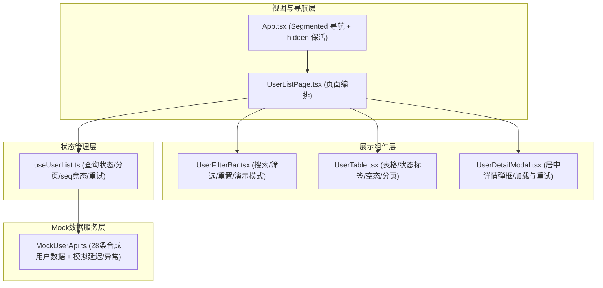
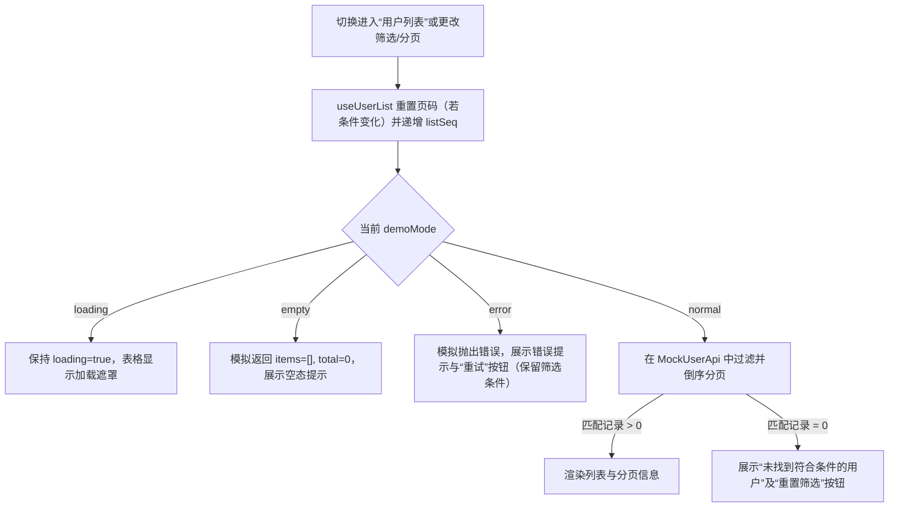

# 用户列表页（静态 Mock 演示）— 前端详细设计文档

## 文档信息

| 项目 | 内容 |
|------|------|
| 所属服务 | `hr-collection-agent-web`（`codes/hr-collection-agent-frontend`） |
| 需求文档 | `01-requirements/HR_PR-2/prd.md`（平台工作项 `issue-1795571795065833793`） |
| Schema 文档 | 无（纯前端静态 Mock，不涉及数据库变更） |
| 接口/管道文档 | 无（纯前端内存模拟服务 `MockUserApi.ts`，不调用 backend HTTP 接口） |
| 设计日期 | 2026-11-25 |
| 版本 | v1.0 |

> 本文档严格遵循人工确认原则：本需求仅用于前端静态效果展示（Mock），不修改 `codes/hr-collection-agent-backend/` 与既有 `ADR-009`（无账号与权限控制边界）。

---

## §1 设计决策表

| 决策项 | 决策 | 理由 | ADR |
|--------|------|------|-----|
| 数据源与服务边界 | 纯前端内存合成数据集 + `MockUserApi.ts` 模拟异步请求 | 人工确认不考虑后端 `user` 模型，且严格遵守 `F-01`/`F-02`（不直连外部服务、不写浏览器持久化存储） | — |
| 导航集成方式 | 在 `App.tsx` 的 `Segmented` 导航新增 `users` 页签，通过 `hidden` 保活 | 遵循既有 `TD-02`（无路由库）与 `TD-25`（页签切换不丢失对话与归档页状态） | — |
| 详情展示形态 | 使用 Ant Design 居中 `Modal` + `Descriptions` | 需求明确要求“点击单行打开详情弹框查看完整信息”，区别于 `ArchiveDetail` 的右侧 `Drawer` | — |
| 列表状态演示机制 | Hook 支持真实防抖/延迟加载与 `DemoSceneMode`（`normal`/`loading`/`empty`/`error`）切换 | 既满足正常交互下的自然加载/筛选空态，也支持静态演示时一键展示加载中、空数据、请求失败与重试恢复 | — |
| 并发竞态控制 | 沿用 `useArchive.ts` 的递增请求序号 `listSeq` / `detailSeq` | 防止快速切换筛选条件、翻页或切换详情行时旧异步结果覆盖新状态 | — |

---

## §2 系统架构图

---

## §3 代码结构变更

| 代码单元 | 路径 | 操作 | 职责 | 关联故事 |
|---|---|---|---|---|
| 用户类型定义 | `codes/hr-collection-agent-frontend/src/types/User.ts` | 新增 | 定义用户角色、状态、演示模式、查询条件与分页响应类型 | #1~#5 |
| 静态 Mock 服务 | `codes/hr-collection-agent-frontend/src/api/MockUserApi.ts` | 新增 | 提供 28 条合成脱敏用户数据及支持过滤、分页、模拟延迟/异常的查询函数 | #1~#5 |
| 列表与详情 Hook | `codes/hr-collection-agent-frontend/src/hooks/useUserList.ts` | 新增 | 管理搜索/筛选/分页状态、演示状态、列表与详情异步加载、竞态控制与重试 | #1~#5 |
| 筛选栏组件 | `codes/hr-collection-agent-frontend/src/components/UserFilterBar.tsx` | 新增 | 关键字搜索、状态/角色/部门下拉筛选、重置按钮及演示状态切换 | #2, #3, #5 |
| 用户表格组件 | `codes/hr-collection-agent-frontend/src/components/UserTable.tsx` | 新增 | 展示用户列、角色与状态 Tag、分页控件、空数据反馈与行点击 | #1, #2, #5 |
| 详情弹框组件 | `codes/hr-collection-agent-frontend/src/components/UserDetailModal.tsx` | 新增 | `Modal` 弹框只读展示完整用户字段、空值占位 `未填写`、加载与错误重试 | #4, #5 |
| 用户列表页面 | `codes/hr-collection-agent-frontend/src/pages/UserListPage.tsx` | 新增 | 复用 `AppShell` 编排页面主体、错误提示区、筛选栏、表格与详情弹框 | #1~#5 |
| 导航入口 | `codes/hr-collection-agent-frontend/src/App.tsx` | 修改 | 顶部 `Segmented` 新增“用户列表”页签并挂载 `UserListPage` | #1 |
| 样式文件 | `codes/hr-collection-agent-frontend/src/components/Layout.css` | 修改 | 新增 `.user-list-page`、`.user-filter-bar` 等布局样式 | #1~#3 |
| 单元测试 | `codes/hr-collection-agent-frontend/src/pages/UserListPage.test.tsx` 等 | 新增/修改 | 验证分页、搜索、筛选、详情弹框、加载/空态/失败重试与页签保活 | #1~#5 |

---

## §4 数据模型与字段规范

- **实体定义**：`UserRecord` 仅存在于前端内存，使用合成脱敏样例数据（如姓名 `张明远`、手机号 `138****8001`、邮箱 `zhangmy@example.com`），不与真实人员或后端简历库耦合（遵循 `B-06`）。
- **状态与角色枚举映射**：
  - `UserStatus`：`active` -> 文案 `启用`（`Tag color="success"`）；`disabled` -> 文案 `禁用`（`Tag color="default"`）。
  - `UserRole`：`admin` -> 文案 `管理员`（`Tag color="blue"`）；`hr` -> 文案 `HR`（`Tag color="cyan"`）；`member` -> 文案 `普通用户`（`Tag`）。
- **空值展示规范**：非必填字段（`gender`、`job_title`、`location`、`last_login_at`、`remark`）为 `null` 或空字符串时，统一渲染为 `未填写`。
- **列表列与详情字段分配**：
  - **表格列**：用户编号（`user_id`）、姓名（`name`，支持点击触发详情）、用户名（`username`）、手机号（`phone`）、邮箱（`email`）、角色（`role`）、状态（`status`）、创建时间（`created_at`，复用 `formatDateTime`）、操作（“查看详情”按钮）。
  - **详情弹框（`Modal`）**：分块展示上述全部字段外加性别（`gender`）、所属部门（`department`）、岗位（`job_title`）、办公地点（`location`）、最近活跃时间（`last_login_at`）、备注（`remark`）。

---

## §5 核心业务流程

---

## §6 组件与实现设计

| 代码单元 | 实现要点 | 关联故事 |
|---|---|---|
| `MockUserApi.ts` | 导出 `MOCK_USERS`（28 条预设记录，涵盖 3 种角色、2 种状态、4 个部门及含 `null` 字段样例）；支持注入 `delayMs`（默认 200ms，单测可传 0 或可控 Promise）以便快速确定性测试。 | #1~#5 |
| `useUserList.ts` | 仅在 `active` 由 `false` 变为 `true` 且尚未加载过（或每次切入）时拉取数据；`setKeyword` / `setStatus` / `setRole` / `setDepartment` 变更自动将 `page` 重置为 `1`；`retryList()` 在当前处于 `error` 演示模式时自动切回 `normal` 并重发请求，使“点击重试恢复正常”闭环可测可演示。 | #1~#5 |
| `UserFilterBar.tsx` | 使用 `Input.Search`（或受控 `Input` + 搜索按钮 + `allowClear`）配合 250ms 防抖与回车立即触发；使用 Ant Design `Select` 提供状态、角色、部门筛选；提供“重置”按钮及右上角演示状态 `Segmented`。 | #2, #3, #5 |
| `UserTable.tsx` | `rowKey="user_id"`；配置 `onRow` 整行点击与操作列“查看详情”按钮（阻止冒泡避免双触发）；空态区分“筛选无结果”（带清空筛选按钮）与“暂无用户数据”（带刷新按钮）。 | #1, #2, #5 |
| `UserDetailModal.tsx` | Ant Design `Modal`（`centered`、`footer` 仅保留关闭按钮、`maskClosable`、`keyboard` 默认开启支持 ESC）；加载态渲染 `Spin`，错误态渲染 `Alert` + “重试”按钮，就绪态使用 `Descriptions` 展示完整字段。 | #4, #5 |

---

## §7 错误处理设计

- **错误展示样式**：沿用仓库统一错误提示视觉规范（`Alert type="error" showIcon role="alert"`），文案面向前端用户清晰说明失败原因（如“用户列表加载失败，请点击重试”、“用户详情加载失败，请稍后重试”），不输出任何敏感数据或堆栈至控制台。
- **状态隔离**：列表加载失败与详情弹框加载失败相互独立；列表失败时保留筛选栏输入值，详情失败时底层列表保持可见与原有状态不变。

---

## §8 设计追溯矩阵

| 设计产物 | 对应用户故事 |
|---|---|
| `App.tsx`、`UserListPage.tsx`、`UserTable.tsx` | 用户故事#1（进入页面与分页浏览） |
| `UserFilterBar.tsx`、`MockUserApi.ts` | 用户故事#2（关键字搜索） |
| `UserFilterBar.tsx`、`useUserList.ts` | 用户故事#3（条件筛选与重置） |
| `UserDetailModal.tsx`、`useUserList.ts` | 用户故事#4（点击单行打开详情弹框） |
| `useUserList.ts`、`UserTable.tsx`、`UserDetailModal.tsx`、`UserFilterBar.tsx` | 用户故事#5（加载/空态/失败重试与并发保护） |

---

## §9 测试策略

| 测试层级 | 测试对象 / 场景 | 测试重点 |
|---|---|---|
| 单元测试 | `MockUserApi.test.ts` | 关键字大小写不敏感匹配、状态/角色/部门组合过滤、倒序排序与分页切片边界、空/异常模拟模式 |
| 页面与集成测试 | `UserListPage.test.tsx` | 默认渲染与分页切换、防抖/回车搜索及清空、多条件筛选与重置（页码归 1）、点击行打开 `Modal` 展示完整字段与 `未填写`、加载/空态/失败重试闭环、快速连续请求 `seq` 防乱序 |
| 导航回归测试 | `App.test.tsx` | 新增“用户列表”页签切换，验证“对话”与“已归档简历”状态保活不丢失 |
| 构建与规范校验 | `npm run lint` / `npm run build` / `npm test` | ESLint 0 warning、`tsc --noEmit && vite build` 成功、全量 Vitest 用例通过 |
